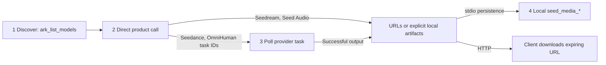

# Ark Seed Multimodal MCP Server

This project-local skill describes the narrowed `byteplus-sa/seed-mcp` server.
External Ark MCP Pages links below are upstream references for retained-tool
details only, not this fork's published site or proof of supported inventory.
Use this server's discovery and schemas for current contracts.

Typed MCP tools for BytePlus multimodal generation, over `stdio` or Streamable
HTTP. The server already publishes every tool's description and schema, so this
skill covers only what the schemas cannot tell you: the flow, the rules that
span tools, and where to look things up. **Parameters live in the tool
schemas** (upstream retained-tool detail: [API reference](https://byteplus-sa.github.io/ark-mcp/api-reference/)).

Determine the transport before choosing a workflow. HTTP BYOK has 7 tools,
or 10 with OmniHuman enabled, and runs provider tools directly in the foreground.
Opt-in `media_prepare_upload` adds one HTTP tool for enrolled clients (8/11).
It has no jobs, native tasks, local storage/artifact tools or resources. Local stdio
retains the 15-entry conditional catalog and storage/artifacts, with direct calls.
Asset administration is unavailable on either transport. Setup and rotation:
[environment.md](references/environment.md#transport-and-auth).

HTTP needs the selected `X-ModelArk-Api-Key`, `X-Seed-Speech-Api-Key`, or
`X-OmniHuman-Api-Key` plus required `X-MCP-Client-Secret` (client-generated
32 random bytes as 64 lowercase hex), including dry runs. Discovery is
anonymous/static. Never put keys in tool arguments or chat. No OAuth, signup
or server-issued key exists; `Authorization` is rejected.

| Product | Create tool | Poll / result | Enabled by |
|---|---|---|---|
| **Seedance** video (2.0, regular 2.5 with 4K, and 2.5 Flash) | `seedance_create_task` | `gen_task_get`, `gen_task_list`, `gen_task_cancel_or_delete` | `BYTEPLUS_MODELARK_API_KEY` |
| **Seedream** images (generate and edit) | `seedream_generate_image` | artifacts in the result | `BYTEPLUS_MODELARK_API_KEY` |
| **Seed Audio** | `seed_audio_generate` | artifact in the result | `BYTEPLUS_SEED_SPEECH_API_KEY` |
| **OmniHuman 2.0** avatar video | `omnihuman_create_task` | `omnihuman_get_task`, `omnihuman_cancel_task` | `BYTEPLUS_OMNIHUMAN_ENABLED=true` + `BYTEPLUS_CV_API_KEY` |
| **Object storage** | `media_upload`, `media_presign` | URLs in the result | TOS or S3 credentials |
| **Always registered (four local tools)** | `ark_list_models`, `seed_media_*` | — | — |

The enabling-settings column and always-registered artifact entries
above describe **stdio only**. HTTP provider registration is credential-independent;
only OmniHuman needs its enable flag. HTTP never falls back to operator keys.

**Do not assume a tool exists.** A tool registers only when its gate passes;
`ark_list_models.services` and the `seed-health://status` resource show what is
on and which setting enables the rest. The health resource is stdio-only.

## How to use this server



1. **Discover.** `ark_list_models` returns the configured models, their
   limits, which tool takes each, and `services`. **`model` accepts exact IDs
   only**; unknown model IDs can receive a did-you-mean hint, while unknown
   image/video `ep-*` values get safe `ENDPOINT_NOT_CONFIGURED` guidance without
   echoing the ID. Omit `model` for the default. Discovery never calls the
   provider and returns no account pricing.
   Anonymous HTTP discovery lists configured bindings without environment
   provider keys; `services[].enabled` means registered, not entitled.
   Default `check_connection=false` returns `connection=null`. For optional
   HTTP image/video setup diagnostics, see the preflight below.
2. **Create.** Call the product tool directly on either transport (see
   [Direct execution](#direct-execution)). Use `variations` instead of looking
   for variation tools, and `dry_run` (Seedance, Seedream) to check a request
   and its cost without billing.
3. **Poll.** Seedance with `gen_task_get`; OmniHuman with
   `omnihuman_get_task`. **Never resubmit a create tool to poll**; there is no
   saved-response replay, and a new create can bill again.
4. **Keep outputs.** HTTP clients download expiring provider URLs themselves.
   Stdio can explicitly persist and use `seed_media_get_artifact`,
   `seed_media_export_artifact`, `seed_media_persist_url`, and resources.

## Rules the schemas do not tell you

### HTTP connection preflight

- Call `ark_list_models` with `{"input":{"check_connection":true}}` only on
  live HTTP. Omit `kind` for both image/video routes, or select `"image"` /
  `"video"`; other kinds and stdio checks are rejected.
- Inspect `modelark_key_present`, `client_secret_present`, `issues`, and
  `routes`. `configuration_valid` means both headers present and every checked
  route exactly bound. It is not authentication, live lineage, entitlement,
  balance or reachability proof. `authentication_verified` and
  `provider_calls_made` always remain false.
- `missing_modelark_key` / `missing_client_secret` require private client
  header setup. A route with `endpoint_not_configured` has null ID/family;
  unknown IDs are not echoed. The operator must verify model/version and
  bind the exact ID. Do not guess a family or accept caller claims as proof.
- Official GetEndpoint metadata requires AK/SK signing, not ModelArk Bearer
  auth. This server takes no customer ModelArk AK/SK custody and does not implement arbitrary
  BYOE self-service. See `specs/SPEC_HOSTED_BYOK.md#byoe-endpoint-authority`
  in the selected checkout.
- An explicit create-tool `model` wins over endpoint headers; preflight checks
  defaults, not a future payload. `models[].is_default` stays server-wide.
  Use `ark-mcp-setup` for stdout client snippets and private environment-name
  mappings. Actual model-driven Codex/Claude and paid provider validation
  remain pending; config inspection or mocked smoke does not establish them.

### HTTP create recovery

- Omit `idempotency_key`; non-null legacy keys are rejected on both transports,
  including dry runs. There is no durable replay or automatic partial-batch resume.
- Retain all accepted task/request IDs and poll. Reconcile uncertain or lost
  responses with the provider; never automatically repeat the create.
- HTTP task get/list/cancel and Draft lookup use the supplied provider key.
  Client secrets scope per-pod admission, not task access. Clients sharing a
  provider key share whatever access that provider permits.
- HTTP is database-free with no shared budget ledger. Local stdio retains
  SQLite-backed artifacts and bookkeeping.

### Direct execution

- Call the original tool with `{"input": {...}}`; inspect `is_error` before
  `structured_content`. Omit `io.modelcontextprotocol/tasks` opt-in on both
  transports, including discovery. No MCP jobs or native tasks are exposed.
- Owner-first admission defaults to 2 seconds; the whole-call deadline defaults
  to 600 seconds. Use client timeout 660 seconds and compatible proxy settings.
  Local stdio reserves budget after admission; HTTP does not.
- `ADMISSION_TIMEOUT` means this attempt did not dispatch, not the whole batch.
  `TOOL_DEADLINE_EXCEEDED` is text-only and retains uncertainty and safe accepted
  IDs. External cancellation propagates; timeout does not cancel provider work.
- SDK/local SQLite draining can exceed the cooperative deadline.
  Direct local writes use live MCP roots or `OUTPUT_ROOTS`; artifact-store
  persistence itself needs no roots. See [local-output.md](references/local-output.md).

### Models, variations, dry runs

- Per-model limits (resolutions, durations, reference counts, Draft support,
  formats) are checked at runtime. **All violations come back in one error**
  that points to `ark_list_models`; fix them all, or use `dry_run`.
- `SEEDANCE_DEFAULT_MODEL` is Seedance 2.5. **4K is a resolution**:
  use `resolution="4k"` on the same model, with no separate binding or flag.
  This is retained server acceptance; current model-specific provider docs
  omit regular 2.5 4K. Confirm provider support before paid use.
- **Flash** uses `model="dreamina-seedance-2-5-flash-261115"` on the same tool,
  with 480p/720p and no Draft. Empty bindings include it automatically;
  explicit binding lists must add it themselves. Discovery does not prove
  account activation; custom Flash endpoints use family `seedance_2_5_flash`.
- `variations`: Seedance 1-5 (separate billed tasks, `tasks[]`), Seedream 1-10
  (`summary`), Seed Audio 1-5 (`summary`). Failures are per variation. Seedream
  `seed` is the base seed (`N, N+1, ...`); `max_images` and `variations > 1`
  are mutually exclusive.
- `dry_run` returns `preview` (request bodies, cost estimate) and bills nothing.
  Video estimates are static and do not account for resolution or duration.
  Flash currently reuses the static 2.5 per-task fallback, not its token price.
- HTTP endpoint defaults `X-ModelArk-Seedance-Endpoint` and
  `X-ModelArk-Seedream-Endpoint` must be exact registry bindings. Explicit tool
  `model` wins. Never infer lineage from arbitrary opaque `ep-*` IDs.

### Seedance

- Keep accepted task/request IDs even alongside an error. On local stdio,
  ownership recording can fail after acceptance: `task_id` and `error` may
  coexist, and `submitted` can overlap with `failed`. Never recreate accepted
  work. HTTP does not persist ownership or submission receipts.
- **Draft (regular 2.5 only, not Flash):** `draft=true` creates a 480p preview.
  After it succeeds, promote within 14 days of creation (7 for creation before
  2026-10-28 10:00 UTC+8) using `draft_task_id` and supported output options.
  The final render is 1080p, not 4K. Omit inherited prompt/media/duration/ratio
  and model; `variations` must be 1. Omit `idempotency_key`.
- Use public HTTPS video references or authorized `asset://` references.
  Local files need stdio `media_upload` or an upload-capable HTTP integration
  using optional `media_prepare_upload`. Refer to assets in prompts as
  "Image 1" or "Video 1" by position.

### Seedream

- Default: Seedream 5.5 (`dola-seedream-5-5-261028`; requires
  account authorization). Explicit operator defaults remain unchanged.
- `images` plus optional `point` or `bbox` (0-999, on the first image) edits;
  without images it is text-to-image.
- `background="transparent"` on 5.5 accepts text-only prompts or references
  without existing alpha. On 5.0 Pro it requires **exactly one PNG input that
  already has transparent pixels** and preserves that transparency.
  Both require `output_format` omitted or `png`. 5.5 defaults to PNG.
- Use `variations`, not provider batches, on 5.5 and 5.0 Pro.
- Seedream 5.5 does not document the retained `seed` compatibility field;
  omit it unless provider acceptance is verified.
- 5.5 sizes: `1K`, `1.5K`, `2K` (default), or positive `WIDTHxHEIGHT` with
  921600-4624220 pixels and width/height ratio 1/16-16, inclusive. No `auto` size.
- 5.5 `prompt_optimization` accepts `standard` only (provider default);
  `background` defaults to `auto` (JPEG always opaque). Pro's operator
  optimization setting never applies to 5.5.
- `safety_identifier` on 5.5/Pro must be a stable hashed user ID, 1-64 non-space
  printable ASCII characters; previews and logs redact it.
- `response_format="b64_json"` requires `persist=true`, including dry runs.
  Missing output is an explicit error, not an artifact-less success.
- Read `generations` for per-call request ID, submitted seed, exact final-prompt
  SHA-256 and allowlisted options; provider background/size/format/usage and
  identifier echo stay separate from local byte `images[].inspection`.
  Inspection is advisory, preserves billed artifacts and never rerolls.
  URL-only inspection and absent provider metadata stay null.
- Delivery is not visual acceptance. Use the bounded
  [generate/review/edit workflow](references/workflows.md#seedream-generate-review-edit)
  for text, absence, counts and geometry. Reviewer refusal is `Not evaluated`,
  not generation failure. Layer-decomposition/OCR inputs are rejected.
- Published tool pages list supported models in one table per capability,
  including defaults, configuration gates and key limits. See the
  [Seedream tool reference](https://byteplus-sa.github.io/ark-mcp/tool-reference/seedream-generate-image/#supported-models)
  for the image model table and shared editing guidance; discovery remains
  authoritative for your connection.

### Polling and persistence

- Poll Seedance with `persist_output=false`; pass every task ID in one
  `gen_task_get` call. When successful outputs are available, call the poller directly with
  `persist_output=true` to keep the outputs on stdio only.
  Seed Audio/Seedream `persist` and OmniHuman get `persist_output` default to
  false globally. HTTP rejects explicit true; local explicit true is allowed.
- `queued` / `running` / `processing` is not a failure. Wait
  `recommended_poll_after_ms` (default 5000).
- Provider URLs expire: **2 hours for Seed Audio, 24 hours for Seedream and
  Seedance, 1 hour for OmniHuman**. An artifact with id `provider-url`
  and a `persistence_error` is still usable until then; recover it with
  `seed_media_persist_url` on stdio; HTTP clients download the URL themselves.
- `output_path`, `output_dir` write to local disk on **stdio only**,
  inside the client's MCP roots (or `OUTPUT_ROOTS`), and need persistence
  (`persist` / `persist_output`). A directory ending in `/` is required when
  several files are written (variations or `max_images > 1`).

### Media upload and assets

- **HTTP-only `media_prepare_upload` is opt-in and prepare-only.** Requires an
  operator-enrolled live `X-MCP-Client-Secret`, no generation-provider key.
  Send category, exact MIME and byte size only (10 MiB image/audio, 200 MiB video).
  The client uploads directly to TOS with signed fields unchanged and file LAST,
  waits for success, then uses `reference_url` with normal generation headers.
  Attaching a file in chat does not perform this upload. Never log/publish signed
  fields or URLs. MIME is declared metadata, not inspected content.
  POST/GET nominal TTLs are 15 minutes/24 hours; STS can shorten them.
  One-day object expiry is scheduled, not exact 24-hour deletion or URL expiry.
  No upload verification, URL renewal, DB or global storage budget exists.
  See [media-assets.md](references/media-assets.md#temporary-http-references).
- **Stdio-only `media_upload` and `media_presign` items fail independently.** Always check
  `failed` and `items[].error` (`media_presign` codes: `INVALID_KEY`,
  `NOT_OWNED`, `INTERNAL`, or a provider code). Only an over-size request
  (`MEDIA_UPLOAD_BATCH_MAX_BYTES`) fails the whole call. Use a long
  `expires_in_seconds` (e.g. 3600) so provider workers can fetch inputs later.
- **Native assets:** Seedance accepts an existing authorized `asset://<id>`
  on either transport with the normal ModelArk key. The server does not create,
  verify, list, delete, resolve or preflight provider assets. Establish usability,
  consent and rights outside this server. Other products reject native asset
  references; ordinary object storage uploads do not create provider assets.

## Examples

Seedance on HTTP: call `seedance_create_task` directly with
`{"input":{"prompt":"A paper boat drifts down a rainy street","dry_run":true}}`.
Provider headers are still required for this non-billable preview.

Seedance on stdio: call `seedance_create_task` directly, then poll.

```json
{"input": {
  "prompt": "A paper boat drifts down a rainy street", "resolution": "1080p", "duration": 8}}
```

From the direct result, take `tasks[0].task_id` and call
`gen_task_get` with `{"input":{"task_ids": ["<task_id>"]}}`; repeat until `all_terminal`.

Seedream: edit a region of an image (submitted the same way).

```json
{"prompt": "Replace the boxed object with a red bicycle",
 "images": [{"kind": "url", "url": "https://cdn.example.com/street.png"}],
 "bbox": {"x1": 120, "y1": 400, "x2": 560, "y2": 900}}
```

Asset reference: pass an already usable provider reference as
`images: ["asset://asset-EXAMPLE"]` to `seedance_create_task`. Refer to it as
"Image 1" in the prompt; a dry run checks the request, not provider authorization.

## Errors

| Symptom | Cause | Fix |
|---|---|---|
| Tool missing | Its gate is off (missing key or flag) | Check `ark_list_models.services` and the enabling setting in the table above |
| Explicit task opt-in rejected | No native task extension on either transport | Call the original tool directly without task metadata |
| `Request is not valid for model ...` | The request breaks that model's limits (all listed) | Fix every item, pick another model from `ark_list_models`, or recheck with `dry_run` |
| Unknown `model` | Not an exact configured ID | Use the suggested ID or one from `ark_list_models` |
| `endpoint_not_configured` / `ENDPOINT_NOT_CONFIGURED` | Missing exact product binding | Operator must verify and bind it; unknown endpoint IDs are not echoed |
| Timeout with `ambiguous_completion=true` | Create or cancel may have succeeded | Reconcile by task or request ID; do not resubmit |
| Unsupported `idempotency_key` | Legacy field supplied | Omit it; no dispatch occurs from this rejected call. Do not reinterpret a prior uncertain create as safe to repeat |
| `queued` / `running` for a long time | Normal provider queue | Keep polling `gen_task_get`; `queue.hint` explains the wait |
| `persistence_error` on an artifact | Output billed, storage failed | `seed_media_persist_url` before the URL expires |
| Variation `error.phase` | `queued` (`QUEUE_TIMEOUT`): not started; `generating`: may have completed; `persisting`: output not stored | Reconcile the whole HTTP create; no automatic partial-batch resume. Local retries only for confirmed unstarted work |
| `NOT_OWNED` | Local artifact/object-key/task ownership mismatch | Use the owning local context. HTTP task authorization instead follows the supplied provider key |
| OmniHuman failed `InvalidParameter ... audio` or error `50510` | Provider rejected the audio or content after submission | Fix the inputs; never retry unchanged |
| Budget rejected | Local stdio `DAILY_BUDGET_USD` exceeded | Review the local estimate limit; HTTP requires zero and has no budget ledger |

Missing/unusable URL-only Seed Audio output is a nonretryable per-item
`NO_DELIVERABLE_OUTPUT`; never regenerate automatically. Uncertain mutation
transport errors and malformed 2xx responses are ambiguous/nonretryable with
sanitized diagnostics.
Mutation 5xx errors are ambiguous and never automatically retried, even
if marked `retryable=true`. Eligible 429 rejections, pre-dispatch failures and
reads can retain bounded retries.

HTTP rate and concurrency limits are per-pod and reset at restart. There is no
recovery bridge from a retired journal to stateless replay. Preserve old state
and accepted IDs for reconciliation. Deployment operations are separate from
media generation; see [deployment limits](references/environment.md#deployment-limits).

## References

Read these only when you need the detail:

- [tool-reference.md](references/tool-reference.md): per-product notes for Seedance, Seedream, Seed Audio and OmniHuman.
- [polling-and-artifacts.md](references/polling-and-artifacts.md): pollers, cancel/delete, artifact tools, local paths, persistence fallbacks.
- [media-assets.md](references/media-assets.md): object storage and native assets.
- [models-and-limits.md](references/models-and-limits.md): per-family limits and model selection.
- [workflows.md](references/workflows.md): direct calls, production workflows, retry policy, common issues.
- [environment.md](references/environment.md): credentials, flags, transport, auth, architecture.
- [local-output.md](references/local-output.md): local-write options in direct calls.
- [Upstream API reference](https://byteplus-sa.github.io/ark-mcp/api-reference/): retained-tool detail only; this server's schemas are authoritative.
