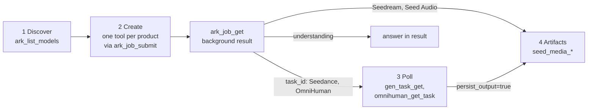

# Ark Seed Multimodal MCP Server

This project-local skill describes the narrowed `byteplus-sa/seed-mcp` server.
External Ark MCP Pages links below are upstream references for retained-tool
details only, not this fork's published site or proof of supported inventory.
Use this server's discovery and schemas for current contracts.

Typed MCP tools for BytePlus multimodal generation, over `stdio` or Streamable
HTTP. The server already publishes every tool's description and schema, so this
skill covers only what the schemas cannot tell you: the flow, the rules that
span tools, and where to look things up. **Parameters live in the tool
schemas** (upstream retained-tool detail: [API reference](https://byteplus-sa.github.io/ark-mcp/api-reference/)).

Hosted HTTP accepts only one shared MCP API key. Every member uses tenant and
principal `shared-team`, sharing data, budgets and fixed ordinary scopes.
Provider keys stay on the server; per-user BYOK is not implemented. Asset
administration is unavailable on either transport. Setup and rotation:
[environment.md](references/environment.md#transport-and-auth).

| Product | Create tool | Poll / result | Enabled by |
|---|---|---|---|
| **Seedance** video (2.0, regular 2.5 with 4K, and 2.5 Flash) | `seedance_create_task` | `gen_task_get`, `gen_task_list`, `gen_task_cancel_or_delete` | `BYTEPLUS_MODELARK_API_KEY` |
| **Seedream** images (generate and edit) | `seedream_generate_image` | artifacts in the result | `BYTEPLUS_MODELARK_API_KEY` |
| **Seed Audio** | `seed_audio_generate` | artifact in the result | `BYTEPLUS_SEED_SPEECH_API_KEY` |
| **OmniHuman 2.0** avatar video | `omnihuman_create_task` | `omnihuman_get_task`, `omnihuman_cancel_task` | `BYTEPLUS_OMNIHUMAN_ENABLED=true` + `BYTEPLUS_CV_API_KEY` |
| **Understanding** | `seed_understand`, `seed_audio_understand` | answer in the result | `BYTEPLUS_MODELARK_API_KEY` |
| **Object storage** | `media_upload`, `media_presign` | URLs in the result | TOS or S3 credentials |
| **Always registered** | `ark_list_models`, `ark_job_*`, `seed_media_*` | — | — |

**Do not assume a tool exists.** A tool registers only when its gate passes;
`ark_list_models.services` and the `seed-health://status` resource show what is
on and which setting enables the rest.

## How to use this server



1. **Discover.** `ark_list_models` returns the configured models, their
   limits, which tool takes each, and `services`. **`model` accepts exact IDs
   only**; an unknown ID fails with a did-you-mean hint. Omit `model` for the
   default. Discovery never calls the provider and returns no account pricing.
2. **Create.** One tool per product, run through `ark_job_submit` (see
   [Background jobs](#background-jobs)). Use `variations` instead of looking
   for variation tools, and `dry_run` (Seedance, Seedream) to check a request
   and its cost without billing.
3. **Poll.** Seedance with `gen_task_get`; OmniHuman with
   `omnihuman_get_task`. **Never resubmit a create tool to poll**; that bills
   a second task.
4. **Keep artifacts.** `seed_media_get_artifact`, `seed_media_export_artifact`,
   `seed_media_persist_url`, and `seed-media://` resources.

## Rules the schemas do not tell you

### Background jobs

- **Required background** (a foreground call is rejected before any provider
  call): `seed_audio_generate`, `media_upload`, `omnihuman_create_task`,
  `seedream_generate_image`, `seedance_create_task`, `seed_understand`,
  and `seed_audio_understand`.
- **Optional** (foreground works; background only to persist output or wait
  long): `gen_task_get`, `omnihuman_get_task`, `seed_media_persist_url`.
  Everything else is foreground.
- **Submit** with `ark_job_submit` and `{"input": {"tool_name": "<tool>",
  "arguments": {"input": {...tool input...}}}}`, then poll `ark_job_get` no
  faster than `poll_after_ms` and read the tool result from `result`
  (`structured_content`). Check terminal status and `result.is_error` before
  treating the nested tool result as successful. A client that negotiates native MCP task
  augmentation may call the tool directly with task metadata instead.
- **The Ark `job_id` is not a provider task ID.** The provider ID is inside
  the job result. Submission is non-idempotent: after a timeout or lost
  response, do not blindly resubmit (reconcile first). Stdio jobs are
  process-local.
- Inside `ark_job_submit` there are no MCP roots, so local writes
  (`output_path`, `output_dir`, `save_to`) need `OUTPUT_ROOTS` set on the
  server; otherwise they are rejected before any provider call.
  `persist_output=true` works. See
  [background-job-output.md](references/background-job-output.md).

### Models, variations, dry runs

- Per-model limits (resolutions, durations, reference counts, Draft support,
  formats) are checked at runtime. **All violations come back in one error**
  that points to `ark_list_models`; fix them all, or use `dry_run`.
- `SEEDANCE_DEFAULT_MODEL` is Seedance 2.5. **4K is a resolution**:
  use `resolution="4k"` on the same model, with no separate binding or flag.
  This is retained server acceptance; current model-specific provider docs
  omit regular 2.5 4K. Confirm provider support before paid use.
- **Flash** uses `model="dreamina-seedance-2-5-flash-261115"` on the same tool,
  with 480p/720p and no Draft. Empty bindings include it automatically;
  explicit binding lists must add it themselves. Discovery does not prove
  account activation; custom Flash endpoints use family `seedance_2_5_flash`.
- `variations`: Seedance 1-5 (separate billed tasks, `tasks[]`), Seedream 1-10
  (`summary`), Seed Audio 1-5 (`summary`). Failures are per variation. Seedream
  `seed` is the base seed (`N, N+1, ...`); `max_images` and `variations > 1`
  are mutually exclusive.
- `dry_run` returns `preview` (request bodies, cost estimate) and bills nothing.
  Video estimates are static and do not account for resolution or duration.
  Flash currently reuses the static 2.5 per-task fallback, not its token price.

### Seedance

- **Draft (regular 2.5 only, not Flash):** `draft=true` makes a cheap 480p preview; once it
  has `succeeded` (within 14 days of creation, or 7 if created before
  2026-10-28 10:00 UTC+8), call again with only `draft_task_id`
  (plus `return_last_frame`, `watermark`, `output_format` and similar) to render
  the final video at 1080p, not 4K. The Draft's model, prompt, media, duration and ratio are
  reused and must be omitted; `variations` must be 1.
- Video references must be public HTTPS URLs (or `asset://`); use
  `media_upload` for local files.
- Refer to `asset://` references in prompts as "Image 1", "Video 1" by position.

### Seedream

- Default: Seedream 5.5 (`dola-seedream-5-5-261028`; requires
  account authorization). Explicit operator defaults remain unchanged.
- `images` plus optional `point` or `bbox` (0-999, on the first image) edits;
  without images it is text-to-image.
- `background="transparent"` on 5.5 accepts text-only prompts or references
  without existing alpha. On 5.0 Pro it requires **exactly one PNG input that
  already has transparent pixels** and preserves that transparency.
  Both require `output_format` omitted or `png`. 5.5 defaults to PNG.
- Use `variations`, not provider batches, on 5.5 and 5.0 Pro.
- Seedream 5.5 does not document the retained `seed` compatibility field;
  omit it unless provider acceptance is verified.
- 5.5 sizes: `1K`, `1.5K`, `2K` (default), or positive `WIDTHxHEIGHT` with
  921600-4624220 pixels and width/height ratio 1/16-16, inclusive. No `auto` size.
- 5.5 `prompt_optimization` accepts `standard` only (provider default);
  `background` defaults to `auto` (JPEG always opaque). Pro's operator
  optimization setting never applies to 5.5.
- `safety_identifier` on 5.5/Pro must be a stable hashed user ID, 1-64 non-space
  printable ASCII characters; previews and logs redact it.
- `response_format="b64_json"` requires `persist=true`, including dry runs.
  Missing output is an explicit error, not an artifact-less success.
- Read `generations` for per-call request ID, submitted seed, exact final-prompt
  SHA-256 and allowlisted options; provider background/size/format/usage and
  identifier echo stay separate from local byte `images[].inspection`.
  Inspection is advisory, preserves billed artifacts and never rerolls.
  URL-only inspection and absent provider metadata stay null.
- Delivery is not visual acceptance. Use the bounded
  [generate/review/edit workflow](references/workflows.md#seedream-generate-review-edit)
  for text, absence, counts and geometry. Reviewer refusal is `Not evaluated`,
  not generation failure. Layer-decomposition/OCR inputs are rejected.
- Published tool pages list supported models in one table per capability,
  including defaults, configuration gates and key limits. See the
  [Seedream tool reference](https://byteplus-sa.github.io/ark-mcp/tool-reference/seedream-generate-image/#supported-models)
  for the image model table and shared editing guidance; discovery remains
  authoritative for your connection.

### Polling and persistence

- Poll Seedance with `persist_output=false`; pass every task ID in one
  `gen_task_get` call. When successful outputs are available, run the poller
  through `ark_job_submit` with
  `persist_output=true` to keep the outputs. `omnihuman_get_task` defaults to
  `true`; pass `false` for a foreground poll.
- `queued` / `running` / `processing` is not a failure. Wait
  `recommended_poll_after_ms` (default 5000).
- Provider URLs expire: **2 hours for Seed Audio, 24 hours for Seedream and
  Seedance, 1 hour for OmniHuman**. An artifact with id `provider-url`
  and a `persistence_error` is still usable until then; recover it with
  `seed_media_persist_url`.
- `output_path`, `output_dir`, `save_to` write to local disk on **stdio only**,
  inside the client's MCP roots (or `OUTPUT_ROOTS`), and need persistence
  (`persist` / `persist_output`). A directory ending in `/` is required when
  several files are written (variations or `max_images > 1`).

### Media upload and assets

- **Audio understanding:** `seed_audio_understand.delivery` defaults to `auto`,
  which retries rejected URL audio through Files API. `files_api` uploads first;
  `direct` disables fallback. Files API supports up to 512 MB and video inputs
  include sampled frames as well as the soundtrack. Cleanup is best effort;
  never blindly retry an ambiguous upload timeout.
- **`media_upload` and `media_presign` items fail independently.** Always check
  `failed` and `items[].error` (`media_presign` codes: `INVALID_KEY`,
  `NOT_OWNED`, `INTERNAL`, or a provider code). Only an over-size request
  (`MEDIA_UPLOAD_BATCH_MAX_BYTES`) fails the whole call. Use a long
  `expires_in_seconds` (e.g. 3600) so provider workers can fetch inputs later.
- **Native assets:** Seedance accepts an existing authorized `asset://<id>`
  on either transport with the normal ModelArk key. The server does not create,
  verify, list, delete, resolve or preflight provider assets. Establish usability,
  consent and rights outside this server. Other products reject native asset
  references; ordinary object storage uploads do not create provider assets.

## Examples

Seedance: submit, then poll in the foreground.

```json
{"input": {"tool_name": "seedance_create_task", "arguments": {"input": {
  "prompt": "A paper boat drifts down a rainy street", "resolution": "1080p", "duration": 8}}}}
```

After `ark_job_get` returns the job result, take `tasks[0].task_id` and call
`gen_task_get` with `{"task_ids": ["<task_id>"]}`; repeat until `all_terminal`.

Seedream: edit a region of an image (submitted the same way).

```json
{"prompt": "Replace the boxed object with a red bicycle",
 "images": [{"kind": "url", "url": "https://cdn.example.com/street.png"}],
 "bbox": {"x1": 120, "y1": 400, "x2": 560, "y2": 900}}
```

Asset reference: pass an already usable provider reference as
`images: ["asset://asset-EXAMPLE"]` to `seedance_create_task`. Refer to it as
"Image 1" in the prompt; a dry run checks the request, not provider authorization.

## Errors

| Symptom | Cause | Fix |
|---|---|---|
| Tool missing | Its gate is off (missing key or flag) | Check `ark_list_models.services` and the enabling setting in the table above |
| Foreground call to a create tool rejected | Background is required | Submit through `ark_job_submit` |
| `Request is not valid for model ...` | The request breaks that model's limits (all listed) | Fix every item, pick another model from `ark_list_models`, or recheck with `dry_run` |
| Unknown `model` | Not an exact configured ID | Use the suggested ID or one from `ark_list_models` |
| Timeout with `ambiguous_completion=true` | Create or cancel may have succeeded | Reconcile by task or request ID; do not resubmit |
| `queued` / `running` for a long time | Normal provider queue | Keep polling `gen_task_get`; `queue.hint` explains the wait |
| `persistence_error` on an artifact | Output billed, storage failed | `seed_media_persist_url` before the URL expires |
| Variation `error.phase` | `queued` (`QUEUE_TIMEOUT`): safe to retry; `generating`: may have completed; `persisting`: output not stored | Retry only `queued` ones |
| `NOT_OWNED` | The task or key is not owned by this server identity | Check the endpoint and retained ownership records; shared-key rotation keeps ownership, but old user/local data is not automatically transferred |
| OmniHuman failed `InvalidParameter ... audio` or error `50510` | Provider rejected the audio or content after submission | Fix the inputs; never retry unchanged |
| Budget rejected | `DAILY_BUDGET_USD` exceeded | Wait for the UTC day rollover or raise it |

## References

Read these only when you need the detail:

- [tool-reference.md](references/tool-reference.md): per-product notes for Seedance, Seedream, Seed Audio and OmniHuman.
- [polling-and-artifacts.md](references/polling-and-artifacts.md): pollers, cancel/delete, artifact tools, local paths, persistence fallbacks.
- [understanding-media-assets.md](references/understanding-media-assets.md): understanding, object storage and native assets.
- [models-and-limits.md](references/models-and-limits.md): per-family limits and model selection.
- [workflows.md](references/workflows.md): background jobs in depth, production workflows, retry policy, common issues.
- [environment.md](references/environment.md): credentials, flags, transport, auth, architecture.
- [background-job-output.md](references/background-job-output.md): local-write options inside `ark_job_submit`.
- [Upstream API reference](https://byteplus-sa.github.io/ark-mcp/api-reference/): retained-tool detail only; this server's schemas are authoritative.
