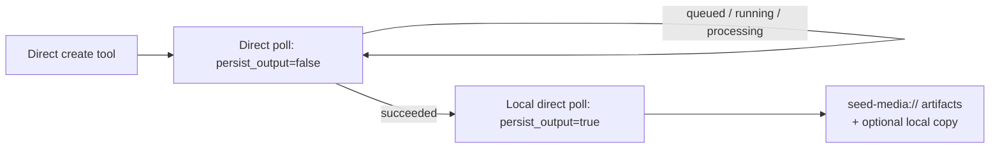

# Polling and artifacts

How to poll asynchronous provider tasks, what the persistence layer does with finished outputs, and how to recover or export them. Parameters and output fields are in the tool schemas ([API reference](https://byteplus-sa.github.io/ark-mcp/api-reference/)); this file covers behaviour the schemas do not.

## Which poller for which task

| Task ID comes from | Poll | Clean up |
|---|---|---|
| `seedance_create_task` | `gen_task_get`, `gen_task_list` | `gen_task_cancel_or_delete` |
| `omnihuman_create_task` | `omnihuman_get_task` | `omnihuman_cancel_task` |

The create tool's direct result carries the provider task ID. There are no MCP job IDs.

## Two-phase polling

The persist phase below is **stdio-only**. HTTP uses direct foreground calls,
has no jobs/native tasks/local storage/artifact tools/resources, and requires
persistence false. Download expiring provider URLs on the client instead.
Optional `media_prepare_upload` prepares input references only, not output persistence.



- **Foreground poll, then one persist run.** Use `persist_output=false`
  (Seedance's default) for quick status checks. When successful outputs are
  available, call the same poller directly with
  `persist_output=true` to download and store them on stdio.
- **No task augmentation is required or supported.** Persistence uses the
  direct call's live MCP context.
- **`omnihuman_get_task` defaults to `persist_output=false`**, as do Seed Audio/Seedream persistence inputs globally. Local true is explicit; HTTP rejects true.
- **Never resubmit a create tool to poll.** `queued`, `running` and `processing` are not failures, and a second create call starts a second billed task. After a local timeout, disconnect or client restart, poll the same task ID again.
- **Persistence is cached per task and output.** Concurrent and repeated polls reuse each cached durable copy. Missing or failed generation outputs can be persisted later without copying successful siblings again.
- Local files written by a persist run (`output_dir`, `output_path`) need live MCP roots or `OUTPUT_ROOTS`; see [local-output.md](local-output.md).

```json
{"input": {"task_ids": ["<task_id>"], "persist_output": true,
           "output_dir": "/abs/project/renders/"}}
```

## Generation tasks: `gen_task_get`, `gen_task_list`, `gen_task_cancel_or_delete`

Hosted HTTP is database-free: provider-key task authorization, no durable replay or shared budget accounting. Omit legacy operation keys; never automatically resubmit uncertain creates. Local stdio persistence remains available.

### `gen_task_get`

- **Batch every ID you are waiting on into one call** (1-50, duplicates ignored). Results come back in request order.
- **Inspect both tool errors and per-ID `errors`.** Local recorded-owner mismatches use `NOT_OWNED`; HTTP does not filter task access by client secret. The provider can return `NOT_FOUND`, authorization failures or other errors. Also check each task's own `error`.
- **Statuses:** `queued`, `running`, `succeeded`, `failed`, `cancelled`, `expired`; `unknown` for an unrecognised provider value. Terminal means `succeeded`, `failed`, `cancelled` or `expired`.
- **Stop polling when `all_terminal` is true.** Otherwise wait `recommended_poll_after_ms` (5000) between calls.
- **`queue` (video tasks, queued or running only) is derived from the task's own timestamps.** ModelArk publishes no queue position or ETA; relay `queue.hint` rather than estimating. `expires_at` is when the provider fails an unfinished task; `expires_at_estimated=true` means the 48 h default was assumed.
- **`outputs` is empty until `succeeded`.** Video tasks produce `video` and optionally `last_frame`. Each output always keeps its `source_url` (expires in about 24 h); `persistence` is `not_requested`, `persisted` or `failed`.
- **Tasks whose model is not configured on this server have `kind: "unknown"` and are never persisted.** Their outputs stay `not_requested` even with `persist_output=true`; copy them with `seed_media_persist_url` before the URL expires.
- **Draft tasks:** a succeeded Seedance Draft reports `draft: true`; pass its `task_id` as `draft_task_id` to `seedance_create_task` within 14 days of `created_at` (7 if created before 2026-10-28 10:00 UTC+8). Retain the ID: `gen_task_list` still covers only seven days.
- **`output_dir`** (stdio only) writes each succeeded task's files as `<artifact_id>.<ext>` and requires `persist_output=true`. MOV video outputs retain `video/quicktime` and the `.mov` extension, including when their download uses a generic Content-Type.

### `gen_task_list`

- **Window: tasks created in the last 7 days, newest first.** Older tasks cannot be listed, but may still answer `gen_task_get`.
- **Keep every filter identical while paging, including `page_size`.** A cursor issued for different filters is rejected with an error asking you to repeat the original filters or start without a cursor.
- **Follow `next_cursor` until it is `null`.** HTTP pages through the provider, not a local owned-ID ledger. A short page alone does not establish the end.
- Entries carry no outputs; use `gen_task_get` for those. `task_ids` narrows the provider query; access follows the selected provider key.

### `gen_task_cancel_or_delete`

**Destructive. `expected_status` must equal the task's current status** or the call is refused (re-fetch with `gen_task_get` and retry). The handler enforces local ownership on stdio, fetches status and then issues the provider DELETE. HTTP task access is provider-authorized.

| Current status | Allowed | Effect |
|---|---|---|
| `queued` | `mode=cancel`, `expected_status=queued` | becomes `cancelled`; cannot be resumed |
| `succeeded`, `failed`, `expired` | `mode=delete`, matching `expected_status` | removes the task record; outputs are no longer retrievable through `gen_task_get`, so **persist first** |
| `running` | none | cannot be cancelled or deleted |
| `cancelled` | none | cannot be deleted |

A mode that does not fit `expected_status` (cancel with `succeeded`, delete with `queued`) is rejected before any provider call.

## OmniHuman: `omnihuman_get_task`, `omnihuman_cancel_task`

- **Statuses:** `queued`, `running`, `succeeded`, `failed`, `canceled` (single l), `expired` (the provider dropped the task; resubmit), `not_found` (unknown, or older than 12 h; the provider keeps tasks 12 h).
- **Poll about every 10 s** until `succeeded`, then use `video.uri` (a `seed-media://` artifact).
- **The provider's `source_url` is valid for only about one hour** (`source_expires_at` is an estimate: first poll plus one hour). Download promptly on HTTP. On stdio explicitly request `persist_output=true` in a direct call to retain it; later local polls reuse cached artifacts. `persistence` is `not_applicable` for any non-succeeded status.
- **`omnihuman_cancel_task` only cancels a `queued` task.** A started or finished
  task returns `canceled=false` with a `message`, including the provider's
  HTTP 400 / `50217` refusal. Other HTTP failures remain errors; no automatic
  cancellation retry is performed. Right after creation the provider may reject
  the ID as invalid: wait a few seconds before a deliberate retry of that
  explicit rejection, never an uncertain cancellation.

## Artifacts

Stdio persisted outputs are `ArtifactRef`s with a stable
`seed-media://artifacts/{artifact_id}` URI. Explicitly request `persist=true` /
`persist_output=true` locally when needed; defaults are false.

### Retention and access

- **Provider URLs expire fast: 2 h for audio, 24 h for ModelArk image/video, about 1 h for OmniHuman video.** Durable artifacts survive 7 days by default (`ARTIFACT_TTL_SECONDS`; see [environment.md](environment.md)).
- **Artifacts are local-only and owner-checked.** The resource needs a canonical UUID and returns bytes with the right MIME type.
- **`seed_media_get_artifact` returns the whole file as Base64 in context.** Prefer local export for large files; the tool does not exist on HTTP.
- **`seed_media_export_artifact` is stdio only.** Without `destination_path` it returns the artifact's path inside the store (`copied=false`), which is only possible when the store is on the local filesystem; with an object-storage backend it errors and asks for a `destination_path`. With `destination_path` (absolute, inside an allowed output root) it writes an atomic copy (`copied=true`). An existing file with different content is replaced only with `overwrite=true`; identical content always succeeds.

### Local output paths

`output_path`, `output_dir` write results straight to disk so the bytes never enter context. The same rules apply to all of them, plus `destination_path` on the export tool:

- **stdio only.** Over HTTP they are rejected.
- **Absolute path inside an allowed output root:** the client's MCP roots, else `OUTPUT_ROOTS`. With neither, path writing is disabled.
- **Validated before any provider call**, so a bad path never costs a billed generation.
- **Need persistence:** `output_path`/`output_dir` require `persist=true` / `persist_output=true`.
- **`output_path` ending in `/` is a directory**, with files named
  `<artifact_id>.<ext>`. A directory is required for Seedream
  `variations > 1` or `max_images > 1`, and Seed Audio `variations > 1`.
- **`output_dir`** is the `gen_task_get` equivalent.
- **A failed local write never fails the call.** The durable artifact is kept and the `ArtifactRef` reports `local_path` on success or `export_error` on failure. Always read these fields.
- Direct calls use client MCP roots first, then `OUTPUT_ROOTS`; see [local-output.md](local-output.md).

### Persistence fallbacks: never lose a billed output

When durable storage fails after the store's own download retries, an
`ArtifactRef` fallback carries `persistence_error` (`code`, `message`,
`retryable`, `artifact_limit_bytes`, `source_url_expires_at`). Check this on
Seedream and Seed Audio artifacts. Provider task success is separate:
Seedance reports `outputs[].persistence` and `outputs[].persistence_issue`;
OmniHuman reports top-level `persistence` and `persistence_issue`. On failed
task-output persistence, keep `source_url` and recover it before expiry;
do not assume an `ArtifactRef` exists.

| `ArtifactRef.id` | Meaning | Recovery |
|---|---|---|
| a UUID | persisted normally | none |
| `provider-url` | `uri` is the temporary provider URL; not stored | `seed_media_persist_url` before the URL expires |
| `inline-fallback` | Base64 bytes in `fallback_data` (Seed Audio, Seedream `b64_json`), used when no provider URL exists and the payload is within `ARTIFACT_INLINE_FALLBACK_MAX_BYTES` (default 8 MB, 0 disables) | decode `fallback_data`, or use `output_path` to write it locally; storage has no copy |

Above the inline cap a Base64 output that cannot be stored becomes a tool error. Oversized or invalid Base64 is a validation error, not a storage failure. A `provider-url` artifact cannot be written locally (its `export_error` says to persist it first); an `inline-fallback` artifact can.

### `seed_media_persist_url`

Persists a temporary provider URL as a durable artifact, for `provider-url` fallbacks and for task outputs whose `persistence` is `failed`.

- **Pass the artifact's own `media_type`, `mime_type` and `source_expires_at`.** For a task output, use its `source_url` and actual format: MP4 is `video/mp4`, MOV is `video/quicktime`; `last_frame` is an image.
- **Only trusted BytePlus provider hosts are accepted**, through the same downloader, host allowlist, redirect checks and size limits as generation-time persistence. Anything else is rejected, so it cannot be used to fetch arbitrary URLs.
- **Retry before the source expires.** A failure returns an error with the persistence code and `retryable`; a non-retryable code such as a size-limit breach will not succeed on retry (see `artifact_limit_bytes`).
- Stdio only. It is not idempotent: each success creates a new artifact.

For model, limit and env details see [models-and-limits.md](models-and-limits.md) and [environment.md](environment.md); for end-to-end flows see [workflows.md](workflows.md).
