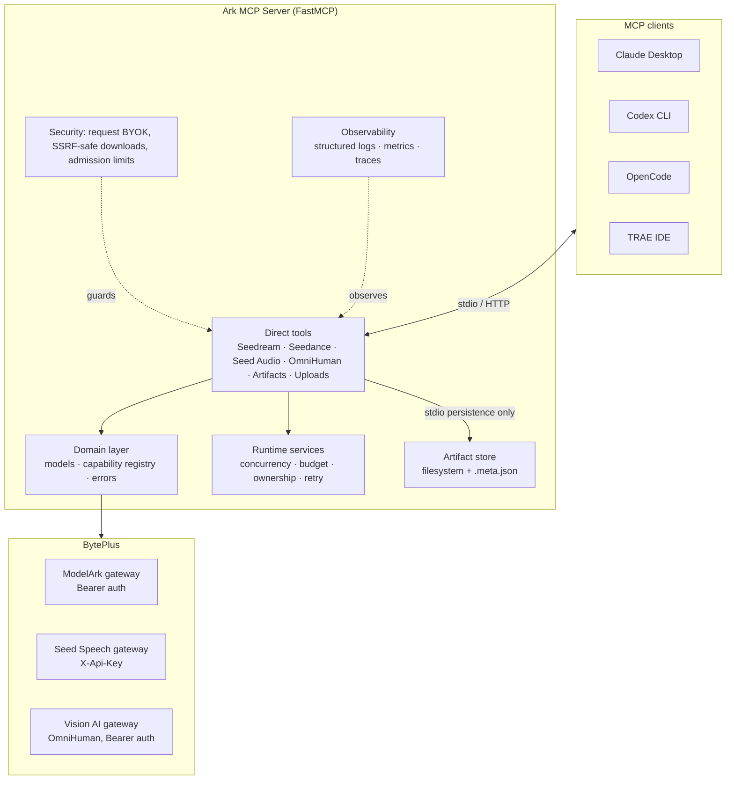
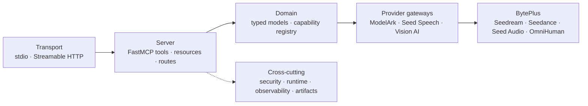
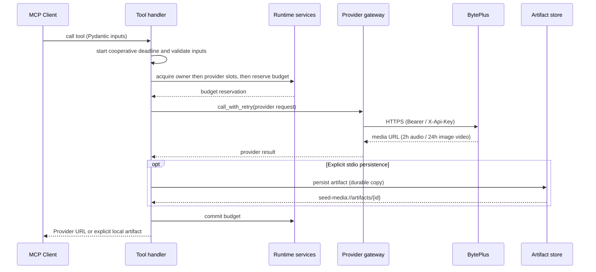

# Ark Seed Multimodal MCP Server

A Python [Model Context Protocol](https://modelcontextprotocol.io) server
built on [FastMCP](https://gofastmcp.com) that exposes BytePlus multimodal
generation through a typed, safe tool surface.

## Documentation

This checkout is the narrowed [`byteplus-sa/seed-mcp`](https://github.com/byteplus-sa/seed-mcp)
fork; package and tool names remain Ark MCP. Its local guides and generated
schemas describe current support. The
[upstream Ark MCP site](https://byteplus-sa.github.io/ark-mcp/) is a reference
for retained-tool detail only, not this fork's installation source or
published documentation site. This task publishes no site or release.

The source guides cover [installation](docs/setup/install.md),
[client integrations](docs/integrations/index.md),
[your first tool call](docs/setup/first-run.md), and
[choosing a tool](docs/capabilities.md). See
[site maintenance](docs/site-maintenance.md) for local development and deployment.

> **Breaking capability removal:** the current server narrows the catalog to
> 15 tools (four always registered locally). MCP jobs/native tasks, media
> understanding, VOD, 3D, dedicated ASR, asset administration/resolution/preflight
> and operator live-pricing discovery are removed. Saved 3D artifacts are no
> longer served by the narrowed schema: **export needed 3D outputs using the
> old server before upgrading**. There is no compatibility guarantee or
> automatic migration. See
> [migration guidance](docs/migration-0.2.md#breaking-capability-migration);
> the 0.1.x consolidation tables on that page are historical.

## Releases

Resolve this fork's available releases independently; upstream Ark MCP tags
and images do not establish narrowed Seed MCP support. See
[release policy and installation](docs/releases.md) and the
[changelog](docs/changelog.md). PyPI publication is not configured.

## What It Does

The server provides a conditional MCP tool surface across several BytePlus
products plus artifact access and an optional media upload helper. The catalog
contains **15 local stdio tools**; four are always registered locally.
HTTP BYOK exposes **7 tools, or 10 with OmniHuman enabled**, independently of
operator provider keys. Discovery is anonymous/static; provider tools run
directly in the foreground. HTTP has no jobs, native tasks, storage/artifact
tools or resources. Both transports execute directly; persistence is stdio-only.

HTTP clients send only the selected `X-ModelArk-Api-Key`,
`X-Seed-Speech-Api-Key`, or `X-OmniHuman-Api-Key`, plus required
`X-MCP-Client-Secret` (client-generated 32 random bytes as 64 lowercase hex).
There is no OAuth, signup or server-issued key; `Authorization` is rejected.
Keys are not persisted and there is no provider-key fallback. See
[client setup](docs/setup/shared-server.md) and the
[BYOK contract](specs/SPEC_HOSTED_BYOK.md).

| Product | Tools | Description |
|---|---|---|
| **Seed Audio** | `seed_audio_generate` | Direct full-scene audio generation through Seed Speech; one clip or 1-5 parallel variations |
| **Seedream** | `seedream_generate_image` | One direct image tool through ModelArk: [Seedream 5.5](https://byteplus-sa.github.io/ark-mcp/tool-reference/seedream-generate-image/#seedream-5-5) by default, generation/reference and point/box editing, native transparent PNGs, auto backgrounds, standard-only optimization, validated 1K/1.5K/2K or custom sizes, hashed safety IDs, provider image metadata, 1-10 variations and dry runs. Pro retains transparency-preserving edits; batches are Lite/4.x only. Layer decomposition/OCR are not exposed |
| **Seedance** | `seedance_create_task` | One direct video tool for every configured Seedance model (regular 2.5 and Flash bound by default, 2.0 configurable): regular 2.5 accepts `resolution="4k"` ([provider-contract caveat](docs/models.md#video-capabilities-videocapabilities)); Flash supports 480p/720p, 10 images / 5 videos / 5 audios and no Draft. Regular 2.5 Drafts have a 14-day window (7 for creation before 2026-10-28 10:00 UTC+8). Pick the model from `ark_list_models(kind='video')`, create 1-5 variations, or use `dry_run` for a free request and static cost preview; poll with the shared generation task tools |
| **Generation tasks** | `gen_task_get`, `gen_task_list`, `gen_task_cancel_or_delete` | Seedance lifecycle: direct batched status checks (1-50 IDs) with derived queue timing and explicit local output persistence, cursor-paged listing of your own tasks, and guarded cancel/delete |
| **OmniHuman 2.0** | `omnihuman_create_task`, `omnihuman_get_task`, `omnihuman_cancel_task` | Image + audio to talking-avatar video through BytePlus Vision AI; direct submission, polling with durable video persistence, and queue cancel (gated by `BYTEPLUS_OMNIHUMAN_ENABLED` and `BYTEPLUS_CV_API_KEY`, disabled by default) |
| **Artifacts** | `seed_media_get_artifact`, `seed_media_export_artifact`, `seed_media_persist_url` | Retrieve persisted media inline by artifact ID, locate/copy it to a local path without Base64 round-trips, or durably persist a provider URL whose storage failed |
| **Object storage** (optional) | `media_upload`, `media_presign` | Direct upload of 1-50 Base64 or local-file media items to TOS or S3 with per-item results; foreground URL renewal for 1-100 object keys without re-uploading |

Key features:

- **Model discovery** - `ark_list_models` reports configured models and the
  tools serving them. Image/video bindings use exact IDs. Default discovery stays static and
  anonymous with `connection=null`. Opt-in HTTP `check_connection=true` checks
  ModelArk/client-secret header presence and exact image/video bindings only,
  not authentication, live lineage or entitlement.
- **Client configuration** - the optional
  [stdout snippet generator](docs/setup/shared-server.md#generate-a-client-snippet)
  emits Codex TOML or Claude Code JSON with environment-name references.
  It reads no files or environment secret values, writes no configuration
  and makes no network calls.
- **Static cost previews** - built-in image, audio and video
  estimates support budgeting, not account billing or live pricing discovery.
- **Native Seedance assets** - pass existing authorized `asset://<id>`
  references with the ModelArk key. Asset creation, liveness verification,
  administration, URL resolution and pre-submit status checks are outside this server.
- **HTTP foundation** - [self-hosting](docs/self-hosting.md) uses one instance,
  request-only BYOK and fresh scoped SQLite state. Hosted provider-secret sync
  is superseded; no operator provider keys belong on the HTTP server.
- **Local durable artifacts** — explicitly requested media is persisted so MCP
  resources remain usable after known provider URL lifetimes (2h audio, 24h
  ModelArk image/video, about 1h OmniHuman)
- **Billed outputs are never dropped** — downloads are retried; if storage
  still fails, the result returns the provider URL (or inline bytes) with a
  `persistence_error` instead of an error, recoverable with
  `seed_media_persist_url`
- **Local output paths** — on stdio, `output_path` / `output_dir`
  write results straight into the client's MCP roots (or `OUTPUT_ROOTS`) with
  symlink-safe, no-silent-overwrite writes
- **Parallel variations** — generate N independent variations in a single
  call, partial failures captured per variation with the failure phase
- **Seedream provenance and byte checks** — single calls and variations record
  request IDs, submitted seeds, final-prompt hashes and allowlisted options.
  Advisory PNG/JPEG inspection measures dimensions, format and actual alpha
  separately from provider reports; it preserves billed output without rerolls.
  Base64 delivery requires persistence. See the bounded
  [review/edit workflow](docs/integration-guide.md#seedream-review-and-edit)
- **Per-variation seeds** — with `variations > 1`, Seedream `seed` is the base
  seed and variation *i* uses `seed + i` (wrapped); identical pixels are not guaranteed.
  Seedream 5.5 does not document this compatibility field; omit it unless verified
- **Typed inputs** — Pydantic models validate all inputs before spending
  quota; unsupported combinations are rejected at the MCP layer
- **Draft ownership retention** — authenticated HTTP with regular Seedance 2.5
  enabled requires `STATE_PRUNE_MAX_AGE_DAYS >= 14`; the default is 30 days
- **Direct operations** — both transports await tool results with bounded
  owner-first provider admission and a cooperative deadline. Provider video
  tasks remain asynchronous; no MCP worker queue or native tasks are exposed
- **Model capability registry** — logical model families map to
  operator-configured model IDs; validates resolutions, formats, and
  batch support per model
- **Security** — DNS-pinned local downloads, credential-tenant/client-owner
  HTTP ownership, Host/Origin protection, and positive admission/body/rate limits
- **Runtime controls** — shared provider/principal concurrency, daily budget
  reservations, safe retries, task ownership and tracing. HTTP readiness exposes
  minimal state without provider probes; public HTTP metrics are unavailable
- **Dedicated VKE deployment** — one StatefulSet with same-pod Caddy TLS,
  retained RWO ext4 EBS and an exclusive HTTP state lease; no application HPA,
  PostgreSQL or Redis. Optional metrics are loopback-only and disabled by default.
  See the [staged VKE runbook](docs/byteplus-terraform.md) and
  [durable deployment contract](specs/SPEC_VKE_DEPLOYMENT.md)
- **Offline regression coverage** — unit, contract, integration, HTTP security,
  E2E, and MCP conformance tests, plus documentation build/link checks

## Supported Input Modalities

All input media is validated through an SSRF-safe URL policy and size-checked
Base64 before reaching the provider. The table below shows what each tool
accepts as reference input:

| Tool | Modality | URL | Base64 | Speaker ID | Roles | Max | Constraints |
|---|---|:---:|:---:|:---:|---|:---:|---|
| `seedream_generate_image` | Image | ✓ | ✓ | — | reference | 10 5.5·PRO / 14 LITE·4X | — |
| `seedance_create_task` (2.0 models) | Image | ✓ | ✓ | — | `first_frame` · `last_frame` · `reference_image` | 9 | — |
| `seedance_create_task` (2.0 models) | Video | ✓ | — | — | `reference_video` | 3 | URL only |
| `seedance_create_task` (2.0 models) | Audio | ✓ | ✓ | — | `reference_audio` | 3 | Not sole input |
| `seedance_create_task` (regular 2.5) | Image | ✓ | ✓ | — | `first_frame` · `last_frame` · `reference_image` | 30 | — |
| `seedance_create_task` (regular 2.5) | Video | ✓ | — | — | `reference_video` | 10 | URL only |
| `seedance_create_task` (regular 2.5) | Audio | ✓ | ✓ | — | `reference_audio` | 10 | May be the sole input |
| `seedance_create_task` (2.5 Flash) | Image | ✓ | ✓ | — | `first_frame` · `last_frame` · `reference_image` | 10 | — |
| `seedance_create_task` (2.5 Flash) | Video | ✓ | — | — | `reference_video` | 5 | URL only |
| `seedance_create_task` (2.5 Flash) | Audio | ✓ | ✓ | — | `reference_audio` | 5 | May be the sole input |
| `seed_audio_generate` | Audio | ✓ | ✓ | ✓ | — | 3 | Exclusive w/ image |
| `seed_audio_generate` | Image | ✓ | ✓ | — | — | 1 | Exclusive w/ audio |

> Variations are a field on the base tools (`variations` on
> `seedream_generate_image`, `seed_audio_generate`, and
> `seedance_create_task`), so they accept the same input modalities and limits
> as a single call.

> [!NOTE]
> **Video references must be pre-hosted.** `seedance_create_task` accepts
> video references as a **public HTTPS URL or existing authorized `asset://`
> reference** — there is no inline Base64
> option. On stdio call `media_upload` directly to upload Base64 or a local
> file path to object storage (TOS or S3). Retrieve its presigned HTTPS GET
> URL from the direct result, then call `seedance_create_task` directly.
> HTTP has no upload tools: host the video on
> your own accessible HTTPS endpoint. The URL must resolve to
> a public IP (private/loopback/link-local addresses are rejected by the SSRF
> policy). `media_upload` requires TOS or S3 credentials; see [Configuration](docs/configuration.md).

## Architecture

The server uses dedicated provider gateways behind one normalized domain layer, a
lifespan-owned runtime for concurrency/budget/ownership, and a durable
artifact store. See [docs/architecture.md](docs/architecture.md) for the full
overview.

**Components**



**Layered view**



**Request sequence (a billable generate call)**



## Quick Start

For agent-guided installation or updates, use the
[`ark-mcp-setup` skill](.agents/skills/ark-mcp-setup/SKILL.md). It detects the
target client (including TRAE, Claude, and Codex), defaults to global MCP
registration, prefers the latest stable release, and opens a private local
credential file for user entry. If no stable release exists, it asks before
using a default-branch commit.

1. Open [guided setup](docs/setup/install.md). A coding agent with terminal
   and file access can prepare the reviewed installation and client entry.
2. Enter the provider keys you need in the private local editor, not in chat.
3. Enable `ark-seed` in your client and ask:

```text
Check Ark with ark_list_models.
Tell me which services and tools are available. Do not generate or upload.
```

The client starts the local server automatically; do not run a separate
terminal server after setup. If your team already runs Ark,
[connect to its endpoint](docs/setup/shared-server.md) without installing
anything locally. [Manual installation](docs/setup/manual-install.md) remains
available for users without a setup-capable agent.

## Agent Skill

Install the optional [ark-mcp usage skill](docs/setup/agent-skill.md) to teach
your agent model discovery, direct calls, provider polling and artifact
handling. Ask your agent to use the Skills CLI, or run:

```bash
npx skills add byteplus-sa/seed-mcp --skill ark-mcp -g
```

Requires Node.js 22.20+, npm/npx and Git. Select your agents and review the
installation summary; omit `-g` for a project-only install. The CLI handles
the skill directories. The [guide](docs/setup/agent-skill.md) covers existing
skills, telemetry, verification and manual fallback. This installs instructions,
not the MCP server or its connection.

## Configuration

For stdio, only configure the products you use. [Provider Keys](docs/api-keys.md) explains
which key each product needs. Store keys in a private file outside the
repository; the client receives only its `ARK_MCP_ENV_FILE` path. Guided setup
prepares the blank file and configuration; optional flags remain off unless
requested.

> [!IMPORTANT]
> **Upgrading:** `SEEDANCE_DEFAULT_MODEL` now defaults to Seedance 2.5. If
> `SEEDANCE_MODEL_BINDINGS` lists only a Seedance 2.0 model, set
> `SEEDANCE_DEFAULT_MODEL` to that ID (or add a 2.5 binding), or the server
> fails at startup. See [Configuration](docs/configuration.md#seedance-default-model-upgrade-note).

On stdio, if a credential is absent, the server skips registering that product's
tools. `seed_media_get_artifact`, `seed_media_export_artifact`, and
`seed_media_persist_url` are always available, provider tools appear only
when their credentials are configured, `media_upload` and
`media_presign` appear
only when object storage credentials (TOS or S3) are configured, and
`seed_audio_generate` appears only when `BYTEPLUS_SEED_SPEECH_API_KEY` is set.
`omnihuman_create_task`,
`omnihuman_get_task`, and `omnihuman_cancel_task` appear only when
`BYTEPLUS_OMNIHUMAN_ENABLED=true` and `BYTEPLUS_CV_API_KEY` is set.

HTTP defaults to `MCP_AUTH_MODE=byok` and requires the operator's
`MCP_IDENTITY_HMAC_KEY` (64 lowercase hex) and positive identity version
`MCP_IDENTITY_KEY_VERSION` (default `1`). This is not a customer credential.
Defaults: 60 RPM, 2 MiB body, 64 in-flight requests, `STATE_MAX_RECORDS=100000`.
Non-dry HTTP Seedance and OmniHuman creates require `idempotency_key`:
16-128 ASCII letters, digits, `_` or `-`; use a fresh UUID per intended
operation, one for the whole batch. Repeat identical arguments/key only to
recover a saved successful receipt, not to poll or resume failed/partial work.
Keep known task IDs and never change keys to bypass uncertain acceptance.
Seedance dry runs need no key or journal; stdio rejects supplied keys.
See the [submission contract](specs/SPEC_HOSTED_BYOK.md#http-submission-safety).
Endpoint headers `X-ModelArk-Seedance-Endpoint` and
`X-ModelArk-Seedream-Endpoint` accept exact registry bindings only; explicit
tool `model` wins. No opaque endpoint lineage inference is supported.
Unknown endpoint IDs are not echoed; the operator must verify and bind them.
Official GetEndpoint metadata uses AK/SK signing, not the ModelArk Bearer key.
This server takes no AK/SK custody and does not provide arbitrary BYOE
self-service. See the [endpoint authority contract](specs/SPEC_HOSTED_BYOK.md#byoe-endpoint-authority).
Seed Audio/Seedream persistence and OmniHuman get persistence default to false
globally. HTTP rejects true; local stdio accepts explicit true.

See [Configuration](docs/configuration.md) for the full environment
variable reference.

## Using with MCP Clients

Both transports use ordinary direct tool calls; explicit native task opt-in is
rejected. `MCP_ADMISSION_TIMEOUT_SECONDS=2.0` (finite positive, max 30) bounds
the combined owner-first/provider wait. `MCP_TOOL_TIMEOUT_SECONDS=600.0`
(finite positive, max 3600) starts at wrapper entry, before credential checks,
journal and admission. Budget is reserved after admission.

Use a **660-second client timeout** and compatible proxy timeouts.
The deadline is cooperative: SDK/SQLite draining may exceed it.
`ADMISSION_TIMEOUT` means this attempt did not dispatch, not the entire
variation batch. `TOOL_DEADLINE_EXCEEDED` preserves uncertainty and safe
accepted IDs; timeout does not cancel upstream work. Never blindly resubmit:
poll known provider IDs or reconcile acceptance. HTTP journal recovery remains
separate from polling. See [Direct Execution](specs/SPEC_DIRECT_EXECUTION.md)
and [workflows](docs/integration-guide.md#direct-execution).

The desktop/IDE snippets remain connection templates, not exact-client
certification.

Use the client-specific guides below. Each starts with guided setup and keeps
manual configuration as an optional fallback.

### Claude Desktop

Follow [Claude Desktop setup](docs/integrations/claude-desktop.md).
A separate coding agent can configure Desktop; Desktop chat alone is not
assumed to have local installation tools.

### Codex CLI

Follow [Codex setup](docs/integrations/codex.md), or
[Claude Code setup](docs/integrations/claude-code.md) for that coding client.

### OpenCode

Follow [OpenCode setup](docs/integrations/opencode.md). Its configuration
format depends on the installed edition.

For HTTP BYOK, see the [transport guide](docs/transports.md). Both transports
execute directly; provider polling is separate from MCP execution.

### TRAE IDE

Follow [TRAE setup](docs/integrations/trae.md). Let the agent resolve paths
and prepare the entry, then complete any required settings-screen confirmation.

### TRAE Work

Use the Work notes in the [TRAE guide](docs/integrations/trae.md), checking
edition and local/cloud runtime. A cloud host cannot use local paths or
credentials without a separate setup decision.

### Cursor, VS Code, MCP Inspector

See [Cursor](docs/integrations/cursor.md) and [VS Code](docs/integrations/vscode.md).
The [MCP Inspector](docs/integration-guide.md#mcp-inspector) is an optional
developer tool, not an onboarding requirement.

## Available Make Targets

```bash
make help          # Show all targets
make install       # Install dependencies from uv.lock
make start         # Run the server over stdio
make start-http    # Run the server over Streamable HTTP (localhost:3000)
make dev           # Run in dev mode with auto-reload
make test          # Run the test suite
make lint          # Lint with ruff
make typecheck     # Type-check with mypy
make inspect       # Launch FastMCP inspector
make check-env     # Validate environment configuration
```

## Documentation

| Document | Description |
|---|---|
| [Getting Started](docs/getting-started.md) | Installation, configuration, and first run |
| [Migration Guide](docs/migration-0.2.md#breaking-capability-migration) | Current breaking capability removal and historical 0.1.x consolidation |
| [Architecture](docs/architecture.md) | System structure, three-provider domain layer, request flow |
| [Configuration](docs/configuration.md) | Full environment variable reference |
| [Integration Guide](docs/integration-guide.md) | MCP client setup (Claude, Cursor, VS Code, Inspector) |
| [API Reference](docs/api-reference.md) | Complete tool schemas, inputs, outputs, and examples |
| [Use Cases](docs/use-cases.md) | Common scenarios with example tool calls |
| [Tools](docs/tools.md) | Tool reference with input/output tables |
| [Native Asset References](docs/assets.md) | Existing authorized Seedance asset references, without administration |
| [Security](docs/security.md) | Consolidated security model (auth, SSRF, body limits) |
| [Runtime](docs/runtime.md) | Concurrency, budget, ownership, retry |
| [Observability](docs/observability.md) | Structured logging, metrics, tracing |
| [Models](docs/models.md) | Model capability registry and validation |
| [Artifacts](docs/artifacts.md) | Durable artifact lifecycle and store |
| [Transports](docs/transports.md) | stdio vs HTTP deployment |
| [Deployment](docs/deployment.md) | Container, Kubernetes, and remote HTTP deployment |
| [BytePlus VKE](docs/byteplus-terraform.md) | Dedicated cluster, existing Secrets, addon readiness, retained disk and recovery |
| [Secret Handling](docs/secret-manager.md) | Operator HMAC/client credentials; hosted provider-secret sync superseded |
| [Troubleshooting](docs/troubleshooting.md) | Common errors and fixes |

## Project Layout

```text
ark-mcp/
├── src/ark_mcp/
│   ├── server.py              # Deterministic FastMCP factory and registration
│   ├── __main__.py            # Entry point (truststore injection)
│   ├── runtime.py             # Lifespan-owned stores, limits, budgets, ownership
│   ├── config/                # Pydantic Settings, model capability registry
│   ├── domain/                # ArtifactRef, errors, media, models
│   ├── providers/             # ModelArk + Seed Speech + Vision AI adapters
│   ├── tools/                 # 15 catalog tools + shared helpers + cost estimation
│   ├── artifacts/             # Tenant-aware filesystem artifact store
│   ├── observability/         # Structured logging and Prometheus metrics
│   └── security/              # Request BYOK, URL/media policy, safe downloader, HTTP limits
├── tests/
│   ├── unit/                  # Model validators, URL policy, media policy, helpers
│   ├── contract/              # Provider gateway + adapter contract tests
│   ├── integration/           # Tool handler, HTTP security, MCP conformance
│   └── e2e/                   # In-process FastMCP client tests
├── docs/                      # User and contributor documentation
├── plans/                     # Implementation plans
├── scripts/                   # Verification and smoke test scripts
├── fastmcp.json               # Declarative server configuration
├── Makefile                  # Task runner
└── pyproject.toml             # Project metadata and dependencies
```

## Tech Stack

- [Python 3.12+](https://www.python.org/) on [uv](https://docs.astral.sh/uv/)
- [FastMCP v4](https://gofastmcp.com/) — MCP server framework
- [httpx](https://www.python-httpx.org/) — async HTTP client
- [Pydantic v2](https://docs.pydantic.dev/) — typed models and validation
- [Pillow](https://pillow.readthedocs.io/) — bounded PNG/JPEG artifact inspection
- [pydantic-settings](https://pydantic.dev/docs/validation/latest/concepts/pydantic_settings/) — environment configuration
- [Starlette](https://www.starlette.io/) — HTTP middleware, body limits, and responses
- [prometheus-client](https://github.com/prometheus/client_python) — optional private loopback metrics; no public `/metrics`
- [cachetools](https://github.com/tkem/cachetools) — TTL caching for provider responses and principal limits
- [truststore](https://truststore.readthedocs.io/) — macOS system certificate injection
- [respx](https://github.com/lundberg/respx) — HTTP mocking for contract tests

## License

See the project configuration for license details.

## Status

The provider surfaces and both transports are implemented. CI enforces offline
regression tests and coverage, formatting/lint, strict typing, security scans,
package builds, dependency auditing, and container health. HTTP is a
forward-only BYOK foundation with fresh SQLite, credential-tenant/client-owner
isolation and no compatibility migration. Local stdio retains storage and artifacts.
SQLite journals HTTP asynchronous creates before dispatch and replays only
saved success after ownership checks. Claims never auto-prune; at capacity
new keys fail while existing keys remain readable. Preserve state and HMAC
configuration. Synchronous product replay and complete crash recovery remain
deferred. PostgreSQL/Redis are future scaling choices, not initial requirements.
No multi-replica, exactly-once inference or public-launch readiness is claimed.
Actual model-driven Codex/Claude tool execution and paid provider validation
remain pending and require separate approval. Isolated configuration inspection
and mocked-network smoke are not live-client/provider acceptance evidence.

Seedream's [live smoke matrix](docs/integration-guide.md#opt-in-seedream-smoke-matrix)
is opt-in; editing/alpha and visual acceptance still require authorized checks.
