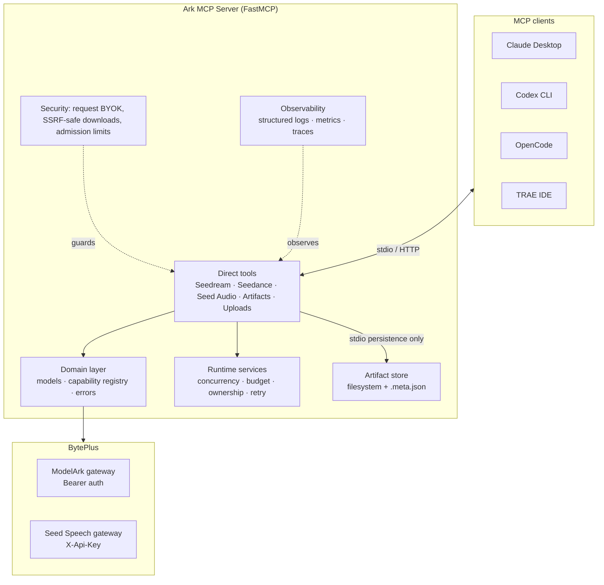
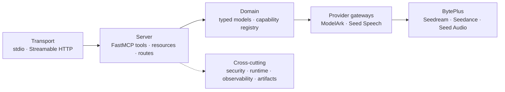
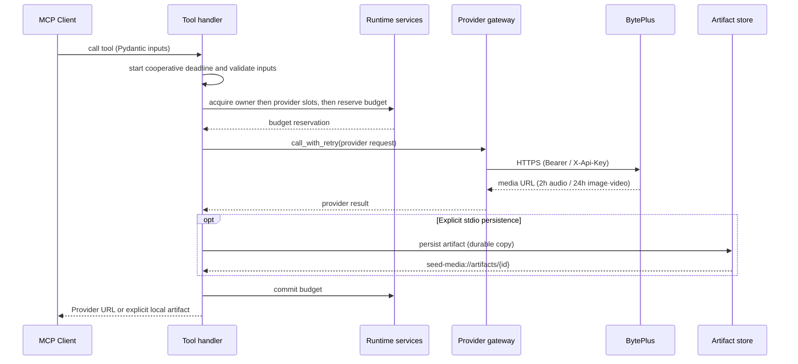

# BytePlus Seed MCP

A Python [Model Context Protocol](https://modelcontextprotocol.io) server
built on [FastMCP](https://gofastmcp.com) that exposes BytePlus multimodal
generation through a typed, safe tool surface.

## Documentation

Start with the [Seed MCP documentation](https://byteplus-sa.github.io/seed-mcp/)
and [connection guide](https://byteplus-sa.github.io/seed-mcp/setup/install/).
This is the focused [`byteplus-sa/seed-mcp`](https://github.com/byteplus-sa/seed-mcp)
fork of Ark MCP; Python package/module, tool and skill names remain unchanged.
The public site focuses on connecting to and using the hosted service.
[Local setup](docs/setup/manual-install.md), [operator guides](docs/deployment.md)
and the [full API reference](docs/api-reference.md) remain in this repository.
Documentation describes its source revision, not an assumed packaged release.
See [site maintenance](docs/site-maintenance.md) for publication details.

> **Breaking capability removal:** the current server narrows the catalog to
> 17 local tools (four always registered), including managed Files operations. MCP jobs/native tasks, media
> understanding, VOD, 3D, dedicated ASR, asset administration/resolution/preflight
> and operator live-pricing discovery are removed. Saved 3D artifacts are no
> longer served by the narrowed schema: **export needed 3D outputs using the
> old server before upgrading**. There is no compatibility guarantee or
> automatic migration. See
> [migration guidance](docs/migration-0.2.md#breaking-capability-migration);
> the 0.1.x consolidation tables on that page are historical.

## Releases

Resolve this fork's available releases independently; upstream Ark MCP tags
and images do not establish narrowed Seed MCP support. See
[release policy and installation](docs/releases.md) and the
[changelog](docs/changelog.md). PyPI publication is not configured.

## What It Does

The server provides a conditional MCP tool surface across several BytePlus
products plus artifact access and managed reference files. The catalog has
**17 conditional local stdio tools**, four always registered, and **12 HTTP
provider/discovery tools**. Discovery is anonymous; provider calls use live BYOK
headers. Managed reference files use `ark_file_upload`, `ark_file_get`,
`ark_file_list`, and `ark_file_delete` with your own ModelArk API key and,
on HTTP, an optional independent client secret. Default
`purpose="agent"` uses provider-managed storage without bucket setup. Retrieve
the accepted file ID until active with a `download_url`, then pass that URL
to generation. The client-side `seed-mcp-upload` streams local files directly
to ModelArk; HTTP MCP accepts HTTPS source URLs, not local paths or Base64.
Reads do not renew the documented 24-hour/100-download URL limit. No upload
enrollment, TOS signer, IRSA, application file database or cleanup worker remains.
Never automatically retry an uncertain upload/delete; keep file/request IDs.

See [managed reference files](docs/files.md). Check the connected deployment's
tools/list before use; the [live source smoke](docs/hosted-deployment-status.md#managed-files-source-validation)
does not establish rollout through the public cloud endpoint.

HTTP has no jobs, native tasks, local storage/artifact tools or resources.
Both transports execute directly. General artifact persistence is stdio-only;
hosted TTS returns [native audio content](docs/seed-tts.md#direct-audio-delivery).

HTTP clients send only the selected `X-ModelArk-Api-Key`
or `X-Seed-Speech-Api-Key`, plus optional
`X-MCP-Client-Secret` (client-generated 32 random bytes as 64 lowercase hex).
There is no OAuth, signup or server-issued key; `Authorization` is rejected.
Keys are not persisted and there is no provider-key fallback. See
[client setup](docs/setup/shared-server.md) and the
[BYOK contract](specs/SPEC_HOSTED_BYOK.md).

| Product | Tools | Description |
|---|---|---|
| **Seed Audio** | `seed_audio_generate` | Direct full-scene audio generation through Seed Speech; one clip or 1-5 parallel variations. WAV/MP3/OGG/PCM artifacts use format-specific MIME; requested sample rate and subtitles need [delivery verification](docs/tools.md#seed_audio_generate) |
| **Seed TTS 3.0** | `seed_tts_generate` | [Text or SSML speech](docs/seed-tts.md), authorized voice, pronunciation/delivery controls and optional alignment; MP3/PCM/Ogg Opus. HTTP returns native MCP audio directly, up to 30 MiB; stdio persists locally |
| **Seedream** | `seedream_generate_image` | One direct image tool through ModelArk: [Seedream 5.5](https://byteplus-sa.github.io/seed-mcp/tool-reference/seedream-generate-image/#seedream-5-5) only, generation/reference and point/box editing, native transparent PNGs, auto backgrounds, standard-only optimization, validated 1K/1.5K/2K or custom sizes up to 8,294,400 pixels (4K UHD: `size="3840x2160"`), hashed safety IDs, provider image metadata, 1-10 variations and size-aware dry-run estimates. Older models and provider batches are not supported. Layer decomposition/OCR are not exposed |
| **Seedance** | `seedance_create_task` | One direct video tool for every configured Seedance model (regular 2.5 and Flash bound by default, 2.0 configurable): regular 2.5 accepts `resolution="4k"` ([provider-contract caveat](docs/models.md#video-capabilities-videocapabilities)); Flash supports 480p/720p, 10 images / 5 videos / 5 audios and no Draft. Regular 2.5 Drafts have a 14-day window (7 for creation before 2026-10-28 10:00 UTC+8). Pick the model from `ark_list_models(kind='video')`, create 1-5 variations, or use `dry_run` for a free request and static cost preview; poll with the shared generation task tools |
| **Generation tasks** | `gen_task_get`, `gen_task_list`, `gen_task_cancel_or_delete` | Seedance lifecycle: direct batched status checks (1-50 IDs) with derived queue timing and explicit local output persistence, cursor-paged listing of your own tasks, and guarded cancel/delete |
| **Artifacts** | `seed_media_get_artifact`, `seed_media_export_artifact`, `seed_media_persist_url` | Retrieve persisted media inline by artifact ID, locate/copy it to a local path without Base64 round-trips, or durably persist a provider URL whose storage failed |
| **Object storage** (optional) | `media_upload`, `media_presign` | Direct upload of 1-50 Base64 or local-file media items to S3 with per-item results; foreground URL renewal for 1-100 object keys without re-uploading |
| **Managed Files** | `ark_file_upload`, `ark_file_get`, `ark_file_list`, `ark_file_delete` | ModelArk-managed reference storage; no bucket setup. URL import on HTTP and stdio, local file streaming on stdio or through the client helper. |

Key features:

- **Model discovery and validation** - exact configured image/video bindings,
  typed inputs and static cost previews before paid calls. Opt-in HTTP
  preflight checks header presence and bindings, not provider authentication.
- **Client configuration** - a
  [stdout snippet generator](docs/setup/shared-server.md#generate-a-client-snippet)
  emits Codex/Claude configuration with environment-name references, without
  reading credentials, changing files or making network calls.
- **Stateless HTTP** - database-free BYOK with provider-key task authorization,
  no durable replay or shared budget accounting. Omit legacy operation keys;
  never automatically resubmit uncertain creates.
- **Local durable artifacts** - explicitly preserve media beyond provider URL
  expiry, recover failed persistence using returned output, and write to
  authorized MCP roots or `OUTPUT_ROOTS`.
- **Parallel variations** - independent results and partial errors per
  variation, with bounded concurrency and no automatic batch resubmission.
- **Seedream provenance** - request IDs, submitted seeds, final-prompt hashes
  and advisory byte inspection, without rerolling billed outputs. See the
  [review/edit workflow](docs/integration-guide.md#seedream-review-and-edit).
- **Native Seedance assets** - use existing authorized `asset://` references;
  asset administration and preflight verification remain outside this server.
- **Direct operations and safety** - bounded admission, cooperative deadlines,
  uncertainty-aware retries, live credential isolation and Host/Origin checks.
- **Multi-pod deployment** - stateless Deployment/HPA/PDB/hostname spread with
  same-pod Caddy TLS and optional loopback-only metrics.
  [Terraform preparation](docs/byteplus-terraform.md#prepare-terraform-source)
  creates private source copies and runs isolated mock-only validation. Two
  fixed private baseline nodes remain at idle; an opt-in bounded burst pool
  requires administrator-managed Cluster Autoscaler and live validation, not
  just pod HPA. Only disposable application/proxy scratch volumes are marked
  evictable; PDB and shutdown grace still apply. See the
  [VKE runbook](docs/byteplus-terraform.md) and
  [deployment contract](specs/SPEC_VKE_DEPLOYMENT.md).
  [Manual GitHub Actions delivery](docs/github-actions-deployment.md) uses a
  protected environment and workflow-restricted private runner for Helm, not
  GitHub-hosted private API access or automatic IAM federation.
  [Optional dedicated APIG preparation](docs/byteplus-terraform.md#optional-dedicated-gateway-infrastructure)
  adds a gateway and two subnets only: no routes or generic MCP endpoint.
  Logging and tracing must read back disabled; the documented backend trust decision, stateless routing
  and host/proxy trust remain launch gates. Explicit operator approval may
  allow provisioning first and billing inspection afterward; regional quotas
  still apply. The chart defaults to CLB/Caddy; opt-in
  [private APIG staging](docs/github-actions-deployment.md#private-apig-staging)
  is synthetic-only, refuses credential headers and keeps public clients blocked.
  [Production APIG source support](docs/github-actions-deployment.md#production-apig-preparation)
  uses a separate private proxy and explicit production approval gates; it
  does not solve APIG backend trust or enable routes. A
  [certificate-renewal procedure](docs/backend-certificate-renewal.md)
  covers versioned Secret rollouts and verification on every replica.
  Default policy verifies backend identity; the existing deployment has a
  [scoped operator exception](specs/SPEC_VKE_DEPLOYMENT.md#accepted-backend-verification-exception)
  retaining HTTPS while accepting unverified backend identity. Other launch
  gates and public HTTPS validation remain.
- **Offline regression coverage** - unit, contract, integration, HTTP security
  and MCP conformance tests, plus documentation build/link checks.

## Supported Input Modalities

All input media is validated through an SSRF-safe URL policy and size-checked
Base64 before reaching the provider. The table below shows what each tool
accepts as reference input:

| Tool | Modality | URL | Base64 | Speaker ID | Roles | Max | Constraints |
|---|---|:---:|:---:|:---:|---|:---:|---|
| `seedream_generate_image` | Image | ✓ | ✓ | — | reference | 10 | — |
| `seedance_create_task` (2.0 models) | Image | ✓ | ✓ | — | `first_frame` · `last_frame` · `reference_image` | 9 | — |
| `seedance_create_task` (2.0 models) | Video | ✓ | — | — | `reference_video` | 3 | URL only |
| `seedance_create_task` (2.0 models) | Audio | ✓ | ✓ | — | `reference_audio` | 3 | Not sole input |
| `seedance_create_task` (regular 2.5) | Image | ✓ | ✓ | — | `first_frame` · `last_frame` · `reference_image` | 30 | — |
| `seedance_create_task` (regular 2.5) | Video | ✓ | — | — | `reference_video` | 10 | URL only |
| `seedance_create_task` (regular 2.5) | Audio | ✓ | ✓ | — | `reference_audio` | 10 | May be the sole input |
| `seedance_create_task` (2.5 Flash) | Image | ✓ | ✓ | — | `first_frame` · `last_frame` · `reference_image` | 10 | — |
| `seedance_create_task` (2.5 Flash) | Video | ✓ | — | — | `reference_video` | 5 | URL only |
| `seedance_create_task` (2.5 Flash) | Audio | ✓ | ✓ | — | `reference_audio` | 5 | May be the sole input |
| `seed_audio_generate` | Audio | ✓ | ✓ | ✓ | — | 3 | Exclusive w/ image |
| `seed_audio_generate` | Image | ✓ | ✓ | — | — | 1 | Exclusive w/ audio |

> Variations are a field on the base tools (`variations` on
> `seedream_generate_image`, `seed_audio_generate`, and
> `seedance_create_task`), so they accept the same input modalities and limits
> as a single call.

> [!NOTE]
> **Video references use HTTPS or authorized assets.** Use `ark_file_upload` on
> stdio, or `seed-mcp-upload` on the hosted client's machine, with a ModelArk key.
> Retrieve the accepted ID with `ark_file_get`, then pass its active `download_url`
> to Seedance. Files IDs are not generation inputs. No user TOS is required.
> See [the managed-file workflow](docs/files.md).

## Architecture

The server uses dedicated provider gateways behind one normalized domain layer, a
lifespan-owned runtime for concurrency/budget/ownership, and a durable
artifact store. See [docs/architecture.md](docs/architecture.md) for the full
overview.

**Components**



**Layered view**



**Request sequence (a billable generate call)**



## Quick Start

**Connect to hosted Seed MCP. No server installation or startup is required.**
The service already runs on BytePlus; users do not need a repository checkout,
Python, uv, Docker or Kubernetes access.

1. Follow [Connect to Hosted Seed MCP](docs/setup/install.md) for the endpoint
   and ready-to-use Codex/Claude Code templates.
2. Configure the selected provider key, and optionally a client secret, in
   private HTTP headers. Never paste credentials into chat.
3. Enable the remote `ark-seed` connection in your client and ask:

```text
Check ark-seed with ark_list_models using {"input": {}}.
Tell me which services and tools are available. Do not generate or upload.
```

Discovery makes no provider calls and does not verify provider credentials
or account entitlement. Generation may incur charges.
The [`ark-mcp-setup` skill](.agents/skills/ark-mcp-setup/SKILL.md) can assist
with the HTTP connection, but is optional. Local installation and self-hosting
are separate operator workflows, not prerequisites for using the hosted service.

## Agent Skill

Install the optional [ark-mcp usage skill](docs/setup/agent-skill.md) to teach
your agent model discovery, direct calls, provider polling and artifact
handling. Ask your agent to use the Skills CLI, or run:

```bash
npx skills add byteplus-sa/seed-mcp --skill ark-mcp -g
```

Requires Node.js 22.20+, npm/npx and Git. Select your agents and review the
installation summary; omit `-g` for a project-only install. The CLI handles
the skill directories. The [guide](docs/setup/agent-skill.md) covers existing
skills, telemetry, verification and manual fallback. This installs instructions,
not the MCP server or its connection.

## Configuration

For stdio, only configure the products you use. [Provider Keys](docs/api-keys.md) explains
which key each product needs. Store keys in a private file outside the
repository; the client receives only its `ARK_MCP_ENV_FILE` path. Guided setup
prepares the blank file and configuration; optional flags remain off unless
requested.

> [!IMPORTANT]
> **Upgrading:** `SEEDANCE_DEFAULT_MODEL` now defaults to Seedance 2.5. If
> `SEEDANCE_MODEL_BINDINGS` lists only a Seedance 2.0 model, set
> `SEEDANCE_DEFAULT_MODEL` to that ID (or add a 2.5 binding), or the server
> fails at startup. See [Configuration](docs/configuration.md#seedance-default-model-upgrade-note).

On stdio, if a credential is absent, the server skips registering that product's
tools. `seed_media_get_artifact`, `seed_media_export_artifact`, and
`seed_media_persist_url` are always available, provider tools appear only
when their credentials are configured, `media_upload` and
`media_presign` appear
only when object storage credentials (S3) are configured, and
`seed_audio_generate` appears only when `BYTEPLUS_SEED_SPEECH_API_KEY` is set.

HTTP requires operator `MCP_IDENTITY_HMAC_KEY` (64 lowercase hex) and positive
`MCP_IDENTITY_KEY_VERSION` (default 1), not operator provider keys.
`STATE_BACKEND` automatically selects `none`; `DAILY_BUDGET_USD` must be zero.
Rate and concurrency limits are per pod and reset at restart.

Client `X-MCP-Client-Secret` must differ from every supplied provider API key.
Reuse returns HTTP 400 `CREDENTIAL_REUSE` before tool execution. Generate an
independent client secret and update its private client entry, keeping provider
keys unchanged. See [client setup](docs/setup/shared-server.md).

Task access follows the selected provider key, not the client secret.
Non-null `idempotency_key` is rejected on both transports. Repeated creates may
bill again; retain task IDs and poll. See the
[submission contract](specs/SPEC_HOSTED_BYOK.md#http-submission-safety).
Endpoint headers accept exact registry bindings only and explicit tool
`model` wins. Unknown IDs require operator verification, not guessed lineage.

See [Configuration](docs/configuration.md) for the full environment
variable reference.

## Using with MCP Clients

Both transports use ordinary direct tool calls; explicit native task opt-in is
rejected. `MCP_ADMISSION_TIMEOUT_SECONDS=2.0` (finite positive, max 30) bounds
the combined owner-first/provider wait. `MCP_TOOL_TIMEOUT_SECONDS=600.0`
(finite positive, max 3600) starts at wrapper entry, before credential checks
and admission. Local stdio reserves budget after admission; HTTP has no ledger.

Use a **660-second client timeout** and compatible proxy settings. Deadlines
are cooperative; SDK/local SQLite draining may exceed them.
`ADMISSION_TIMEOUT` means this attempt did not dispatch, not the entire batch.
`TOOL_DEADLINE_EXCEEDED` preserves uncertainty and known safe accepted IDs.
Timeout does not cancel provider work. Poll known IDs or reconcile uncertain
acceptance; never automatically resubmit.

The desktop/IDE snippets remain connection templates, not exact-client
certification.

Use the client-specific guides below. Each starts with guided setup and keeps
manual configuration as an optional fallback.

### Claude Desktop

Follow [Claude Desktop setup](docs/integrations/claude-desktop.md).
A separate coding agent can configure Desktop; Desktop chat alone is not
assumed to have local installation tools.

### Codex CLI

Follow [Codex setup](docs/integrations/codex.md), or
[Claude Code setup](docs/integrations/claude-code.md) for that coding client.

### OpenCode

Follow [OpenCode setup](docs/integrations/opencode.md). Its configuration
format depends on the installed edition.

For HTTP BYOK, see the [transport guide](docs/transports.md). Both transports
execute directly; provider polling is separate from MCP execution.

### TRAE IDE

Follow [TRAE setup](docs/integrations/trae.md). Let the agent resolve paths
and prepare the entry, then complete any required settings-screen confirmation.

### TRAE Work

Use the Work notes in the [TRAE guide](docs/integrations/trae.md), checking
edition and local/cloud runtime. A cloud host cannot use local paths or
credentials without a separate setup decision.

### Cursor, VS Code, MCP Inspector

See [Cursor](docs/integrations/cursor.md) and [VS Code](docs/integrations/vscode.md).
The [MCP Inspector](docs/integration-guide.md#mcp-inspector) is an optional
developer tool, not an onboarding requirement.

## Available Make Targets

```bash
make help          # Show all targets
make install       # Install dependencies from uv.lock
make start         # Run the server over stdio
make start-http    # Run the server over Streamable HTTP (localhost:3000)
make dev           # Run in dev mode with auto-reload
make test          # Run the test suite
make lint          # Lint with ruff
make typecheck     # Type-check with mypy
make inspect       # Launch FastMCP inspector
make check-env     # Validate environment configuration
```

## Documentation

| Document | Description |
|---|---|
| [Getting Started](docs/getting-started.md) | Installation, configuration, and first run |
| [Migration Guide](docs/migration-0.2.md#breaking-capability-migration) | Current breaking capability removal and historical 0.1.x consolidation |
| [Architecture](docs/architecture.md) | System structure, three-provider domain layer, request flow |
| [Configuration](docs/configuration.md) | Full environment variable reference |
| [Integration Guide](docs/integration-guide.md) | MCP client setup (Claude, Cursor, VS Code, Inspector) |
| [API Reference](docs/api-reference.md) | Complete tool schemas, inputs, outputs, and examples |
| [Use Cases](docs/use-cases.md) | Common scenarios with example tool calls |
| [Tools](docs/tools.md) | Tool reference with input/output tables |
| [Native Asset References](docs/assets.md) | Existing authorized Seedance asset references, without administration |
| [Security](docs/security.md) | Consolidated security model (auth, SSRF, body limits) |
| [Runtime](docs/runtime.md) | Concurrency, budget, ownership, retry |
| [Observability](docs/observability.md) | Structured logging, metrics, tracing |
| [Models](docs/models.md) | Model capability registry and validation |
| [Artifacts](docs/artifacts.md) | Durable artifact lifecycle and store |
| [Transports](docs/transports.md) | stdio vs HTTP deployment |
| [Deployment](docs/deployment.md) | Container, Kubernetes, and remote HTTP deployment |
| [GitHub Actions Delivery](docs/github-actions-deployment.md) | Protected Helm delivery from a private VKE runner |
| [Hosted Deployment Status](docs/hosted-deployment-status.md) | Verified operator endpoint, acceptance evidence, scoped TLS exception and renewal ownership |
| [Secret Handling](docs/secret-manager.md) | Operator HMAC/client credentials; hosted provider-secret sync superseded |
| [Troubleshooting](docs/troubleshooting.md) | Common errors and fixes |

## Project Layout

```text
ark-mcp/
├── src/ark_mcp/
│   ├── server.py              # Deterministic FastMCP factory and registration
│   ├── __main__.py            # Entry point (truststore injection)
│   ├── runtime.py             # Lifespan-owned stores, limits, budgets, ownership
│   ├── state/                 # Disabled HTTP persistence and provider-authorized task adapters
│   ├── config/                # Pydantic Settings, model capability registry
│   ├── domain/                # ArtifactRef, errors, media, models
│   ├── providers/             # ModelArk + Seed Speech adapters
│   ├── tools/                 # 17 definitions (12 hosted; local artifacts/S3 optional)
│   ├── artifacts/             # Tenant-aware filesystem artifact store
│   ├── observability/         # Structured logging and Prometheus metrics
│   └── security/              # Request BYOK, URL/media policy, safe downloader, HTTP limits
├── tests/
│   ├── unit/                  # Model validators, URL policy, media policy, helpers
│   ├── contract/              # Provider gateway + adapter contract tests
│   ├── integration/           # Tool handler, HTTP security, MCP conformance
│   └── e2e/                   # In-process FastMCP client tests
├── docs/                      # User and contributor documentation
├── plans/                     # Implementation plans
├── scripts/                   # Verification and smoke test scripts
├── fastmcp.json               # Declarative server configuration
├── Makefile                  # Task runner
└── pyproject.toml             # Project metadata and dependencies
```

## Tech Stack

- [Python 3.12+](https://www.python.org/) on [uv](https://docs.astral.sh/uv/)
- [FastMCP v4](https://gofastmcp.com/) — MCP server framework
- [httpx](https://www.python-httpx.org/) — async HTTP client
- [Pydantic v2](https://docs.pydantic.dev/) — typed models and validation
- [Pillow](https://pillow.readthedocs.io/) — bounded PNG/JPEG artifact inspection
- [pydantic-settings](https://pydantic.dev/docs/validation/latest/concepts/pydantic_settings/) — environment configuration
- [Starlette](https://www.starlette.io/) — HTTP middleware, body limits, and responses
- [prometheus-client](https://github.com/prometheus/client_python) — optional private loopback metrics; no public `/metrics`
- [cachetools](https://github.com/tkem/cachetools) — TTL caching for provider responses and principal limits
- [truststore](https://truststore.readthedocs.io/) — macOS system certificate injection
- [respx](https://github.com/lundberg/respx) — HTTP mocking for contract tests

## License

See the project configuration for license details.

## Status

The provider tools, direct transports and database-free hosted runtime are
implemented. Local stdio retains SQLite-backed artifacts and bookkeeping.
CI checks offline coverage, lint/types, security, packaging and documentation.
The chart supports multiple pods, but live VKE routing, scaling, capacity and
actual model-driven client/provider acceptance remain separately approved
gates. Mocked tests do not establish public-launch readiness.

Hosted deployment starts fresh without historical database compatibility or
stateful-release migration tooling. Source changes do not authorize deployment
or delete cloud resources.

Seedream's [live smoke matrix](docs/integration-guide.md#opt-in-seedream-smoke-matrix)
is opt-in; editing/alpha and visual acceptance still require authorized checks.

HTTP preflight: `ark_list_models(check_connection=true)` checks live header presence
and exact configured bindings only; it never verifies provider authentication.
