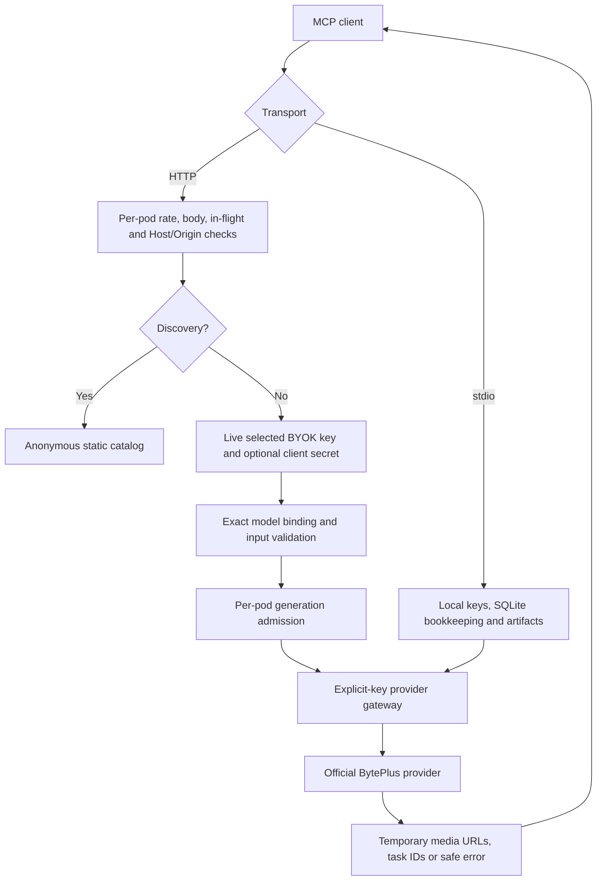

# Architecture

Seed MCP is a direct-call Python/FastMCP server with 17 conditional local
tools and 12 hosted tools, including TTS and ModelArk Files. There are no
MCP jobs, native tasks or inference workers.

## Request Flow

HTTP has no application database: no SQLite, PostgreSQL, Redis, task ownership
ledger, submission journal, durable replay or shared budget/rate accounting.
The client retains task IDs and can poll through any compatible replica after
a pod restart. Provider work remains asynchronous independently of the pods.

## Provider Domain Layer

| Provider | Fixed HTTP origin | Upstream auth |
| --- | --- | --- |
| ModelArk | `https://ark.ap-southeast.bytepluses.com/api/v3` | Bearer; Seedream, Seedance and Files |
| Seed Speech | `https://voice.ap-southeast-1.bytepluses.com` | `X-Api-Key`; Seed Audio and Seed TTS 3 |

Clients privately send `X-ModelArk-Api-Key` or `X-Seed-Speech-Api-Key`,
and optional `X-MCP-Client-Secret`. Credentials live only for the
HTTP request and never fall back to operator provider keys. The client secret
and operator HMAC define ephemeral admission scopes, not provider task access.
Clients sharing a provider key have the task access that provider authorizes.

`tools/_catalog.py` owns discovery. `server.py` owns direct-call wrappers and
transport boundaries. `security/credentials.py` validates request headers.
`providers/factory.py` builds explicit-key gateways. `runtime.py` owns lifespan
services and uses disabled persistence adapters on HTTP.

Exact registry bindings determine capabilities. Endpoint headers select
registered defaults; explicit tool `model` wins. There is no opaque endpoint
lineage inference or asset administration. Native `asset://` references pass
through to the provider.

## Execution and Delivery

HTTP uses URL-only references for media inputs. It rejects binary/local uploads, artifact resources, stored artifact
references and persistence requests. Local stdio keeps explicit persistence
and writes constrained by live MCP roots or `OUTPUT_ROOTS`.
TTS always persists its bounded stream on stdio. HTTP returns one native MCP
audio block plus metadata; no output upload, local file or database is created.
It uses direct-call deadlines and dispatch tracking, with no automatic synthesis
retry or provider URL. See [Seed TTS](seed-tts.md).

Managed reference files use `ark_file_upload`, `ark_file_get`,
`ark_file_list`, and `ark_file_delete` with the ModelArk API key. Default
`purpose="agent"` uses provider-managed storage without bucket setup. Retrieve
the accepted file ID until active with a `download_url`, then pass that URL
to generation. The client-side `seed-mcp-upload` streams local files directly
to ModelArk; HTTP MCP accepts HTTPS source URLs, not local paths or Base64.
Reads do not renew the documented 24-hour/100-download URL limit. No upload
enrollment, TOS signer, IRSA, application file database or cleanup worker remains.
Never automatically retry an uncertain upload/delete; keep file/request IDs.

See [managed references](files.md).

The tool deadline starts before credentials and admission (default 600s).
Owner-first then provider admission has a combined 2s wait. Use a client timeout
of 660s. Safe accepted IDs are retained only for live-call diagnostics; there
is no saved response after the call ends.

Omit `idempotency_key`; non-null legacy keys are rejected before dispatch.
Identical creates are independent operations and can bill again. Uncertain
mutation failures are nonretryable. Keep known IDs and reconcile lost create
responses through the provider, never automatic resubmission.

## Scaling and Operations

The stateless Deployment can run multiple pods without sticky sessions or a
shared filesystem. Rate and concurrency limits are per pod, reset at restart
and multiply with replicas. `DAILY_BUDGET_USD=0` is required on HTTP because
there is no ledger. Configure provider-side spend and quota controls.

Readiness checks lifespan availability only; it does not prove provider
authorization or connectivity. Caddy exposes only `/mcp` and `/health`;
`/ready` and optional loopback metrics stay private.

See [deployment](deployment.md), [runtime](runtime.md) and the
[BYOK contract](../specs/SPEC_HOSTED_BYOK.md). Source validation does not prove
live capacity, VKE rollout behavior or paid provider/client compatibility.
