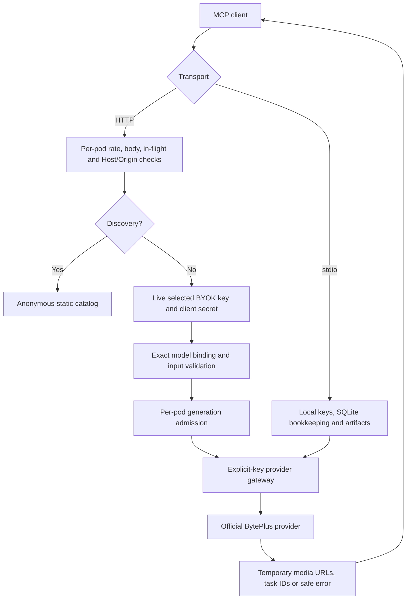

# Architecture

Seed MCP is a direct-call Python/FastMCP server. The catalog contains 12 local
tools; HTTP exposes seven discovery/provider tools.
Opt-in HTTP-only `media_prepare_upload` adds one signing capability; its client
uploads directly to private TOS. The full catalog has 13 definitions.
There are no MCP jobs, native tasks or inference workers.

## Request Flow

HTTP has no application database: no SQLite, PostgreSQL, Redis, task ownership
ledger, submission journal, durable replay or shared budget/rate accounting.
The client retains task IDs and can poll through any compatible replica after
a pod restart. Provider work remains asynchronous independently of the pods.

## Provider Domain Layer

| Provider | Fixed HTTP origin | Upstream auth |
| --- | --- | --- |
| ModelArk | `https://ark.ap-southeast.bytepluses.com/api/v3` | Bearer; Seedream and Seedance |
| Seed Speech | `https://voice.ap-southeast-1.bytepluses.com` | `X-Api-Key`; Seed Audio |

Clients privately send `X-ModelArk-Api-Key` or `X-Seed-Speech-Api-Key`,
plus `X-MCP-Client-Secret`. Credentials live only for the
HTTP request and never fall back to operator provider keys. The client secret
and operator HMAC define ephemeral admission scopes, not provider task access.
Clients sharing a provider key have the task access that provider authorizes.

`tools/_catalog.py` owns discovery. `server.py` owns direct-call wrappers and
transport boundaries. `security/credentials.py` validates request headers.
`providers/factory.py` builds explicit-key gateways. `runtime.py` owns lifespan
services and uses disabled persistence adapters on HTTP.

Exact registry bindings determine capabilities. Endpoint headers select
registered defaults; explicit tool `model` wins. There is no opaque endpoint
lineage inference or asset administration. Native `asset://` references pass
through to the provider.

## Execution and Delivery

HTTP is URL-only. It rejects binary/local uploads, artifact resources, stored artifact
references and persistence requests. Local stdio keeps explicit persistence
and writes constrained by live MCP roots or `OUTPUT_ROOTS`.

Temporary uploads use a separate enrolled client-secret authorization scope and
operator TOS signer, with exact-key POST permissions and a GET URL. No object
is created or inspected by MCP and no database is needed. Static credentials
sign locally without network calls. Explicit VKE IRSA mode lazily exchanges a
projected ServiceAccount token with BytePlus STS and caches temporary credentials
in runtime memory. One triplet signs the POST/form/GET pair; refresh never
extends already issued URLs. Only the app mounts the manually projected token,
not Caddy. Discovery/readiness perform no token read or STS/TOS probe.
See [temporary references](temporary-uploads.md#vke-iam-roles-for-service-accounts).

The tool deadline starts before credentials and admission (default 600s).
Owner-first then provider admission has a combined 2s wait. Use a client timeout
of 660s. Safe accepted IDs are retained only for live-call diagnostics; there
is no saved response after the call ends.

Omit `idempotency_key`; non-null legacy keys are rejected before dispatch.
Identical creates are independent operations and can bill again. Uncertain
mutation failures are nonretryable. Keep known IDs and reconcile lost create
responses through the provider, never automatic resubmission.

## Scaling and Operations

The stateless Deployment can run multiple pods without sticky sessions or a
shared filesystem. Rate and concurrency limits are per pod, reset at restart
and multiply with replicas. `DAILY_BUDGET_USD=0` is required on HTTP because
there is no ledger. Configure provider-side spend and quota controls.

Readiness checks lifespan availability only; it does not prove provider
authorization or connectivity. Caddy exposes only `/mcp` and `/health`;
`/ready` and optional loopback metrics stay private.

See [deployment](deployment.md), [runtime](runtime.md) and the
[BYOK contract](../specs/SPEC_HOSTED_BYOK.md). Source validation does not prove
live capacity, VKE rollout behavior or paid provider/client compatibility.
