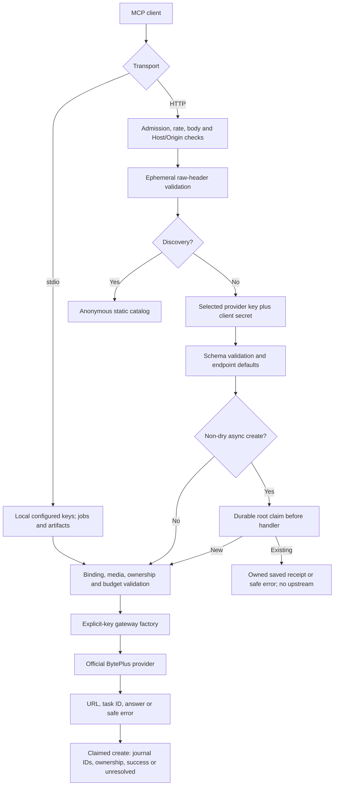

# Architecture

The static catalog contains 21 local stdio tools. HTTP exposes only nine
discovery/provider tools, or twelve when OmniHuman is enabled. The
[BYOK specification](../specs/SPEC_HOSTED_BYOK.md) defines the forward-only
boundary implemented by this server.

## Request Flow

`tools/_catalog.py` is the single inventory. `server.py` controls
transport registration and execution. `security/credentials.py` validates
raw live headers and binds provider-specific ownership; `providers/factory.py`
constructs explicit-key gateways. `runtime.py` owns state, budgets and
limiters. No HTTP gateway falls back to operator provider keys.
`submissions.py` coordinates HTTP asynchronous-create claims and receipt replay;
`submission_store.py` owns the durable SQLite journal.

HTTP middleware scopes `Settings` to the receiving server for each request;
capability lookup uses those settings instead of the process-default registry.
Concurrent server instances therefore keep their bindings and defaults isolated.
Anonymous `ark_list_models` lists configured bindings without environment
provider keys. `services[].enabled` means registered, not entitled.

## Provider Domain Layer

| Provider | Fixed HTTP origin | Upstream auth |
| --- | --- | --- |
| ModelArk | `https://ark.ap-southeast.bytepluses.com/api/v3` | Bearer; Seedream, Seedance, image/video/audio understanding and Files API |
| Seed Speech | `https://voice.ap-southeast-1.bytepluses.com` | `X-Api-Key`; Seed Audio |
| Vision AI | `https://openapi.cv.bytepluses.com` | Separate Bearer key; optional OmniHuman |

The client-facing headers differ from upstream auth:
`X-ModelArk-Api-Key`, `X-Seed-Speech-Api-Key`, `X-OmniHuman-Api-Key`, plus
required `X-MCP-Client-Secret` for provider calls. There is no OAuth,
signup or server-issued key. Discovery makes no provider calls.

The registry maps exact model IDs to capabilities. Optional endpoint headers
select only registered Seedance/Seedream defaults; explicit tool `model` wins.
No arbitrary opaque endpoint lineage is inferred. Native Seedance assets are
passed through without asset administration, resolution or status preflight.

## Execution and Delivery

HTTP calls execute directly in the foreground. Seedance/OmniHuman execution
remains asynchronous at the provider: return a provider ID and poll it with
the corresponding tool. HTTP has no Docket queue, task snapshots, native tasks,
storage/artifact tools or MCP resources.
Non-dry HTTP Seedance/OmniHuman creates require `idempotency_key`, with one
durable root claim before handler entry for the entire batch. Key and input
fingerprints use operator HMAC. Complete saved receipts replay only after
ownership checks, before any upstream access including Draft lookup.
Failed/partial/cancelled attempts remain unresolved, with known IDs and no
automatic resume. Same-key calls recover delivery, not provider status.
Seedance dry runs need no key/journal; stdio rejects supplied keys.
Explicit per-call `io.modelcontextprotocol/tasks` opt-in is rejected, including
on discovery, before provider dispatch, snapshot capture/save or queue creation.

Local stdio retains [ordinary jobs and native tasks](../specs/SPEC_BACKGROUND_JOBS.md).
Required tools run through `ark_job_submit` by default; capable clients can use
native augmentation. Job IDs and provider IDs remain distinct.

Seed Audio/Seedream `persist` and OmniHuman get `persist_output` default to false
globally. HTTP rejects true; stdio permits explicit persistence and guarded
local outputs. HTTP clients retrieve expiring URLs themselves. Files API
cleanup uses the same request key; remote temporary-file expiry is not local
artifact persistence.

## Ownership and State

Credential tenants are HMAC-derived from the selected provider, official origin,
exact key and identity version. Owners additionally include the client secret.
Adding another provider key does not change existing scope. The operator HMAC
key and version are stable configuration, not customer credentials.

Fresh SQLite has ownership primary key `(provider, tenant_id, task_id)` and
an immutable `principal_id`. Checks precede upstream access and fail closed
on missing ownership or state errors. No compatibility migration exists.
Keys are not written to state, snapshots, cache keys, logs or spans.
The journal stores no raw prompts, media or errors. Claims never auto-prune;
`STATE_MAX_RECORDS` limits new keys while existing keys remain readable.
Retain state, HMAC key/version and the original provider/client credentials.

HTTP starts with positive rate/body/in-flight/state limits. `/health` and
`/ready` expose minimal state status and never probe providers; `/metrics`
is unavailable publicly. See [security](security.md) and [runtime](runtime.md).

## Failure Boundary

Provider mutation failures with uncertain dispatch and malformed 2xx responses
are nonretryable/ambiguous, including potentially billed understanding
completions. Chat/mutation 5xx responses are ambiguous and never automatically
retried, even if marked `retryable=true`. Eligible 429 rejections, pre-dispatch
failures and reads can have bounded retries; understanding excludes all
`TIMEOUT` retries. Preserve task/request IDs, including IDs retained alongside
Seedance bookkeeping errors. See [runtime recovery](runtime.md#billable-call-composition-billed_provider_slot).

SQLite and in-process limiters support one instance only. Synchronous product
replay and complete crash recovery remain deferred, including the gap between
provider acceptance and the first ID write. PostgreSQL/Redis are future scaling
choices, not initial requirements. This foundation does not promise exactly-once
inference or establish public-launch readiness. See the
[submission contract](../specs/SPEC_HOSTED_BYOK.md#http-submission-safety).
