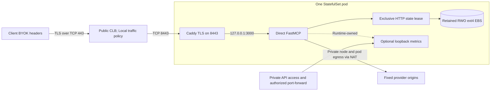

# Deploy on BytePlus with Terraform

The supported cloud source is a **dedicated VKE cluster** in
`deploy/terraform/vke` and the application chart in `deploy/helm/seed-mcp`.
It replaces the ECS/Compose workflow. One StatefulSet pod runs FastMCP and a
Caddy TLS sidecar with retained SQLite state. There is no application HPA,
PostgreSQL, Redis, HA or public-launch certification.

The durable contract is [VKE Deployment](../specs/SPEC_VKE_DEPLOYMENT.md);
[HTTP BYOK](../specs/SPEC_HOSTED_BYOK.md) remains authoritative for identity
and submission recovery. Commands below are local validation or explicitly
identified operator read-only checks, not authorization for paid execution.

<span id="verify-before-inviting-users"></span>

## Validation Status

Live VKE provisioning remains **unverified**. CLB source-IP preservation,
CSI attach/detach, same-zone rescheduling, rollout/drain behavior, DNS/TLS
and backup recovery require separately authorized evidence. Real target-client
tool execution and provider acceptance remain unverified for this deployment.
Old partial ECS provisioning is not evidence for VKE.

Local mocked Terraform plans, Helm renders and isolated mocked TLS/load
acceptance check source contracts only. A mock benchmark is **not capacity
certification**: it does not measure real provider latency, quotas or regional
network/storage behavior. No universal RPS promise follows from it.

## Requirements

Members connecting to an existing server do not need IAM credentials,
Terraform, Python or a checkout. They need their provider key, a client-generated
isolation secret and a trusted HTTPS endpoint. See
[client setup](setup/shared-server.md).

Operators need:

- A reviewed Seed MCP checkout, Terraform `>=1.17.1,<2.0.0`, locked
  `bytepluscc` 0.0.63, Helm (source validation uses 4.3.2), and a
  Kubernetes-compatible `kubectl`.
- Operator-verified region, zone, supported Kubernetes version and available
  on-demand node type. Regional quotas must cover VKE, nodes, EBS, CLB, NAT
  and EIP. Example values are not inventory or entitlement guarantees.
- Access to the private control plane through approved **private connectivity**
  (such as organizational VPN/private routing or an authorized management host).
  A kubeconfig alone does not provide network reachability. Do not expose the
  API publicly to work around this requirement.
- A reviewed digest-pinned application image compatible with the nodes, a public
  DNS name, a valid matching TLS certificate, and protected existing Kubernetes
  Secrets. No Seed MCP image publication or certificate issuer is assumed.
- Private deployment/state storage and tested off-host backups, with a VKE
  administrator responsible for addon readiness.

Python/uv are needed for repository checks, not remote client connections.
ArkCLI and bytedcli are not required by this deployment source.

## Set Up Dependencies

Use your organization's approved installation process or the official
[uv installation guide](https://docs.astral.sh/uv/getting-started/installation/),
[Python setup](https://docs.astral.sh/uv/guides/install-python/) and
[Terraform installation guide](https://developer.hashicorp.com/terraform/install).
Review downloaded code before executing it. With dependencies already installed,
these checks use no cloud account:

```bash
terraform version
helm version
kubectl version --client
terraform -chdir=deploy/terraform/vke fmt -check
terraform -chdir=deploy/terraform/vke init -backend=false -lockfile=readonly
terraform -chdir=deploy/terraform/vke validate
terraform -chdir=deploy/terraform/vke test
helm lint deploy/helm/seed-mcp -f deploy/helm/seed-mcp/values.ci.yaml
helm template seed-mcp deploy/helm/seed-mcp -f deploy/helm/seed-mcp/values.ci.yaml
python scripts/generate_identity_secret.py --help
python scripts/inspect_runtime_state.py --help
```

Provider initialization may download the locked provider; never bypass checksum
checks. Terraform tests use mocks. `values.ci.yaml` contains synthetic inputs
for rendering, **not deployment approvals** or usable credentials. Do not install
it into a cluster. Default/example values intentionally fail until required
inputs and the prerequisite acknowledgement are supplied.

## Set Up IAM and Credentials

Infrastructure credentials (`BYTEPLUS_ACCESS_KEY`, `BYTEPLUS_SECRET_KEY`,
and matching `BYTEPLUS_SESSION_TOKEN` for STS) belong only in the operator's
approved secure injector. Never put values in HCL, tfvars, CLI arguments,
shell history or logs. ArkCLI sign-in does not automatically configure them.

Review Cloud Control and VKE/node/VPC/NAT/EIP permissions separately from
VKE administrator addon privileges and namespace-level application access.
This is not a validated least-privilege IAM policy. Do not grant blanket admin
access as a shortcut. Protect kubeconfig and private files with mode `0600`
in a private `0700` directory; never print raw kubeconfig or Secret data.
Refreshing STS or changing inputs invalidates a previously reviewed plan.

Official account setup references:

- [Create IAM access keys](https://docs.byteplus.com/en/docs/IAM/creating-an-access-key)
- [IAM roles](https://docs.byteplus.com/en/docs/IAM/about-roles)
- [Temporary STS credentials](https://docs.byteplus.com/en/docs/byteplus-platform/reference-assumerole)
- [GHCR pull authentication](https://docs.github.com/en/packages/working-with-a-github-packages-registry/working-with-the-container-registry)

Terraform stores no HMAC key, TLS Secret or kubeconfig in state or outputs and
does not retrieve them. Helm references existing Secrets only; it does not
create Secret resources or accept secret values. A protected operator workflow
must create them in the intended namespace before installation:

- `identitySecret.name`, with keys `MCP_IDENTITY_HMAC_KEY` (random 32 bytes,
  64 lowercase hex) and `MCP_IDENTITY_KEY_VERSION` (positive, normally `1`).
  These key names are fixed by the chart schema; values are not Helm inputs.
- A different `tlsSecretName` containing `tls.crt` and `tls.key`, mounted only
  into Caddy. Certificate issuance, renewal and reload verification are
  operator responsibilities; Caddy automatic HTTPS is disabled.
- Optional existing `imagePullSecrets` names. For GHCR, restrict pull tokens
  to `read:packages`, not publication rights.

The retained standalone `scripts/generate_identity_secret.py` is for private
operator generation, not a customer connection token. Do not invoke generation
in agent-visible output or regenerate an identity for existing state.
[Provider-secret sync is superseded](secret-manager.md); no hosted provider
key bundle or client secret belongs in Terraform, Helm or pod environment.

<span id="guided-deployment-cli"></span>

## Staged VKE Deployment

1. Select a **separate fresh VKE Terraform state** and independently reviewed
   backend/workspace. Never apply this root over old ECS state or migrate that
   state into this stack. `fresh_state_confirmed=true` acknowledges separation;
   it does not inspect or prove the backend is safe.
2. Review `variables.tf` and `terraform.tfvars.example`. Verify `zone_id`,
   `kubernetes_version`, `node_instance_type`, private network ranges and
   regional quotas. Defaults select `ap-southeast-1`, two fixed on-demand nodes
   and no node autoscaling. Two nodes are for same-zone rescheduling, not
   application replication. NAT/EIP/SNAT supply node/pod egress without public
   node IPs. Infrastructure creation is a separate approved, billable step.
3. Establish authenticated private management access. Inspect the actual VKE
   cluster and its addons before preparing Helm values.
4. Complete every prerequisite below, privately prepare the existing identity
   and TLS Secrets, then review the chart render with actual nonsecret inputs.
5. Obtain separate approval for Helm installation. It creates a public CLB
   and an EBS claim and can incur charges. Verify DNS/TLS and all live gates
   before inviting clients. No one-command cloud deployment is provided.

## Addon and Node Gate

The **VKE administrator owns both `csi-ebs` and `cloud-controller-manager`,
outside Terraform and Helm**. Inspect existing installations first; retain
healthy compatible versions, and install only absent addons using compatible,
maintained versions through **VKE addon management**. Do not assume automatic
installation, create a duplicate controller, import them into this root, or
silently upgrade/delete them.

After approved cluster creation, an authorized operator with private connectivity
can run these read-only checks against the deliberately selected context:

```bash
kubectl config current-context
kubectl get nodes -o wide
kubectl wait --for=condition=Ready nodes --all --timeout=300s
kubectl get csidriver ebs.csi.volcengine.com
kubectl -n kube-system rollout status deployment/csi-ebs-controller --timeout=300s
kubectl -n kube-system rollout status daemonset/csi-ebs-node --timeout=300s
```

Check nodes are Ready with adequate allocatable CPU/memory; check CCM is
Running on its VKE addon card even if its workload is outside the tenant
namespace. Both addon cards must show Running and compatible maintained
versions; the CSI driver/controller/node checks must also pass. Record versions
and readiness evidence privately. Verify private API access, existing HMAC
Secret keys, valid TLS material and matching hostname without displaying data.

Only then set `prerequisitesConfirmed=true`. This is an **acknowledgement,
not programmatic proof** of addon, node, TLS, identity or network readiness.
Failure of a prerequisite blocks deployment even when rendering succeeds.

<span id="state-and-activation"></span>

## Chart Inputs and Network

Start from `values.example.yaml`, not the synthetic CI file. Required inputs:
`image` (digest pinned), `publicHost`, `identitySecret.name`, `tlsSecretName`,
`service.subnetId`, `service.sourceRanges` and `storage.zone`. Match the actual
cluster network, disk zone and BytePlus project; review `values.schema.json`.
Do not guess zone availability, Kubernetes versions, image digests or subnet IDs.

Custom BYOE endpoints require operator-verified exact model/family bindings.
A request header cannot make an unknown endpoint usable or establish lineage;
the [authority contract](../specs/SPEC_HOSTED_BYOK.md#byoe-endpoint-authority)
is unchanged. Do not bypass validation, infer endpoint lineage or supply an
arbitrary environment map or provider secrets.

### Model and Runtime Values

The chart passes only explicit allowlisted environment settings. Model IDs and
families are nonsecret configuration visible in anonymous discovery, not
evidence of customer entitlement.

| Helm value | Chart default | Application setting / meaning |
| --- | --- | --- |
| `models.seedream.defaultModel` | `dola-seedream-5-5-261028` | `SEEDREAM_DEFAULT_MODEL` |
| `models.seedance.defaultModel` | `dreamina-seedance-2-5-260628` | `SEEDANCE_DEFAULT_MODEL` |
| `models.seedream.bindings` | `[]` | JSON `SEEDREAM_MODEL_BINDINGS`; entries `{model_id, family}` |
| `models.seedance.bindings` | `[]` | JSON `SEEDANCE_MODEL_BINDINGS`; entries `{model_id, family}` |
| `app.dailyBudgetUsd` | `25` | `DAILY_BUDGET_USD`; per-owner daily estimate limit, not account spend protection |
| `app.providerMaxConcurrency` | `5` | `PROVIDER_MAX_CONCURRENCY`; slots per provider bucket |
| `app.principalMaxConcurrency` | `3` | `PRINCIPAL_MAX_CONCURRENCY`; slots per derived HTTP owner |
| `app.rateLimitBurst` | `0` | `RATE_LIMIT_BURST`; zero inherits RPM, default 60 |

Seedream families are `seedream_5_5`, `pro`, `lite`, `4x`; Seedance families
are `standard`, `fast`, `mini`, `seedance_2_5`, `seedance_2_5_flash`.
Each product accepts at most 100 bindings with unique IDs. A nonempty list
must include its selected `defaultModel`. **Any alternate default requires
explicit bindings**, including another built-in model. Empty lists are allowed
only with the chart's shipped defaults; the runtime then adds Seedance Flash
alongside regular 2.5. Explicit lists replace, not append to, those bindings:
include Flash yourself when it should remain available.

An operator must verify each custom endpoint's model/version outside this
server before adding its exact ID/family. Explicit tool `model` still wins
over a request endpoint header; used header defaults must match this registry
exactly. No AK/SK custody, automatic metadata lookup or arbitrary BYOE
self-service is added.

The chart's USD 25 budget differs from the standalone application's
`DAILY_BUDGET_USD=0` default. A chart value of zero records estimates without
blocking. Clients can create new isolation secrets, so this is never a
provider-account spending ceiling. The schema bounds budget to 0-1000000 USD,
both concurrency values to 1-256, and burst to 0-10000. Use provider-console
spending controls and measured capacity before raising limits.

### Network and Storage



The chart exposes **TCP 443** to Caddy **8443** with
`externalTrafficPolicy: Local`; TLS terminates in Caddy, not the CLB. The
backend binds **127.0.0.1:3000** and trusts only **127.0.0.1/32** through
`RATE_LIMIT_TRUSTED_PROXY_CIDRS`. Caddy overwrites `X-Forwarded-For` with the
socket source, removes `Forwarded` and replaces forwarded host/proto.
Uvicorn proxy-header rewriting is disabled. Real source-IP behavior still
needs VKE acceptance; never widen trusted CIDRs to hide failed preservation.
`service.sourceRanges` requests a Kubernetes source restriction; it is not
proof of CLB ACL enforcement. Verify both source preservation and restriction
from allowed/disallowed networks during authorized live acceptance.

Only `/mcp` and `/health` pass the proxy. `/ready`, `/metrics` and unknown paths
return 404 publicly. Application readiness is a loopback exec probe, not a
provider probe. Admin API and proxy access logs are disabled; responses stream
without buffering. Both layers default to a 2 MiB request body limit.

The pod runs nonroot UID/GID 1001, read-only root filesystems, dropped
capabilities and RuntimeDefault seccomp, without a service-account token.
CPU/memory and temporary volumes are bounded. `app.metricsEnabled=false`
keeps the optional loopback listener off; enabling it selects port 9000,
never a public Service. See [private operations](observability.md#metrics-endpoint).

Storage is one `ReadWriteOnce` filesystem claim: ext4, `ESSD_PL0`, PostPaid,
`ebs.csi.volcengine.com`, `WaitForFirstConsumer`, explicit zone/project and
`Retain` policies. The StorageClass is kept on Helm uninstall. Defaults are
40 GiB and unencrypted; enabling disk encryption requires separately verified
KMS prerequisites. Retention is not backup or protection from manual deletion.

The HTTP process and Caddy use `max(tool, provider) + 30` seconds for graceful
shutdown; the chart uses `max(tool, provider) + 60` for pod termination
(630/660 seconds with default 600-second deadlines). Use client timeout 660
seconds by default. Cooperative SDK/SQLite draining can exceed nominal
deadlines; forced termination is not provider cancellation.

## Backup, Upgrade and Recovery

Start a new BYOK installation with fresh SQLite; do not adopt an older schema.
For an existing compatible installation, preserve
`/app/.artifacts/runtime.sqlite3`, consistent WAL state and the **matching HMAC
key/version**. The HTTP runtime acquires `runtime.sqlite3.lock` before stores
or recovery and releases it only after close. Never unlink a live lock.

Before maintenance, stop accepting new creates through an approved procedure,
drain foreground work, and record safe task IDs for client reconciliation.
Back up consistently using an approved SQLite backup procedure or a quiesced
volume; copying only a live main database can omit WAL transactions. Encrypt
off-host backups and separately protect matching HMAC configuration. Test a
restore in isolation with no provider access before any production recovery.
The repository does not automate backup scheduling or safe restore.

Review immutable StatefulSet/storage changes before an upgrade. Do not use
force replacement, overlap writers or remove retention/deletion guards to
make a rollout pass. Confirm disk identity and old writer termination before
attachment/recovery; an unreachable node is not proof its process stopped.
No state reset, blind restore or requeue is a supported repair. An older
backup may lose claims and allow duplicates; reconcile the recovery window
with provider records before reopening writes.

HTTP asynchronous-create idempotency replays only saved complete success,
under original credentials and ownership, not unresolved work. Claims never
auto-prune; at `STATE_MAX_RECORDS` new keys fail while existing reads work.
Use [read-only aggregate inspection](runtime.md#read-only-state-inspection),
not row deletion, for capacity triage. Synchronous product replay and complete
crash recovery remain deferred. There is no exactly-once billing guarantee.

## Local TLS and Load Acceptance

With the reviewed development dependencies installed, plus `openssl` and a
compatible Caddy executable, the maintained harness can run without cloud or
provider credentials:

```bash
uv run --locked --no-sync python scripts/hosted_acceptance.py --help
uv run --locked --no-sync python scripts/hosted_acceptance.py \
  --caddy-bin /absolute/path/to/caddy --max-requests 40 --concurrency 4
```

`--caddy-bin` is required and must identify an installed executable. Load
defaults to 40 requests and concurrency 4; bounds are 1-1000 requests and
1-32 workers, with concurrency no greater than requests. There is no remote
target or paid-provider mode.

The harness adapts/validates the chart's actual Caddyfile, narrowing its
listener to loopback for isolation, then starts real HTTP/Caddy TLS processes.
It uses ephemeral client-trusted TLS without changing system trust, synthetic
keys, temporary HOME/state, an environment allowlist and child-installed
strict provider mocks. It exercises inventory, credentials, two-owner
isolation, replay/restart, spoof resistance, body/in-flight/admission bounds,
deadlines/disconnects and public exclusion of private routes. It scans
temporary logs/state for synthetic sensitive canaries and cleans up children.

JSON reports contain check names and aggregate load counts, duration,
concurrency, nearest-rank p50/p95/p99 latency, throughput, HTTP statuses and
success/overload/error counts. Latency and throughput include expected overload
outcomes. The harness uses a synthetic 20 ms provider delay, 32 KiB body cap
and 2-second tool deadline, not production defaults. Record the actual
revision, binary and output when run; these instructions do not claim a pass.
Mock results are not VKE capacity, failover or real-client/provider certification.

## Decommissioning

**Source deletion is not cloud decommissioning.** Preserve a reviewed old
checkout, private workspaces, old Terraform state and backups for separately
approved ECS retirement. Do not reconstruct old state with this VKE root or
assume removed automation deleted cloud resources.

For VKE retirement, reconcile active provider work, archive state and HMAC
configuration, then separately review application, cluster and retained-disk
disposition. Both addons remain VKE-admin owned. Retained PVC/PV/EBS,
StorageClass, snapshots, CLB, NAT and EIP resources can continue to cost money.
Verify actual cloud absence and billing after approved retirement; empty
Terraform state or a Helm uninstall alone is not proof.

## Official References

The [durable spec sources](../specs/SPEC_VKE_DEPLOYMENT.md#sources) retain the
official VKE, CLB and EBS URLs recorded during plan research on 2026-11-17.
Use those manuals to verify regional prerequisites; source rendering cannot
replace the operator's live evidence.
