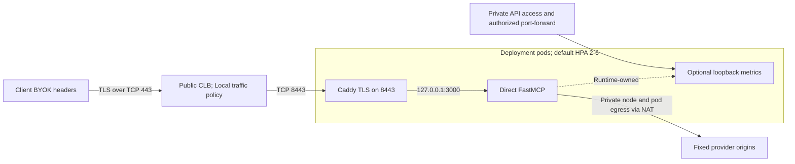

# Deploy on BytePlus with Terraform

The supported cloud source is a **dedicated VKE cluster** in
`deploy/terraform/vke` and the application chart in `deploy/helm/seed-mcp`.
It replaces ECS/Compose with database-free FastMCP/Caddy Deployment pods,
default 2-6 pod HPA, PDB and hostname spread. This source support is not live
HA, capacity or public-launch certification. SQLite remains local stdio only, not this chart; Redis is not required.

The durable contract is [VKE Deployment](../specs/SPEC_VKE_DEPLOYMENT.md);
[HTTP BYOK](../specs/SPEC_HOSTED_BYOK.md) remains authoritative for identity
and submission recovery. Commands below are local validation or explicitly
identified operator read-only checks, not authorization for paid execution.

<span id="verify-before-inviting-users"></span>

## Validation Status

Live VKE provisioning remains **unverified**. CLB source-IP preservation,
HPA/spread, rollout/drain behavior and DNS/TLS
require separately authorized evidence. Real target-client
tool execution and provider acceptance remain unverified for this deployment.

Local mocked Terraform plans, Helm renders and isolated mocked TLS/load
acceptance check source contracts only. A mock benchmark is **not capacity
certification**: it does not measure real provider latency, quotas or regional
network/storage behavior. No universal RPS promise follows from it.

## Requirements

Members connecting to an existing server do not need IAM credentials,
Terraform, Python or a checkout. They need their provider key, a client-generated
isolation secret and a trusted HTTPS endpoint. See
[client setup](setup/shared-server.md).

Operators need:

- A reviewed Seed MCP checkout, Terraform `>=1.17.1,<2.0.0`, locked
  `bytepluscc` 0.0.63, Helm (source validation uses 4.3.2), and a
  Kubernetes-compatible `kubectl`.
- Operator-verified region, zone, maintained Kubernetes >=1.30 and available
  on-demand node type. Regional quotas must cover VKE, nodes, EBS, CLB, NAT
  and EIP. Example values are not inventory or entitlement guarantees.
- Access to the private control plane through approved **private connectivity**
  (such as organizational VPN/private routing or an authorized management host).
  A kubeconfig alone does not provide network reachability. Do not expose the
  API publicly to work around this requirement.
- A reviewed digest-pinned application image compatible with the nodes, a public
  DNS name, a valid matching TLS certificate, and protected existing Kubernetes
  Secrets. No Seed MCP image publication or certificate issuer is assumed.
- Metrics API and node/provider headroom for active/surge/draining pods
  plus maintenance, with a VKE administrator owning addon readiness.

Python/uv are needed for repository checks, not remote client connections.
ArkCLI and bytedcli are not required by this deployment source.

### GitHub Actions Instead of Laptop Access

The manual [Actions delivery workflow](github-actions-deployment.md) runs Helm
on a workflow-restricted private runner after an environment approval. A runner
in the VKE VPC needs neither a laptop VPN nor CEN. CI/image publishing remain
GitHub-hosted. An ordinary GitHub-hosted runner does not automatically gain
private Kubernetes access by receiving credentials.

Runner bootstrap, isolation, Kubernetes credentials and existing Secrets remain
operator prerequisites. This workflow handles application delivery, not initial
Terraform provisioning, IAM federation or addon installation. It makes no public
API fallback and stores no provider-generation keys. Keep runner/prerequisite
readiness flags false until independently verified.

## Set Up Dependencies

Use your organization's approved installation process or the official
[uv installation guide](https://docs.astral.sh/uv/getting-started/installation/),
[Python setup](https://docs.astral.sh/uv/guides/install-python/) and
[Terraform installation guide](https://developer.hashicorp.com/terraform/install).
Review downloaded code before executing it. With dependencies already installed,
these checks use no cloud account:

```bash
terraform version
helm version
kubectl version --client
terraform -chdir=deploy/terraform/vke fmt -check
terraform -chdir=deploy/terraform/vke init -backend=false -lockfile=readonly
terraform -chdir=deploy/terraform/vke validate
terraform -chdir=deploy/terraform/vke test
helm lint deploy/helm/seed-mcp -f deploy/helm/seed-mcp/values.ci.yaml
helm template seed-mcp deploy/helm/seed-mcp -f deploy/helm/seed-mcp/values.ci.yaml
python scripts/generate_identity_secret.py --help
```

Provider initialization may download the locked provider; never bypass checksum
checks. Terraform tests use mocks. `values.ci.yaml` contains synthetic inputs
for rendering, **not deployment approvals** or usable credentials. Do not install
it into a cluster. Default/example values intentionally fail until required
input values and the prerequisite acknowledgement are supplied.

## Prepare Terraform Source

The standard-library helper `scripts/prepare_vke_terraform.py` prepares source
only. It has no live-plan, apply, destroy, credential-fetching or Helm commands,
does not load `.env`, and does not provision a TOS bucket or database.

Validate the reviewed checkout without touching its backend or operator inputs:

```bash
python scripts/prepare_vke_terraform.py validate
# Or select an already installed, reviewed binary:
make vke-validate TERRAFORM=/absolute/path/to/terraform
```

Validation copies an explicit source allowlist and the unchanged provider
lockfile into a temporary directory. It runs version/fmt/init/validate/test
with a private HOME and no inherited provider credentials, `TF_VAR_*`,
CLI flags, CLI configuration, workspaces, tokens or plugin caches. Init uses
`-backend=false -lockfile=readonly`; every test uses mock providers and plan
mode only. Registry/provider downloads still require network access. Passing
these checks does not establish regional availability or deployment readiness.

For staging, create a private operator parent and a new dedicated working
directory, outside the repository:

```bash
mkdir -m 700 "$HOME/.seed-mcp-ops"
python scripts/prepare_vke_terraform.py prepare "$HOME/.seed-mcp-ops/vke-staging"
```

Use an existing parent only if it is same-owner, mode `0700` and not a symlink.
The helper refuses an existing destination and copies only source/lock/tests,
plus an initial mode-`0600` `terraform.tfvars`. It never copies existing state,
plans, provider caches, `.env` or other operator inputs. A failed partial
preparation is not reusable; inspect it privately and select a new path.

The generated inputs select `seed-mcp-staging`, `ap-southeast-1`, two fixed
baseline nodes and `burst_node_max_count=0` (disabled). Required zone,
maintained Kubernetes release and instance type remain
empty; `fresh_state_confirmed` remains false. Verify those values, account/
project, quotas, private network ranges and backend separation before changing
the acknowledgement. The helper does not certify a fresh backend.

### Optional Dedicated Gateway Infrastructure

The prepared inputs also leave `public_gateway_enabled=false` and
`gateway_secondary_zone_id=""`. Enabling requires a verified distinct regional
secondary AZ and adds two /20 gateway subnets plus a new standard APIG with two
`1c2g` nodes, `small_1` CLB and traffic-based public billing. Existing node/pod/
edge ranges and NAT configuration are unchanged. When disabled, a nonempty
secondary AZ is rejected.

This prepares infrastructure only: no upstream, service, route, default domain
or generic MCP endpoint is configured. `public_gateway_id` is nullable.
The chart defaults to public CLB/Caddy. Opt-in `service.mode=apig-staging`
provides a private ClusterIP/ingress-policy backend for synthetic-only tests,
with separate `backendHost`, no CLB subnet and disabled uploads. It refuses
credential headers and does not fix the APIG trust gap. Keep public client
routes disabled; see [private staging](github-actions-deployment.md#private-apig-staging).
`service.mode=apig-production` adds separate private BYOK source support with
`service.productionConfirmed=true` and separate protected production delivery
gates. It preserves host/source restrictions and disabled uploads; it does not
configure APIG verification or open routes. See
[production preparation](github-actions-deployment.md#production-apig-preparation)
and [backend certificate renewal](backend-certificate-renewal.md).
Do not install the public CLB path as a substitute for a selected gateway design.

Monitoring is disabled explicitly. Tracing is left unset: the native APIG API
rejected a partial `TraceSpec` containing only `Enable=false`, while the same
request without that object was accepted. The locked provider also rejects
destination-free disabled logging configuration. Logging and tracing must
both read back disabled through Terraform postconditions; omission does not
establish either cloud default. A postcondition failure may occur
after creation: inspect protected state and the gateway before another attempt;
never blindly repeat creation or attach routes/send BYOK traffic.

Before provisioning for a generic URL, record the private HTTPS trust decision
(verification by default or an explicitly scoped operator exception), host/proxy-trust, stateless/no-retry routing, body/header/streaming/
timeout contracts and full cost/quota review in the
[deployment contract](../specs/SPEC_VKE_DEPLOYMENT.md).
The existing operator instance has a separate
[verified deployment record](hosted-deployment-status.md), not blanket
authorization to provision or reuse its resources.
An operator may explicitly authorize infrastructure creation first and billing
review afterward. This does not waive regional quotas or permit real BYOK
traffic before TLS, disabled logging and routing acceptance.
Two gateway AZs do not make single-zone workers AZ-resilient. Gateway, private
backend, runner and traffic charges are additional; node limits are not a cap.

The 2026-11-21 staging probe found that APIG 4.4.4 one-way TLS (`SIMPLE`)
with SNI accepted an untrusted self-signed K8S backend certificate. Public TLS
was verified, but backend chain trust failed; the synthetic diagnostic route
was disabled afterward. Do not treat SNI or encryption as verification.
The operator subsequently approved
[keeping HTTPS while waiving backend verification](../specs/SPEC_VKE_DEPLOYMENT.md#accepted-backend-verification-exception)
for this exact deployment. That makes the native trust control and its negative
tests deferred hardening rather than launch blockers, without changing the
historical result. Other deployments retain the default verification requirement.
Public HTTPS validation, private encryption and all other launch gates remain.

After separately approving authenticated infrastructure planning and privately
injecting the IAM credentials described below, an operator can run:

```bash
terraform -chdir="$HOME/.seed-mcp-ops/vke-staging" init -input=false -lockfile=readonly
terraform -chdir="$HOME/.seed-mcp-ops/vke-staging" plan -input=false -out=review.tfplan
```

The local backend stays inside that dedicated directory. Protect its state and
saved plan, review the planned resources/costs, and obtain separate approval
before applying. No live plan is run by the helper or by repository CI.
Source updates do not update an existing prepared directory; review a new copy
without replacing or migrating state automatically.

### Failed or Asynchronous Creates

A failed apply or empty Terraform state does not establish cloud absence.
Inspect accepted Cloud Control task IDs, protected state and signed live
inventory before another attempt. Import only a completed resource whose
identity and configuration match the approved deployment; never blindly repeat
an uncertain create or rerun a stale saved plan.

The locked provider's gateway-ID import does not restore top-level write-only
`vpc_id`/`subnet_ids`. Inspect a fresh full plan after import; missing values can
propose replacement even when live `network_spec` matches. Never apply that
replacement as reconciliation. A reviewed operator state correction must
restore only independently verified exact IDs, preserve all other resources,
lineage and locking, and be followed by another full no-change plan. Do not
disable drift detection or use force to bypass state conflicts.

`QuotaLimitExceeded` / `QuotaExceeded.Vpc` means regional VPC headroom must be
established before creating the dedicated network. Check the exact regional
quota and usage as well as any pending adjustment. A quota read can show an
adjustable item already at the normal maximum; do not submit an out-of-range
request or delete/reuse unrelated networks without explicit approval. Exact
operator-approved retirement requires fresh dependency checks, confirmed cloud
absence and separate evidence outside the new Terraform state. After capacity
changes, reconcile live inventory and quota again and produce a fresh plan.
Retain completed dedicated resources after a partial apply; do not rerun the
original saved plan. A new remaining-resource plan must preserve them without
unapproved replacement or deletion.

## Set Up IAM and Credentials

Infrastructure credentials (`BYTEPLUS_ACCESS_KEY`, `BYTEPLUS_SECRET_KEY`,
and matching `BYTEPLUS_SESSION_TOKEN` for STS) belong only in the operator's
approved secure injector. Never put values in HCL, tfvars, CLI arguments,
shell history or logs. ArkCLI sign-in does not automatically configure them.

Review Cloud Control and VKE/node/VPC/NAT/EIP permissions separately from
VKE administrator addon privileges and namespace-level application access.
This is not a validated least-privilege IAM policy. Do not grant blanket admin
access as a shortcut. Protect kubeconfig and private files with mode `0600`
in a private `0700` directory; never print raw kubeconfig or Secret data.
Refreshing STS or changing inputs invalidates a previously reviewed plan.

Official account setup references:

- [Create IAM access keys](https://docs.byteplus.com/en/docs/IAM/creating-an-access-key)
- [IAM roles](https://docs.byteplus.com/en/docs/IAM/about-roles)
- [Temporary STS credentials](https://docs.byteplus.com/en/docs/byteplus-platform/reference-assumerole)
- [GHCR pull authentication](https://docs.github.com/en/packages/working-with-a-github-packages-registry/working-with-the-container-registry)

Terraform stores no HMAC key, TLS Secret or kubeconfig in state or outputs and
does not retrieve them. Helm references existing Secrets only; it does not
create Secret resources or accept secret values. A protected operator workflow
must create them in the intended namespace before installation:

- A distinct identity Secret containing `MCP_IDENTITY_HMAC_KEY` and
  `MCP_IDENTITY_KEY_VERSION`, and a TLS Secret matching `publicHost`.
- Only when enabling temporary uploads, a distinct existing TOS/enrollment
  Secret after completing the [upload prerequisites](temporary-uploads.md#operator-setup).
  Static mode includes restricted AK/SK and optional STS token. Explicit
  `temporaryUpload.credentialsMode=irsa` uses only bucket/region/endpoint/
  enrollment keys in that Secret, with separately approved VKE OIDC and exact
  namespace/ServiceAccount IAM trust. The chart creates a manual app-only token
  projection, not cluster IRSA enablement or IAM roles. See
  [IRSA setup and lifetime limits](temporary-uploads.md#vke-iam-roles-for-service-accounts).
  No database Secret or database CA ConfigMap is required.

Hosted HTTP is database-free: provider-key task authorization, no durable replay or shared budget accounting. Omit legacy operation keys; never automatically resubmit uncertain creates. Local stdio persistence remains available.

The retained standalone `scripts/generate_identity_secret.py` is for private
operator generation, not a customer connection token. Do not invoke generation
in agent-visible output or regenerate an identity for existing state.
[Provider-secret sync is superseded](secret-manager.md); no hosted provider
key bundle or client secret belongs in Terraform, Helm or pod environment.

<span id="guided-deployment-cli"></span>

## Staged VKE Deployment

1. Select a **separate fresh VKE Terraform state** and independently reviewed
   backend/workspace. Do not reuse state owned by another deployment.
   `fresh_state_confirmed=true` acknowledges separation;
   it does not inspect or prove the backend is safe.
2. Review `variables.tf` and `terraform.tfvars.example`. Verify `zone_id`,
   `kubernetes_version`, `node_instance_type`, private network ranges and
   regional quotas. Defaults select `ap-southeast-1`, two fixed on-demand nodes
   and no burst pool. Optional `burst_node_max_count` adds a separate bounded
   private on-demand pool starting at zero, not a change to baseline ownership.
   Hostname spreading needs two schedulable nodes and the default-enabled
   `MatchLabelKeysInPodTopologySpread` feature. The chart counts each
   `pod-template-hash` revision separately during a rollout. Verify final
   worker diversity after rollout and scale-in: topology constraints schedule
   incoming pods but do not rebalance survivors after deletion.
   Same-zone nodes are not AZ resilience. NAT/EIP/SNAT supply egress without public
   node IPs. Infrastructure creation is a separate approved, billable step.
3. Establish authenticated private management access. Inspect the actual VKE
   cluster and its addons before preparing Helm values.
4. Complete the private API, CCM, node/headroom and HPA metrics prerequisites.
   Privately provision distinct identity and TLS Secrets, plus the optional
   TOS/enrollment Secret only when enabling temporary uploads, then review
   actual nonsecret inputs. No database provisioning or migration is required.
5. Obtain separate approval for Helm installation. It creates a public CLB
   and can incur charges. Verify DNS/TLS and all live gates
   before inviting clients. No one-command cloud deployment is provided.

## Addon and Node Gate

The **VKE administrator owns `cloud-controller-manager`,
outside Terraform and Helm**. Inspect existing installations first; retain
healthy compatible versions, and install only absent addons using compatible,
maintained versions through **VKE addon management**. Do not assume automatic
installation, create a duplicate controller, import them into this root, or
silently upgrade/delete them.

After approved cluster creation, an authorized operator with private connectivity
can run these read-only checks against the deliberately selected context:

```bash
kubectl config current-context
kubectl get nodes -o wide
kubectl wait --for=condition=Ready nodes --all --timeout=300s
```

CSI is not an application prerequisite; this chart has no persistent volumes.
Check nodes are Ready with adequate allocatable CPU/memory; check CCM is
Running on its VKE addon card even if its workload is outside the tenant
namespace. Existing addon versions/lifecycle remain administrator-owned. Record versions
and readiness evidence privately. Verify private API access, existing HMAC
Secret keys, matching TLS/hostname, source restrictions, HPA metrics API
and node/provider headroom for active, surge and draining pods without
displaying sensitive data. Optional upload prerequisites remain a separate gate.

Only then set `prerequisitesConfirmed=true`. This is an **acknowledgement,
not programmatic proof** of addon, node, TLS, identity or network readiness.
Failure of a prerequisite blocks deployment even when rendering succeeds.

### Optional Worker Autoscaling

HPA scales application pods, not worker nodes. Terraform `node_count` remains
the fixed baseline (default two). `burst_node_max_count=0` creates no burst
pool; a positive whole value adds a separate private PostPaid/NoSpot pool with
desired/minimum zero and that maximum. Baseline plus burst cannot exceed ten
nodes. Both pools share the same instance type, network/security configuration
and 80 GiB ESSD_PL0 system disk.

For a two-baseline plus zero-to-two-burst design, select `node_count=2` and
`burst_node_max_count=2` only after reviewing the full costs and quotas.
Terraform retains the baseline count and burst bounds/configuration; it ignores
only the burst pool's live `auto_scaling.desired_replicas`, owned by Cluster
Autoscaler. The addon is not installed or configured by these roots.

The VKE administrator must verify a maintained compatible Cluster Autoscaler,
pool discovery, scale-from-zero and automatic scale-in for Pay-as-you-go nodes.
Review cooldown/stabilization and configure its pod-drain timeout above the
application termination grace (660 seconds with defaults). Verify actual
allocatable capacity for addons, active/surge/draining pods, PDB/topology
interactions, pending-pod scale-out and safe burst scale-in to zero before
claiming elasticity. Inspect existing addons before any separately approved
installation or configuration change.

The chart marks only `app-tmp,proxy-tmp` with
`cluster-autoscaler.kubernetes.io/safe-to-evict-local-volumes`. Both bounded
`emptyDir` volumes contain disposable scratch, not durable media or submission
state. This prevents the default local-storage safeguard from pinning an
application-bearing burst node. It does not bypass PDB, scheduling constraints
or graceful termination, and does not disable local-storage protection for
other workloads. Verify application rescheduling and scale-in live.

At low usage the two baseline nodes still cost money. Include cluster management,
node compute/disks, NAT/EIP, private control-plane load balancing, application
CLB/EIP when installed, traffic and private management connectivity in the
estimate. A node ceiling or bandwidth cap is not a monthly spend cap. Single-zone
nodes remain vulnerable to an AZ outage. Application installation and billable
infrastructure creation each require their own approval.

<span id="state-and-activation"></span>

## Chart Inputs and Network

Start from `values.example.yaml`, not the synthetic CI file. Required inputs:
`image` (digest pinned), `publicHost`, `identitySecret.name`, `tlsSecretName`,
`service.subnetId` and
`service.sourceRanges`. Match actual network references;
review `values.schema.json`. No storage-zone pin is accepted.
Do not guess zone availability, Kubernetes versions, image digests or subnet IDs.

Custom BYOE endpoints require operator-verified exact model/family bindings.
A request header cannot make an unknown endpoint usable or establish lineage;
the [authority contract](../specs/SPEC_HOSTED_BYOK.md#byoe-endpoint-authority)
is unchanged. Do not bypass validation, infer endpoint lineage or supply an
arbitrary environment map or provider secrets.

### Model and Runtime Values

The chart passes only explicit allowlisted environment settings. Model IDs and
families are nonsecret configuration visible in anonymous discovery, not
evidence of customer entitlement.

| Helm value | Chart default | Application setting / meaning |
| --- | --- | --- |
| `models.seedream.defaultModel` | `dola-seedream-5-5-261028` | `SEEDREAM_DEFAULT_MODEL` |
| `models.seedance.defaultModel` | `dreamina-seedance-2-5-260628` | `SEEDANCE_DEFAULT_MODEL` |
| `models.seedream.bindings` | `[]` | JSON `SEEDREAM_MODEL_BINDINGS`; entries `{model_id, family}` |
| `models.seedance.bindings` | `[]` | JSON `SEEDANCE_MODEL_BINDINGS`; entries `{model_id, family}` |
| `app.dailyBudgetUsd` | `0` | HTTP requires zero; no budget ledger. Use provider spend controls. |
| `app.providerMaxConcurrency` | `5` | `PROVIDER_MAX_CONCURRENCY`; per-pod slots per provider bucket |
| `app.principalMaxConcurrency` | `3` | `PRINCIPAL_MAX_CONCURRENCY`; per-pod slots per derived HTTP owner |
| `app.rateLimitBurst` | `0` | `RATE_LIMIT_BURST`; zero inherits RPM, default 60 |

Seedream families are `seedream_5_5`, `pro`, `lite`, `4x`; Seedance families
are `standard`, `fast`, `mini`, `seedance_2_5`, `seedance_2_5_flash`.
Each product accepts at most 100 bindings with unique IDs. A nonempty list
must include its selected `defaultModel`. **Any alternate default requires
explicit bindings**, including another built-in model. Empty lists are allowed
only with the chart's shipped defaults; the runtime then adds Seedance Flash
alongside regular 2.5. Explicit lists replace, not append to, those bindings:
include Flash yourself when it should remain available.

An operator must verify each custom endpoint's model/version outside this
server before adding its exact ID/family. Explicit tool `model` still wins
over a request endpoint header; used header defaults must match this registry
exactly. No AK/SK custody, automatic metadata lookup or arbitrary BYOE
self-service is added.

The chart requires `DAILY_BUDGET_USD=0`: no hosted budget ledger exists. Concurrency values remain bounded to1-256 and burst to0-10000, per pod. Use provider-console spend controls and measured capacity.

### Network and Scaling

The diagram below is the current chart path. Optional APIG source does not
change it or make a generic gateway endpoint ready.



The chart exposes **TCP 443** to Caddy **8443** with
`externalTrafficPolicy: Local`; TLS terminates in Caddy, not the CLB. The
backend binds **127.0.0.1:3000** and trusts only **127.0.0.1/32** through
`RATE_LIMIT_TRUSTED_PROXY_CIDRS`. Caddy overwrites `X-Forwarded-For` with the
socket source, removes `Forwarded` and replaces forwarded host/proto.
Uvicorn proxy-header rewriting is disabled. Real source-IP behavior still
needs VKE acceptance; never widen trusted CIDRs to hide failed preservation.
`service.sourceRanges` requests a Kubernetes source restriction; it is not
proof of CLB ACL enforcement. Verify both source preservation and restriction
from allowed/disallowed networks during authorized live acceptance.

Only `/mcp` and `/health` pass the proxy. `/ready`, `/metrics` and unknown paths
return 404 publicly. Application readiness is a loopback exec probe, not a
provider probe. Admin API and proxy access logs are disabled; responses stream
without buffering. Both layers default to a 2 MiB request body limit.

The pod runs nonroot UID/GID 1001, read-only root filesystems, dropped
capabilities and RuntimeDefault seccomp, with automatic service-account token
mounting disabled. Only explicit IRSA mode projects an app-only OIDC token;
Caddy never mounts it. Verify nonroot readability, token rotation, absence of
webhook double-injection and live BytePlus STS acceptance separately.
CPU/memory and temporary volumes are bounded. `app.metricsEnabled=false`
keeps the optional loopback listener off; enabling it selects port 9000,
never a public Service. See [private operations](observability.md#metrics-endpoint).

See the database-free HTTP contract above; local stdio persistence is unchanged.

The HTTP process and Caddy use `max(tool, provider) + 30` seconds for graceful
shutdown; the chart uses `max(tool, provider) + 60` for pod termination
(630/660 seconds with default 600-second deadlines). Use client timeout 660
seconds by default. Cooperative SDK/SQLite draining can exceed nominal
deadlines; forced termination is not provider cancellation.

## Restart and Recovery


There is no hosted state to restore or replay. Restarting a pod does not
cancel provider work; clients must retain IDs and poll with authorized provider
credentials. A lost create response may hide billed work and must be reconciled,
not resubmitted automatically.

This is a fresh stateless deployment. Historical database compatibility and
stateful-release migration tooling are not part of this repository.

## Local TLS and Load Acceptance


Run `uv run python scripts/hosted_acceptance.py --caddy-bin PATH`. This uses isolated loopback TLS and mocked providers, not a database or live credentials. It checks eight tools, BYOK isolation, repeated-create behavior, polling after restart, proxy controls, bounded load and absence of local state. Live VKE/client/provider and capacity validation remain separately authorized gates.

`uv run python scripts/hosted_drain_acceptance.py --caddy-bin PATH --profile short`
checks accepted mock requests through process termination. Explicit
`--profile production` runs six parallel 590-second calls with production
deadline/grace budgets. The private production listener negotiates HTTP/1.1,
including with H2-capable clients, after a reproduced HTTPX H2 GOAWAY failure.
This does not certify APIG's independent public protocol behavior or Kubernetes
rollout/node drain. See [local drain checks](github-actions-deployment.md#local-drain-checks).

## Decommissioning

**Source deletion is not cloud decommissioning.** VKE retirement requires
separate approval. Reconcile active provider work, protect Terraform state and
operator identity, then review application, cluster and infrastructure
disposition. Addons remain VKE-admin owned. Node disks, CLB, NAT and EIP
resources can continue to cost money.
Verify actual cloud absence and billing after approved retirement; empty
Terraform state or a Helm uninstall alone is not proof.

## Official References

The [durable spec sources](../specs/SPEC_VKE_DEPLOYMENT.md#sources) retain the
official VKE, CLB and EBS URLs recorded during plan research on 2026-11-17.
Use those manuals to verify regional prerequisites; source rendering cannot
replace the operator's live evidence.
