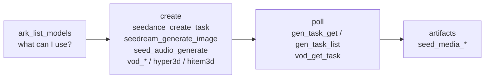

# Migrating to 0.2.0

> **Historical migration guide:** this page records the 0.1.x to 0.2.0
> transition and later consolidation notes, including the JWT scopes and
> broader capability catalog used at that time. The historical tables below
> are not current support or authentication advice.

## Breaking Capability Migration

**The current narrowing is a breaking capability removal, not a compatible
upgrade.** With all services configured, the catalog now contains **12 tools**.
VOD / AI MediaKit, 3D generation, dedicated ASR (`speech_to_text`), asset
administration (`ark_asset_*`), asset resolution/preflight and operator AK/SK
live-pricing discovery have been removed. MCP jobs/native task execution and
both understanding tools are also removed. Historical replacements below do
not restore these capabilities.

**Old saved 3D artifacts are no longer served by the narrowed media schema.**
Export needed 3D outputs using the old server **before upgrading**. This
applies to saved artifacts as well as provider tasks whose outputs still need
retrieval. Keeping the bytes or state database does not make old 3D metadata
readable through the new server. No compatibility layer or automatic migration
is provided.

1. Stop new submissions and reconcile active work using the old server.
   Retrieve and export needed outputs, especially 3D, before replacing it or
   allowing provider URLs or artifact retention to expire.
2. Back up artifact bytes/metadata, SQLite, Redis and the existing task-snapshot
   encryption key. Retain the old installation for controlled recovery; do not
   run old and new workers concurrently against the same state.
3. Remove retired tool calls and settings from clients, prompts, skills and
   dashboards. `gen_task_*` now handles Seedance only. No transcription or
   understanding replacement is offered by this server.
4. Rediscover configured tools and models after upgrading. Existing authorized
   Seedance `asset://` references still pass natively with the ModelArk Bearer
   key, but administration, lookup, resolution and status preflight are absent.
   Ordinary TOS/S3 uploads do not register provider assets.

Current HTTP is a forward-only BYOK foundation with 8 tools, anonymous static discovery and foreground provider calls.
Local stdio retains the conditional 13-tool catalog (including Seed TTS) and storage, using direct
calls without MCP workers. Removing jobs does not delete current provider
ownership or journal state; preserve it. No old-auth compatibility or ownership
migration exists. See [direct execution](../specs/SPEC_DIRECT_EXECUTION.md),
[the current HTTP contract](../specs/SPEC_HOSTED_BYOK.md) and
[self-hosting](self-hosting.md), not the historical scope tables below.

## Historical Consolidation

**0.2.0 consolidated the tool surface.** One tool per product capability
replaced the per-model, per-variation and per-operation tools of 0.1.x. The
broader catalog documented at that time contained **38 tools** when every
service was enabled, not the current 12. **There was no
compatibility layer**: clients, prompts, skills and dashboards that name a
removed tool must switch to its replacement.

## What to do first

1. **Call `ark_list_models`** to see the bound models, their limits, and the
   tool that serves each one. Model IDs passed to create tools must match a
   bound ID exactly; unknown IDs fail with a did-you-mean suggestion.
2. **Rename tool calls** using the table below.
3. **Grant the new scopes** `gen:read` and `gen:delete` (JWT mode only).
4. **Update dashboards** keyed on the `tool` label of
   `ark_mcp_tool_requests_total` / `ark_mcp_tool_duration_seconds`.

## Old to new tools

### Seedance (video)

| 0.1.x tool | 0.2.0 replacement |
|---|---|
| `seedance_create_task` (2.0) | `seedance_create_task` with `model` set to the 2.0 ID |
| `seedance_2_5_create_task` | `seedance_create_task` (2.5 is the default model) |
| `seedance_2_5_premium_create_task` | `seedance_create_task` with `model="dreamina-seedance-2-5-260628"` and `resolution="4k"` |
| `seedance_create_task_variations`, `seedance_2_5_create_task_variations`, `seedance_2_5_premium_create_task_variations` | `seedance_create_task` with `variations` (and optional `variation_prompts`) |
| `seedance_get_task`, `seedance_get_tasks` | `gen_task_get` (`task_ids`, 1-50) |
| `seedance_list_tasks` | `gen_task_list` (`page_size`, `cursor`, `status`, `model`) |
| `seedance_cancel_or_delete_task` | `gen_task_cancel_or_delete` |

- **New:** `dry_run=true` returns the provider request(s) with media URLs
  redacted and an estimated cost, without submitting.
- **One output shape:** `tasks[]` (one entry per submission), `submitted`,
  `failed`, `recommended_poll_after_ms`.
- **Default model changed:** `SEEDANCE_DEFAULT_MODEL` now defaults to
  `dreamina-seedance-2-5-260628`. Set it explicitly to keep 2.0 as the default.
- **4K is unified:** regular Seedance 2.5 accepts `resolution="4k"`.
  The separate Premium family, model settings, and service entry are removed,
  with no compatibility aliases. Remove the old Premium settings and update
  bindings explicitly; see [configuration](configuration.md#seedance-25-4k).
- **Flash shares the tool:** `dreamina-seedance-2-5-flash-261115` uses
  `seedance_create_task` with 480p/720p and no Draft mode. Empty bindings now
  include Flash; non-empty lists are unchanged and must add it explicitly.
  Regular 2.5 remains the default. See
  [Flash configuration](configuration.md#seedance-25-flash).

### 3D

| 0.1.x tool | 0.2.0 replacement |
|---|---|
| `hyper3d_get_task`, `hitem3d_get_task` | `gen_task_get` |
| `hyper3d_list_tasks`, `hitem3d_list_tasks` | `gen_task_list` |
| `hyper3d_cancel_or_delete_task`, `hitem3d_cancel_or_delete_task` | `gen_task_cancel_or_delete` |

The create tools `hyper3d_create_task` and `hitem3d_create_task` were
unchanged by that consolidation. Both are removed from the current server.

### Seedream (images)

| 0.1.x tool | 0.2.0 replacement |
|---|---|
| `seedream_edit_image` | `seedream_generate_image` with `images`, plus optional `point` / `bbox` |
| `seedream_generate_image_variations` | `seedream_generate_image` with `variations`; `base_seed` is now `seed` |

- **Current image support:** Seedream 5.5 only. `background="transparent"` generates PNGs from text or reference images without existing alpha. Older family bindings must be replaced with verified 5.5 bindings; see the [upgrade note](configuration.md#seedream-default-model-upgrade-note).
- **New:** `dry_run=true`.
- **`max_images` accepts only 1 or omission; use `variations` for multiple images.**
- **`output_path` replaces `output_dir`;** it must be a directory ending in
  `/` when several images are produced.

### Seed Audio

| 0.1.x tool | 0.2.0 replacement |
|---|---|
| `seed_audio_generate_variations` | `seed_audio_generate` with `variations` (1-5) and optional `variation_prompts` |

With `variations > 1`, `artifact`, `duration_seconds` and
`billing_duration_seconds` are null and `summary` carries the per-variation
results.

### VOD AI MediaKit

| 0.1.x tool | 0.2.0 replacement |
|---|---|
| `vod_get_enhancement_task` | `vod_get_task` with `operation="enhance"` |
| `vod_get_transcode_task` | `vod_get_task` with `operation="transcode"` |
| `vod_get_audio_separation` | `vod_get_task` with `operation="separate_audio"` |
| `vod_get_subtitle_addition_task` | `vod_get_task` with `operation="add_subtitles"` |
| `vod_get_subtitle_removal_task` | `vod_get_task` with `operation="remove_subtitles"` |

At that time, every `vod_*` create tool echoed the `operation` value to pass
back. All VOD tools are removed from the current server.

### Object storage

| 0.1.x tool | 0.2.0 replacement |
|---|---|
| `media_upload` (one file), `media_upload_batch` | `media_upload` with `items` (1-50) |
| `media_presign` (one key), `media_presign_batch` | `media_presign` with `object_keys` (1-100) |

**Per-item failures no longer raise.** They are reported in `items[].error`;
check `failed` in every response.

### Private asset library

These are historical replacements; no asset-administration tools remain.

| 0.1.x tool | 0.2.0 replacement |
|---|---|
| `ark_asset_group_create` | `ark_asset_group_ensure` (reuses the group with the exact subject name, or creates it) |
| `ark_asset_group_get` | `ark_asset_group_list` with `group_ids` |
| `ark_asset_get` | `ark_asset_list` with `asset_ids` (IDs or `asset://` references) |
| `ark_asset_group_update` | `ark_asset_update` with `group_id` |
| `ark_asset_group_delete` | `ark_asset_delete` with `group_id` |

- **`ark_asset_delete` refuses a non-empty group unless `cascade=true`**,
  because deleting a group also deletes its assets.
- `ark_asset_update` and `ark_asset_delete` take exactly one of `asset_id`
  or `group_id`.
- `ark_asset_create` reports `group_created_empty` when it created a subject
  group but every source failed.

## Auth scopes (JWT mode)

This section is historical: the current server rejects `jwt` mode.

| Removed | Replacement |
|---|---|
| `seedance:read`, `hyper3d:read`, `hitem3d:read` | `gen:read` |
| `seedance:delete`, `hyper3d:delete`, `hitem3d:delete` | `gen:delete` |

Under the historical JWT mode, principals needed `gen:read` and `gen:delete`
to poll or cancel their own tasks. Current HTTP uses credential-tenant and
client-owner scoping. See [security.md](security.md) for today's contract.

## Observability

The `tool` label on `ark_mcp_tool_requests_total` and
`ark_mcp_tool_duration_seconds` follows the new names. **The merged
`seedance_create_task` no longer separates 2.0 and 2.5 by label**;
use the `model` field in logs to split them.
