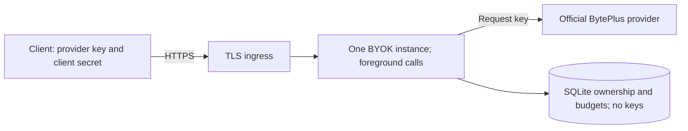

# Self-Hosting the BYOK Foundation

Run one trusted HTTP instance for clients that bring their own provider keys.
This is a foundation for controlled evaluation, not a public launch or
multi-replica deployment claim. No public endpoint or image publication is
assumed. Build a reviewed Seed MCP revision; upstream Ark MCP images do not
establish this contract.

## Choosing Hosted or Local

| | Local stdio | HTTP BYOK |
| --- | --- | --- |
| Provider credentials | Private local environment file | Client request headers; never persisted by the server |
| Identity | Trusted local principal | Credential tenant plus client-generated secret owner |
| Tools | 21 conditional catalog entries | 9, or 12 with OmniHuman |
| Long operations | Ordinary jobs or native tasks | Foreground direct calls |
| Storage/artifacts | Optional local persistence and resources | Unavailable; retrieve provider URLs on the client |
| State | Single-instance SQLite | Fresh single-instance SQLite; no compatibility migration |

## Operator Configuration

The operator supplies `MCP_AUTH_MODE=byok` (default),
`MCP_IDENTITY_HMAC_KEY` (32 random bytes as 64 lowercase hex) and a positive
`MCP_IDENTITY_KEY_VERSION` (default `1`). Generate the HMAC key privately with
an OS cryptographic RNG or secret manager, never in agent-visible output.
Preserve it across restarts. It is not a provider key, login credential or
customer connection key and must not be distributed to clients.

Keep operator configuration outside Git in an owner-only file. Set
`MCP_TRANSPORT=http`, the bind address, and explicit Host/Origin allowlists.
Load configuration through `ARK_MCP_ENV_FILE` or a protected runtime injector.
Do not configure hosted provider keys, storage credentials or a Redis task
backend. HTTP ignores startup generation keys and has no fallback to them.
Hosted [provider-secret sync is superseded](secret-manager.md).

| Setting | Application default |
| --- | --- |
| `RATE_LIMIT_RPM` | `60`, positive on HTTP |
| `RATE_LIMIT_BURST` | `0`, inherits RPM |
| `MCP_HTTP_MAX_BODY_BYTES` | `2097152` (2 MiB) |
| `MCP_HTTP_MAX_IN_FLIGHT` | `64` |
| `STATE_MAX_RECORDS` | `100000` |
| `STATE_PRUNE_MAX_AGE_DAYS` | `30`; at least 14 with regular Seedance 2.5 |
| `PROVIDER_MAX_CONCURRENCY` | `5` |
| `PRINCIPAL_MAX_CONCURRENCY` | `3`, per derived owner |
| `DAILY_BUDGET_USD` | `0`, records estimates without blocking |

A positive daily budget is useful but is an estimate-based owner limit, not a
provider-account spending guarantee. A client can create another isolation
secret; use provider-console spending controls as well.

## Network and State

Expose only trusted HTTPS ingress. Keep application and database access
private, preserve the Host header, and configure timeouts for foreground
generation/understanding. Do not trust forwarded IP headers unless your proxy
overwrites them. HTTP provider origins are fixed official endpoints.

Deploy with [the container guide](deployment.md) or review the
[BytePlus infrastructure guide](byteplus-terraform.md#requirements). Check the
selected deployment templates against this contract before activation.
No provisioning or live deployment is part of this documentation update.

Use a new state directory for this forward-only schema. Do not point it at
an older database or delete existing state to work around a refusal.
Back up SQLite and the matching HMAC configuration securely. Restoring state
with another HMAC key/version changes the scope and does not restore access.

## Client Access

Follow [Connect to a Shared Server](setup/shared-server.md). Only the provider
being called needs a key. Each client generates a private
`X-MCP-Client-Secret`, 64 lowercase hex characters from 32 random bytes,
and keeps it stable for subsequent polls. There is no OAuth, signup or
server-issued key. `Authorization` headers are rejected.

An explicit tool `model` overrides `X-ModelArk-Seedance-Endpoint` or
`X-ModelArk-Seedream-Endpoint`; a used header default must be an exact registry
binding. Arbitrary opaque endpoint lineage is never inferred.

## Rotation and Recovery

Historical links land here for the current forward-only contract. They do not
imply an old-auth migration procedure or compatibility bridge.

Changing a provider key changes that provider's credential tenant. Changing
the client secret changes the owner; changing HMAC key/version changes the
server's derived identity namespace. No scope migration or recovery bridge
exists. Retain accepted task IDs and original authorized scope until retrieval
finishes. Revoke exposed keys through the provider, not an MCP signup portal.

Two clients sharing a provider key but using different client secrets are
separate MCP owners. They can still access the provider directly using that
shared key; separate provider keys/projects give stronger isolation.

Drain active foreground calls during maintenance. A provider submission may
have succeeded when the response is lost. Do not recreate it automatically.
Durable pre-dispatch records, idempotency and crash recovery remain next-phase
work; no exactly-once inference guarantee is made.

## Validation Status

Verify anonymous `ark_list_models`, exact 9/12 HTTP tool inventory, no resources,
rejected jobs/native tasks, selected-key enforcement, owner isolation, limits,
and minimal `/health`/`/ready`. HTTP `/metrics` is unavailable and readiness
never probes providers. Dry runs do not validate provider authentication.
Named client header handling, TLS, load/abuse behavior, provider acceptance and
restore drills need separate approved validation before inviting users.
