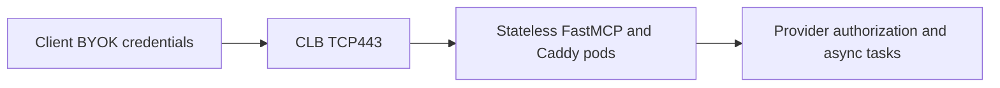

# Self-Hosting the BYOK Foundation

Run trusted HTTP for clients that bring their own provider keys.
This is source support, not public-launch, live failover or capacity certification.
No public endpoint or image publication is
assumed. Build a reviewed Seed MCP revision; upstream Ark MCP images do not
establish this contract.

The cloud source is dedicated VKE, replacing ECS/Compose, with database-free
Deployment/Caddy pods, default 2-6 pod HPA, PDB and hostname spread on maintained
Kubernetes >=1.30. Redis is not required. Start with the
[staged operator runbook](byteplus-terraform.md), not a cloud apply as a side
effect of client setup.

## Choosing Hosted or Local

| | Local stdio | HTTP BYOK |
| --- | --- | --- |
| Provider credentials | Private local environment file | Client request headers; never persisted by the server |
| Identity | Trusted local principal | Provider-key authorization; client secret scopes admission only |
| Tools | 12 conditional catalog entries, four always registered | 7; temporary preparation adds one |
| Long operations | Direct calls | Direct calls |
| Storage/artifacts | Optional local persistence and resources | No local persistence/resources; optional temporary TOS preparation; client retrieves provider URLs |

## Operator Configuration

The operator supplies `MCP_AUTH_MODE=byok` (default),
`MCP_IDENTITY_HMAC_KEY` (32 random bytes as 64 lowercase hex) and a positive
`MCP_IDENTITY_KEY_VERSION` (default `1`). Generate the HMAC key privately with
an OS cryptographic RNG or secret manager, never in agent-visible output.
Preserve it across restarts. It is not a provider key, login credential or
customer connection key and must not be distributed to clients.

Keep operator configuration outside Git in an owner-only file. Set
`MCP_TRANSPORT=http`, the bind address, and explicit Host/Origin allowlists.
Load configuration through `ARK_MCP_ENV_FILE` or a protected runtime injector.
Do not configure hosted generation-provider keys or a Redis task backend.
Operator TOS credentials are required only for opt-in temporary upload preparation.
These may be configured static AK/SK or explicit VKE IRSA with app-only OIDC
projection and automatic in-memory refresh. Cluster/IAM setup and live
acceptance remain separate operator gates. STS can shorten reference URLs;
refresh does not renew them. See [IRSA setup](temporary-uploads.md#vke-iam-roles-for-service-accounts).
HTTP ignores startup generation keys and has no fallback to them.
Hosted [provider-secret sync is superseded](secret-manager.md).

For VKE, Helm references distinct existing identity and TLS Secrets by name/key
only, plus a separate TOS/enrollment Secret when temporary uploads are enabled.
No database Secret or database CA ConfigMap is required;
Terraform does not fetch kubeconfig or store HMAC/TLS values. The retained
`scripts/generate_identity_secret.py` utility supports private operator
generation, not agent-visible secret output or identity resets.

| Setting | Application default |
| --- | --- |
| `RATE_LIMIT_RPM` | `60`, positive on HTTP |
| `RATE_LIMIT_BURST` | `0`, inherits RPM |
| `MCP_HTTP_MAX_BODY_BYTES` | `2097152` (2 MiB) |
| `MCP_HTTP_MAX_IN_FLIGHT` | `64` |
| `PROVIDER_MAX_CONCURRENCY` | `5` |
| `PRINCIPAL_MAX_CONCURRENCY` | `3`, per derived owner |
| `MCP_ADMISSION_TIMEOUT_SECONDS` | `2.0`, finite positive, max 30; owner-first then provider wait |
| `MCP_TOOL_TIMEOUT_SECONDS` | `600.0`, finite positive, max 3600; cooperative whole-tool deadline |
| `MCP_METRICS_PORT` | `0`, disabled; optional HTTP listener only on 127.0.0.1, ports 1024-65535 |
| `RATE_LIMIT_TRUSTED_PROXY_CIDRS` | empty; VKE explicitly trusts only `127.0.0.1/32` |
| `DAILY_BUDGET_USD` | `0`, required on HTTP; no hosted budget ledger |

Positive daily budgets are local stdio only. HTTP has no budget ledger and
rejects nonzero values; use provider-console spending controls.

The table describes standalone application defaults. VKE Helm sets
`app.dailyBudgetUsd=0`, while provider/owner concurrency remains 5/3 and
burst 0 inherits RPM. `models.seedream` and `models.seedance` provide explicit
`defaultModel` and verified `{model_id, family}` binding lists; nonempty lists
must include the default, and alternate defaults require bindings. No
arbitrary env or credential map is accepted. See
[chart values](byteplus-terraform.md#model-and-runtime-values); endpoint
header authority and exact-match precedence remain unchanged.

## Network and State

Hosted HTTP is database-free: provider-key task authorization, no durable replay or shared budget accounting. Omit legacy operation keys; never automatically resubmit uncertain creates. Local stdio persistence remains available.

Task get/list/cancel and Draft lookup are authorized by the supplied provider
key. `X-MCP-Client-Secret` separates per-pod admission scopes, not task access.
Clients sharing a provider key can access whatever that key authorizes.
Use separate provider credentials when independent authorization is required.

Omit `idempotency_key`; the retained legacy field is rejected when supplied.
An identical create is a new operation and may bill again. Save task/request IDs,
poll existing tasks, and reconcile lost or uncertain create responses through
the provider. Never automatically retry an uncertain mutation.

Rate limits and in-flight/provider/principal concurrency are in-memory per pod;
they multiply with replicas and reset at restart. `DAILY_BUDGET_USD` must be `0`
on HTTP; use provider-side spend controls. Readiness is lifespan-only and makes
no storage or provider probes. No database, migration, distributed lock, shared
volume or sticky session is needed for the hosted deployment.

The chart renders a stateless `Deployment`, HPA (default 2-6 pods, CPU 70%),
`PodDisruptionBudget` with `minAvailable: 1` and hostname topology spread with
`minDomains: 2`. Kubernetes must be >=1.30 and a maintained regional release.
Same-zone nodes are not zone-failure resilience.

Every pod runs FastMCP on `127.0.0.1:3000` and Caddy TLS on 8443. CLB TCP 443 uses
Local traffic policy; Caddy overwrites forwarding headers and Uvicorn does not
rewrite them. Only `/mcp` and `/health` are public. `/ready` is an internal exec
probe. Private metrics remain opt-in on loopback.

Helm references existing identity and TLS Secrets, with an optional distinct
TOS/enrollment Secret for upload preparation. `STATE_BACKEND=none` and
`DAILY_BUDGET_USD=0`; database inputs are rejected. No PVC, StorageClass, database
CA, PostgreSQL driver or shared state service is required. Bounded scratch uses
emptyDir. Model bindings remain exact and operator-verified.

Verify private API access, CCM, two Ready nodes and surge/draining headroom,
DNS/TLS, source restrictions and HPA metrics API before `prerequisitesConfirmed`.
CSI is not an application prerequisite. Addon readiness and lifecycle remain
administrator-owned outside Terraform/Helm.

Shutdown allows max(tool, provider seconds)+30; pod grace uses+60. CPU HPA is a
starting policy, not a capacity guarantee. Measure live rollout, CLB source-IP,
latency, provider quotas and cost before launch. No paid/live acceptance is
implied by source checks.

## Client Access

Follow [Connect to a Shared Server](setup/shared-server.md). Only the provider
being called needs a key. Each client generates a private
`X-MCP-Client-Secret`, 64 lowercase hex characters from 32 random bytes,
and keeps it stable for subsequent polls. There is no OAuth, signup or
server-issued key. `Authorization` headers are rejected.

An explicit tool `model` overrides `X-ModelArk-Seedance-Endpoint` or
`X-ModelArk-Seedream-Endpoint`; a used header default must be an exact registry
binding. Arbitrary opaque endpoint lineage is never inferred.

## Rotation and Recovery

There is no hosted state to restore or replay. Restarting a pod does not
cancel provider work; clients must retain IDs and poll with authorized provider
credentials. A lost create response may hide billed work and must be reconciled,
not resubmitted automatically.

This is a fresh stateless deployment. Historical database compatibility and
stateful-release migration tooling are not part of this repository.

## Validation Status

Verify anonymous `ark_list_models`, exact 7 baseline (8 with temporary preparation) HTTP tool inventory, no resources,
rejected jobs/native tasks, selected-key enforcement, owner isolation, limits,
and minimal backend `/health`/`/ready`. Caddy exposes only `/mcp` and `/health`;
`/ready` and `/metrics` are private. Optional metrics use authorized pod
port-forward, never a public Service. Readiness never probes providers.
Dry runs do not validate provider authentication. Live VKE apply, source-IP,
rollout and real-client/provider acceptance remain
unverified. Isolated mocked TLS/load acceptance is not capacity certification.
