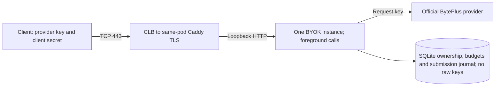

# Self-Hosting the BYOK Foundation

Run one trusted HTTP instance for clients that bring their own provider keys.
This is a foundation for controlled evaluation, not a public launch or
multi-replica deployment claim. No public endpoint or image publication is
assumed. Build a reviewed Seed MCP revision; upstream Ark MCP images do not
establish this contract.

The cloud source is dedicated VKE, replacing ECS/Compose, with one StatefulSet
pod, a Caddy sidecar and retained ext4 ReadWriteOnce EBS. No application HPA,
PostgreSQL or Redis is needed. Start with the
[staged operator runbook](byteplus-terraform.md), not a cloud apply as a side
effect of client setup.

## Choosing Hosted or Local

| | Local stdio | HTTP BYOK |
| --- | --- | --- |
| Provider credentials | Private local environment file | Client request headers; never persisted by the server |
| Identity | Trusted local principal | Credential tenant plus client-generated secret owner |
| Tools | 15 conditional catalog entries, four always registered | 7, or 10 with OmniHuman |
| Long operations | Direct calls | Direct calls |
| Storage/artifacts | Optional local persistence and resources | Unavailable; retrieve provider URLs on the client |
| State | Single-instance SQLite | Fresh single-instance SQLite; no compatibility migration |

## Operator Configuration

The operator supplies `MCP_AUTH_MODE=byok` (default),
`MCP_IDENTITY_HMAC_KEY` (32 random bytes as 64 lowercase hex) and a positive
`MCP_IDENTITY_KEY_VERSION` (default `1`). Generate the HMAC key privately with
an OS cryptographic RNG or secret manager, never in agent-visible output.
Preserve it across restarts. It is not a provider key, login credential or
customer connection key and must not be distributed to clients.

Keep operator configuration outside Git in an owner-only file. Set
`MCP_TRANSPORT=http`, the bind address, and explicit Host/Origin allowlists.
Load configuration through `ARK_MCP_ENV_FILE` or a protected runtime injector.
Do not configure hosted provider keys, storage credentials or a Redis task
backend. HTTP ignores startup generation keys and has no fallback to them.
Hosted [provider-secret sync is superseded](secret-manager.md).

For VKE, Helm references existing identity and TLS Secrets by name/key only;
Terraform does not fetch kubeconfig or store HMAC/TLS values. The retained
`scripts/generate_identity_secret.py` utility supports private operator
generation, not agent-visible secret output or identity resets.

| Setting | Application default |
| --- | --- |
| `RATE_LIMIT_RPM` | `60`, positive on HTTP |
| `RATE_LIMIT_BURST` | `0`, inherits RPM |
| `MCP_HTTP_MAX_BODY_BYTES` | `2097152` (2 MiB) |
| `MCP_HTTP_MAX_IN_FLIGHT` | `64` |
| `STATE_MAX_RECORDS` | `100000` |
| `STATE_PRUNE_MAX_AGE_DAYS` | `30`; at least 14 with regular Seedance 2.5 |
| `PROVIDER_MAX_CONCURRENCY` | `5` |
| `PRINCIPAL_MAX_CONCURRENCY` | `3`, per derived owner |
| `MCP_ADMISSION_TIMEOUT_SECONDS` | `2.0`, finite positive, max 30; owner-first then provider wait |
| `MCP_TOOL_TIMEOUT_SECONDS` | `600.0`, finite positive, max 3600; cooperative whole-tool deadline |
| `MCP_METRICS_PORT` | `0`, disabled; optional HTTP listener only on 127.0.0.1, ports 1024-65535 |
| `RATE_LIMIT_TRUSTED_PROXY_CIDRS` | empty; VKE explicitly trusts only `127.0.0.1/32` |
| `DAILY_BUDGET_USD` | `0`, records estimates without blocking |

A positive daily budget is useful but is an estimate-based owner limit, not a
provider-account spending guarantee. A client can create another isolation
secret; use provider-console spending controls as well.

The table describes standalone application defaults. VKE Helm sets
`app.dailyBudgetUsd=25`, while provider/owner concurrency remains 5/3 and
burst 0 inherits RPM. `models.seedream` and `models.seedance` provide explicit
`defaultModel` and verified `{model_id, family}` binding lists; nonempty lists
must include the default, and alternate defaults require bindings. No
arbitrary env or credential map is accepted. See
[chart values](byteplus-terraform.md#model-and-runtime-values); endpoint
header authority and exact-match precedence remain unchanged.

## Network and State

Expose only trusted HTTPS ingress. VKE's CLB sends TCP 443 to Caddy 8443,
with `externalTrafficPolicy: Local`; the app binds `127.0.0.1:3000` in the
same pod. Caddy overwrites forwarded headers; the application trusts only
`127.0.0.1/32`. The removed boolean proxy setting has no compatibility alias.
Uvicorn proxy rewriting is disabled. HTTP provider origins remain fixed.

The VKE private control plane requires operator private connectivity.
Both `csi-ebs` and `cloud-controller-manager` are VKE-admin owned outside
Terraform and Helm. Inspect existing installations, install absent compatible
maintained versions through VKE, and confirm CSI ready, nodes Ready and CCM
Running before `prerequisitesConfirmed=true`. The acknowledgement is not
programmatic proof; see [the full gate](byteplus-terraform.md#addon-and-node-gate).

Use client timeout 660 seconds for the default tool deadline. SDK/SQLite
draining can exceed it, so align ingress and shutdown allowances with actual
cleanup needs. HTTP/Caddy shutdown uses max(tool, provider seconds) plus 30;
chart pod grace uses the maximum plus 60, default 630/660 seconds.
Timeout is not provider cancellation; retain safe accepted
IDs and never blindly resubmit. See [Direct Execution](../specs/SPEC_DIRECT_EXECUTION.md).

Build with [the container guide](deployment.md) and follow the
[BytePlus infrastructure guide](byteplus-terraform.md#requirements). Check the
selected deployment templates against this contract before activation.
No provisioning or live deployment is part of this documentation update.

Use a new state directory for this forward-only schema. Do not point it at
an older database or delete existing state to work around a refusal.
Back up SQLite and the matching HMAC configuration securely. Restoring state
with another HMAC key/version changes the scope and does not restore access.
The HTTP submission journal never auto-prunes, including under
`STATE_PRUNE_MAX_AGE_DAYS`. `STATE_MAX_RECORDS` caps claims: new keys fail at
capacity while existing keys and owned task reads remain available. Do not
delete claims or reset state to free space; that can permit duplicate work.
Plan capacity and recovery procedures before wider use.

HTTP holds an exclusive `runtime.sqlite3.lock` before stores/recovery until
close. Do not delete a live lock, run overlapping writers or use network
filesystems. Source deletion is not cloud decommissioning: retain reviewed
old checkouts, private workspaces, Terraform state and backups for approved
retirement. Backups must be SQLite/WAL-consistent. No state reset, blind
restore or requeue is supported; an old backup can lose accepted claims.
Use [aggregate inspection](runtime.md#read-only-state-inspection) for triage.

## Client Access

Follow [Connect to a Shared Server](setup/shared-server.md). Only the provider
being called needs a key. Each client generates a private
`X-MCP-Client-Secret`, 64 lowercase hex characters from 32 random bytes,
and keeps it stable for subsequent polls. There is no OAuth, signup or
server-issued key. `Authorization` headers are rejected.

An explicit tool `model` overrides `X-ModelArk-Seedance-Endpoint` or
`X-ModelArk-Seedream-Endpoint`; a used header default must be an exact registry
binding. Arbitrary opaque endpoint lineage is never inferred.

## Rotation and Recovery

Historical links land here for the current forward-only contract. They do not
imply an old-auth migration procedure or compatibility bridge.

Changing a provider key changes that provider's credential tenant. Changing
the client secret changes the owner; changing HMAC key/version changes the
server's derived identity namespace. No scope migration or recovery bridge
exists. Retain accepted task IDs and original authorized scope until retrieval
finishes. Revoke exposed keys through the provider, not an MCP signup portal.

Two clients sharing a provider key but using different client secrets are
separate MCP owners. They can still access the provider directly using that
shared key; separate provider keys/projects give stronger isolation.

Drain active foreground calls during maintenance. A provider submission may
have succeeded when the response is lost. Do not recreate it automatically.
HTTP Seedance/OmniHuman non-dry creates require `idempotency_key` (16-128 ASCII
letters, digits, `_` or `-`; UUID recommended). One key covers the whole call.
Repeat identical arguments/key only for delivery recovery, not polling.
SQLite idempotency replays only saved success after ownership checks;
failed/partial/cancelled attempts need reconciliation, never a new key to
bypass uncertainty. Seedance dry runs need no key/journal; stdio rejects keys.
See the [submission contract](../specs/SPEC_HOSTED_BYOK.md#http-submission-safety).
Synchronous product replay and complete crash recovery remain deferred;
no exactly-once inference guarantee is made. PostgreSQL/Redis are future
scaling choices, not requirements for the initial single-instance design.

## Validation Status

Verify anonymous `ark_list_models`, exact 7/10 HTTP tool inventory, no resources,
rejected jobs/native tasks, selected-key enforcement, owner isolation, limits,
and minimal backend `/health`/`/ready`. Caddy exposes only `/mcp` and `/health`;
`/ready` and `/metrics` are private. Optional metrics use authorized pod
port-forward, never a public Service. Readiness never probes providers.
Dry runs do not validate provider authentication. Live VKE apply, source-IP,
CSI, rollout, real-client/provider acceptance and restore drills remain
unverified. Isolated mocked TLS/load acceptance is not capacity certification.
