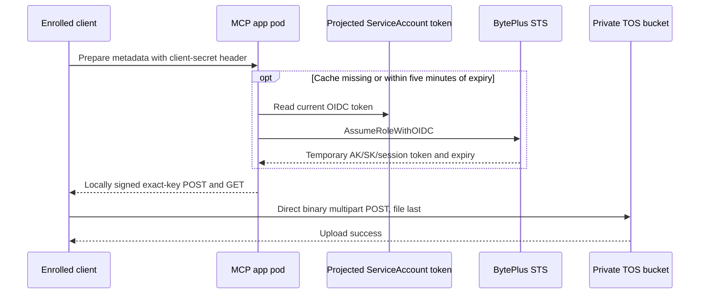

# Temporary Reference Uploads

Hosted HTTP can optionally expose `media_prepare_upload` for operator-funded
temporary TOS storage. It is disabled by default and requires operator enrollment.
No application database, upload proxy, finalization endpoint or cleanup worker
is added. `media_upload` and `media_presign` remain stdio-only.

## Client Workflow

1. Call `media_prepare_upload` with metadata and an enrolled
   `X-MCP-Client-Secret` in private headers. No generation-provider key is needed
   for this preparation call.
2. Upload the binary directly to `upload_url` using multipart POST. Include
   every `form_fields` entry unchanged and append `file` **last**. Let the HTTP
   library choose the multipart boundary.
3. Wait for a successful TOS upload. The preparation result is not an upload
   receipt and does not prove that the file exists.
4. Pass `reference_url` into an existing generation tool with its usual BYOK
   headers. Submit promptly so queued provider workers can fetch before expiry.

```json
{
  "name": "media_prepare_upload",
  "arguments": {
    "input": {
      "media_type": "video",
      "mime_type": "video/mp4",
      "size_bytes": 1048576
    }
  }
}
```

`size_bytes` must be the exact binary file size, not the multipart request size.
Images and audio are capped at 10 MiB; video at 200 MiB. MIME types must exactly
match the category's allowlist in the tool schema/runtime. MIME is declared
metadata, not inspection of the bytes or proof of valid media.

An upload-capable integration can consume the structured result as follows.
This example is client-side code, not a new MCP endpoint or an automatic upload
performed by the server:

```python
from pathlib import Path

import httpx


def upload_reference(prepared: dict, path: Path, mime_type: str) -> str:
    if path.stat().st_size != prepared["size_bytes"]:
        raise ValueError("File size changed; prepare again with the exact size.")
    with path.open("rb") as file:
        # httpx encodes data fields before the final binary file part.
        response = httpx.post(
            prepared["upload_url"],
            data=prepared["form_fields"],
            files={prepared["file_field"]: (path.name, file, mime_type)},
            timeout=300,
            follow_redirects=False,
        )
    response.raise_for_status()
    return prepared["reference_url"]
```

After upload success, a Seedance call can use:

```json
{
  "name": "seedance_create_task",
  "arguments": {
    "input": {
      "prompt": "Use Video 1 as the movement reference.",
      "videos": ["https://your-bucket.tos-ap-southeast-1.bytepluses.com/temporary-references/replace-with-returned-signed-url"]
    }
  }
}
```

Use the complete returned URL, including its signature query, not the illustrative
URL above. Seedream uses `images`; audio references use the selected tool's audio
fields. Generation schemas and model limits remain unchanged. An AI-client
attachment alone does not upload to TOS; the client needs filesystem access and
an HTTP multipart uploader or a separately approved helper.

## Fixed Permissions

| Permission | Duration or restriction |
| --- | --- |
| POST authorization | 15 minutes (900 seconds) |
| GET reference URL | 24 hours (86400 seconds), minted before upload |
| Object expiry | `x-tos-object-expires=1`, one whole day |
| Object key | Server-selected `temporary-references/{HMAC principal}/{media_type}/{uuid4}` |
| POST policy | Exact key, exact declared MIME and byte count, private ACL, STANDARD storage, forbid overwrite |

No caller-selected bucket, prefix, endpoint, ACL or lifetime is accepted.
Signed fields and URLs are sensitive bearer capabilities. Never publish them
or log the structured result; the fields can include an STS token. They are not
guaranteed one-use tokens. Effective permission lifetime may end earlier when
the signing STS credentials expire.

URL expiration is not object deletion. TOS expiry is day-based from
Last-Modified, with deletion starting at the following midnight and scheduled
asynchronously, not precisely 24 hours after upload. One-hour object deletion
is not offered by this implementation. Object expiry takes priority over
lifecycle deletion rules. Versioning can retain historic data and defeat
forbid-overwrite, so use a dedicated bucket with versioning **disabled**, not
enabled or suspended.

## Operator Setup

Configure these securely outside Git:

| Setting | Value |
| --- | --- |
| `MCP_TEMPORARY_UPLOAD_ENABLED` | `true` on HTTP only; default `false` |
| `MCP_UPLOAD_CLIENT_SECRET_SHA256` | 1-1000 unique lowercase SHA-256 digests, comma-separated without spaces |
| `OBJECT_STORAGE_BACKEND` | `tos`; S3 upload preparation is not supported |
| `TOS_CREDENTIAL_MODE` | `static` (default) or explicit `irsa` for HTTP preparation only |
| `TOS_ACCESS_KEY`, `TOS_SECRET_KEY` | Static mode only: dedicated restricted signing credentials |
| `TOS_SECURITY_TOKEN` | Static mode only: optional matching STS token; operator owns rotation |
| `TOS_BUCKET` | Dedicated private bucket in either mode |
| `TOS_REGION` | Regional identifier, e.g. `ap-southeast-1` |
| `TOS_ENDPOINT` | Exact `tos-{TOS_REGION}.bytepluses.com`, optionally prefixed with `https://`; no port/path |
| `TOS_IRSA_ROLE_TRN` | IRSA only: exact `trn:iam::<account>:role/<role>` without wildcards |
| `TOS_IRSA_TOKEN_FILE` | IRSA only: absolute projected OIDC token path; reread on refresh |
| `TOS_IRSA_STS_ENDPOINT` | `https://sts.byteplusapi.com` (default), or `https://open.byteplusapi.com`; no other origin/path |
| `TOS_IRSA_DURATION_SECONDS` | Requested STS session, 3600-43200 seconds; default 3600 |

The allowlist digest is SHA-256 of the **exact 64-character ASCII header value**,
not of its hex-decoded bytes. Client secrets are generated from 32 random bytes.
Enroll only approved clients; a self-selected well-formed secret and a provider
key do not establish upload entitlement. Do not collect raw client secrets in
chat. Removing enrollment blocks future preparation after every pod reloads
configuration, but does not revoke already issued signed permissions.

Before enabling:

- Verify a dedicated private bucket with versioning disabled and public access
  denied. Restrict signing IAM to PutObject/GetObject under `temporary-references/`.
- Add browser POST CORS for approved client origins if browser uploads are
  needed; configure CORS independently of MCP ingress.
- Configure a prefix-scoped lifecycle deletion backstop and verify native
  object-expiry behavior with the selected bucket.
- Set operator storage/egress alerts and abuse controls. Per-pod preparation
  rates and concurrency do not impose global byte, object or spend quotas.
- Check signer credential lifetime, rotation and provider queue/fetch timing.
  Readiness is lifespan-only and does not probe TOS.

Helm accepts `temporaryUpload.enabled: true` and
`temporaryUpload.existingSecret: <existing-name>`. The Secret must differ from
identity and TLS Secrets. Both modes require fixed keys `TOS_BUCKET`,
`TOS_REGION`, `TOS_ENDPOINT`, and `MCP_UPLOAD_CLIENT_SECRET_SHA256`.
Default `temporaryUpload.credentialsMode: static` additionally requires
`TOS_ACCESS_KEY` and `TOS_SECRET_KEY`; `TOS_SECURITY_TOKEN` is optional.
IRSA does not mount or reference these three credential keys. Use a configuration/
enrollment-only Secret for IRSA. Do not put secret values in Helm values or
Terraform state. Roll pods after configuration/enrollment Secret changes;
the chart checksum cannot observe external Secret content.

### VKE IAM Roles for Service Accounts

IRSA removes operator AK/SK distribution to application pods, not the need for
temporary credentials at signing time. The explicit flow is:



Before enabling, an authorized VKE administrator must separately verify regional
IRSA support, cluster OIDC enablement and the actual issuer/provider. Enabling
IRSA can restart API servers and is documented as irreversible; it is not a
chart or Terraform side effect. The IAM role trust must restrict `oidc:iss` to
the actual issuer, `oidc:sub` to the exact
`system:serviceaccount:<namespace>:<serviceaccount>`, and `oidc:aud` to
`sts.volcengine.com`. That audience is the fixed value in the BytePlus VKE guide,
not a caller-selected or inferred audience. Restrict the role's TOS permission
policy to PutObject/GetObject for the dedicated bucket's `temporary-references/`
prefix. Do not reuse a node role or grant account-wide storage access.

After these prerequisites are independently approved and verified:

```yaml
temporaryUpload:
  enabled: true
  credentialsMode: irsa
  existingSecret: seed-mcp-upload-config
  irsa:
    prerequisitesConfirmed: true
    serviceAccountName: seed-mcp-tos-signer
    roleTrn: trn:iam::3000000000:role/seed-mcp-tos-signer
    stsEndpoint: https://sts.byteplusapi.com
    durationSeconds: 3600
```

The account/role and Secret above are illustrative, not provisioned resources.
The chart creates the explicitly named non-`default` ServiceAccount without
IAM annotations or Role/RoleBinding. It disables automatic API-token mounting
and manually projects an OIDC token with audience `sts.volcengine.com`, requested
expiry 3600 seconds and mode `0440`. Only the MCP app mounts
`/var/run/secrets/seed-mcp/irsa/token`; Caddy does not receive the token or TOS
environment. Verify UID/GID/fsGroup 1001 readability and kubelet rotation.
Exclude this workload from any automatic IRSA webhook injection that would
duplicate credentials or mount tokens in Caddy.

There is no ambient environment/metadata credential chain or static fallback.
IRSA rejects configured AK/SK/session tokens and is unsupported for stdio
storage. STS exchange is lazy, after enrollment and admission, not at startup,
discovery or readiness. Credentials are cached only in the receiving runtime's
memory and discarded on shutdown. Refresh is single-flight, five minutes early;
failed refreshes back off ten seconds and may reuse still-valid credentials only
outside their last sixty seconds. Otherwise signing fails closed with sanitized
`TOS_IRSA_CREDENTIALS_UNAVAILABLE`. One credential triplet signs both permissions
and supplies their session token. Signing workers drain on cancellation.

**Reference lifetime is not guaranteed to be 24 hours.** Nominal POST/GET
expiries stay 900/86400 seconds, but the default 3600-second STS session often
limits a new URL to roughly an hour or less. A 43200-second request still cannot
guarantee 24 hours. The returned timestamps are nominal, not STS lifetime
certificates. Refresh does not renew existing URLs. Verify provider queue/fetch
timing; use an independently managed reference source when a longer lifetime
is required.

The OIDC request uses unsigned HTTPS form POST `AssumeRoleWithOIDC`, version
`2018-01-01`, with `RoleTrn`, `OIDCToken`, `RoleSessionName` and
`DurationSeconds`. BytePlus STS origins are allowlisted; proxy inheritance and
redirects are disabled, exchanges are time-bounded and responses capped.
The VKE guide and installed TOS SDK ground this wire shape, but an exact
BytePlus OIDC OpenAPI schema and live regional endpoint acceptance have not
been established. Staging must verify the selected endpoint, trust, exchange,
rotation and direct signed TOS upload/read before production activation.

The server does not configure IAM, bucket privacy, versioning, CORS or lifecycle,
inspect uploaded bytes, verify upload completion, renew these references, or
retain upload records. Live bucket/client/provider acceptance remains an
operator gate separate from offline signing tests.

## Sources

Official documentation, accessed 2026-11-18:

- [TOS POST form presigning](https://docs.byteplus.com/en/docs/tos/Post-form-pre-signature-python-sdk)
- [TOS PostObject](https://docs.byteplus.com/docs/tos/reference-postobject)
- [TOS object expiration](https://docs.byteplus.com/docs/tos/Set-expiration-times)
- [TOS lifecycle rules](https://docs.byteplus.com/en/docs/tos/docs-setting-lifecycle-rules)

IRSA sources, accessed 2026-11-19:

- [BytePlus VKE IRSA and manual token projection](https://docs.byteplus.com/docs/vke/Using_IRSA_in_clusters)
- [BytePlus STS AssumeRole origins, duration and credential envelope](https://docs.byteplus.com/id/docs/byteplus-platform/reference-assumerole) (not an OIDC API acceptance test)
- Installed TOS Python SDK 2.9.3, `tos/credential.py` OIDC implementation
  (wire-shape evidence, not proof of BytePlus endpoint compatibility).

Durable contract: [Hosted BYOK](../specs/SPEC_HOSTED_BYOK.md#temporary-upload-preparation).
