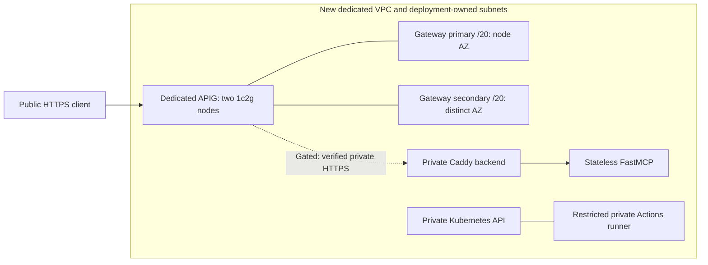
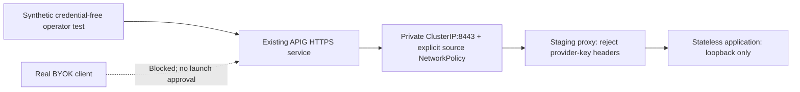

# Dedicated Gateway Deployment Preparation

**Goal:** Prepare an opt-in dedicated standard APIG and two-zone network for the
approved generic HTTPS entry, without treating infrastructure preparation as a
working MCP deployment.

**Source Context:**
- User approved deployment funding and selected a dedicated generic gateway URL.
- User subsequently approved provisioning before backend TLS/routing acceptance
  and removed the earlier infrastructure spending targets as approval caps.
  Billing is to be inspected afterward. Real BYOK traffic remains gated on
  verified TLS, logging and routing; this approval does not cover unrelated
  purchases or repeated paid generation tests.
- Account `3000006864`, IAM user `arthur.lechoncito`, region `ap-southeast-1`.
- After the regional new-VPC quota failure, the user authorized selecting the
  best existing VPC. Read-only selection chose `vpc-jack-demo`
  (`vpc-14wd8di3kiku83tvs80ksgahc`, `192.168.0.0/16`, project `default`).
  Selection did not change any cloud resource. After the broader usage audit,
  the user explicitly superseded reuse with retirement of that exact network
  and creation of a new dedicated VPC. Approved subnet/VPC retirement completed
  on 2026-11-21; details and audit limitations are recorded below.
- Read `AGENTS.md`, `specs/SPEC_VKE_DEPLOYMENT.md`,
  `docs/byteplus-terraform.md`, `docs/github-actions-deployment.md`.
- Inspected Terraform root, locked provider schema, preparation helper,
  infrastructure tests, Helm Service/Caddyfile and private delivery helper.
- Official fixed-IP guide restricts backends to reachable RFC1918 addresses.
  It describes certificate selection; the live one-way TLS form and installed
  SDK expose SNI but no certificate trust field. The 2026-11-21 synthetic
  K8S upstream test accepted an untrusted self-signed certificate; this
  configuration fails the backend chain-trust launch gate.
- Unsubmitted gateway preview: two 1c2g nodes, small_1 CLB,
  USD 0.096/hour plus USD 0.041/GB. No complete matched-stack quote is available.

**Architecture Decision:** Terraform may own a new dedicated gateway and its
subnets alongside the new dedicated private VKE network. The latest approval
supersedes existing-VPC reuse; current dedicated-VPC source matches this
decision, so no existing-VPC implementation is required. Historical network
retirement is separate from dedicated Terraform state. Gateway creation stays
explicitly disabled by default. This unit does not create gateway routes,
change Helm exposure, upload certificates or declare a generic endpoint ready.
The existing public CLB path is not an acceptable silent fallback for the
selected gateway design.

**Parallelization Summary:** Main agent owns the tightly coupled Terraform,
tests and documentation changes. No parallel implementation lanes share these
contracts. An independent read-only reviewer reviews this plan; the supervisor
can investigate costs while review runs.

## File Ownership

| Path | Owner | Responsibility |
| --- | --- | --- |
| `deploy/terraform/vke/variables.tf` | Main | Explicit gateway enablement and secondary AZ |
| `deploy/terraform/vke/main.tf` | Main | Conditional distinct gateway subnet CIDRs/zones |
| `deploy/terraform/vke/gateway.tf` | Main | Dedicated standard APIG, no routes or credentials |
| `deploy/terraform/vke/outputs.tf` | Main | Safe nullable gateway ID; readiness unchanged |
| `deploy/terraform/vke/terraform.tfvars.example` | Main | Disabled/unset opt-in inputs |
| `deploy/terraform/vke/tests/deployment.tftest.hcl` | Main | Mock plans for disabled/enabled/invalid gateway |
| `scripts/prepare_vke_terraform.py` | Main | Add gateway source to explicit copy allowlist |
| `tests/unit/test_vke_infrastructure.py` | Main | Resource ownership and no-secret assertions |
| `tests/unit/test_prepare_vke_terraform.py` | Main | Copied gateway source and unset inputs |
| `specs/SPEC_VKE_DEPLOYMENT.md`, `docs/byteplus-terraform.md` | Main | Shipped preparation scope, unresolved delivery gates |
| `README.md`, `.agents/skills/ark-mcp-setup/SKILL.md` | Main | Discoverable operator caveat; no client setup changes |
| `AGENTS.md` | Main | Preserve gateway delivery gates for future agents |
| `out/vke-deployment-update-20261120.md` | Main | Correct stale decision/status; do not commit evidence |

## Implementation Tasks

### Task 1: Explicit Gateway Infrastructure

**Depends on:** Read-only plan review.
**Can run in parallel with:** No other source edits.

- [x] Add `public_gateway_enabled: bool = false`, nonnullable.
- [x] Add `gateway_secondary_zone_id: string = ""`, nonnullable; enabled mode
  requires a region-matching AZ different from `zone_id`. Disabled mode requires
  an empty value, rejecting ignored operator input.
- [x] Derive `gateway-primary` and `gateway-secondary` /20 subnets at VPC
  indices 3 and 4 only when enabled. Use the existing primary node AZ and the
  explicit secondary AZ. Keep existing node/pod/edge ranges unchanged.
- [x] Add `bytepluscc_apig_gateway.public` with conditional count, new resource
  name `${var.name}-gateway`, dedicated VPC/subnet IDs, `type="standard"`,
  `instance_spec_code="1c2g"`, `replicas=2`, `clb_spec_code="small_1"`,
  public/private networking enabled and public traffic billing.
- [x] Explicitly disable managed monitoring and omit partial disabled tracing,
  which the native API rejected. Require disabled tracing readback by
  `try(self.trace_spec.enable == false, false)`. Provider 0.0.63 rejects
  destination-free disabled `log_spec`, including empty topic IDs, so omit it
  rather than invent a logging destination. Require
  `try(self.log_spec.enable == false, false)` as a lifecycle postcondition.
  This checks readback, not the cloud default; missing/enabled logging fails
  closed. Failure can follow creation: inspect cloud/state before any retry.
  No BYOK traffic, custom log headers, credential fields, upstreams, services
  or routes are configured by this unit.
- [x] Output nullable `public_gateway_id`. Never output certificate material,
  kubeconfig, IAM credentials or a made-up default domain. Preserve
  `helm_infrastructure_values.prerequisitesConfirmed=false`.
- [x] Copy `gateway.tf` through `SOURCE_FILES`; sample enablement stays false
  and secondary zone stays empty.

### Task 2: Offline Validation And Documentation

**Depends on:** Task 1.
**Can run in parallel with:** No, shares source and contract files.

- [x] Extend mock Terraform plans: default absence; enabled two distinct AZs
  and five nonoverlapping subnets; explicit two-node gateway configuration;
  no public Kubernetes API/nodes; unchanged node/pod SNAT and baseline/burst
  ownership; disabled logging readback/tracing and readiness false. Override
  computed subnet IDs at plan time; synthetic log output is not cloud evidence.
- [x] Reject empty/same-zone/wrong-region secondary AZ when enabled, and
  nonempty secondary AZ when disabled.
- [x] Add enabled-logging resource rejection and missing-object/null-enable
  guard-expression assertions. The mock engine rejects a null `log_spec`
  override before the postcondition, so null coverage tests expression semantics
  only; Python source tests pin the production guard. No fake cloud logging
  destination is configured.
- [x] Extend Python source/preparation tests for the new resource and inputs;
  scan every Terraform file for secret assignments, including trace AK/SK.
- [x] Run `uv run pytest tests/unit/test_vke_infrastructure.py
  tests/unit/test_prepare_vke_terraform.py --no-cov`, Ruff on touched Python,
  and `scripts/prepare_vke_terraform.py validate` with the reviewed Terraform.
- [x] Update deployment spec/runbook and operator-facing skill/rules to
  distinguish optional gateway infrastructure from unimplemented private
  backend/routing integration.
  Runtime/tool/auth schemas and client setup do not change in this unit.
- [x] Record the user's gateway choice and current CI evidence in the ignored
  operational report.

### Task 3: Provisioning And Delivery Gates

**Depends on:** Tasks 1-2 for approved infrastructure creation; TLS/routing
acceptance before real BYOK launch. Reconciled task/state/inventory, verified
regional headroom and a fresh creates-only plan are the creation gates.
**Can run in parallel with:** Read-only pricing/contract investigation only.

- [ ] Establish the exact APIG upstream certificate-verification contract and
  trust configuration. Require hostname/chain verification and negative tests
  for wrong certificates. Do not use TLS bypasses or a plaintext backend.
- [ ] Establish plain HTTP service/routing support without MCP persistence,
  affinity, response caching, traffic mirroring or automatic POST retries.
  Require exact `/mcp` and `/health` paths, all MCP methods, 2 MiB bodies,
  credential-header forwarding, and a timeout at least 630 seconds.
- [ ] Specify the verified private backend and public/upstream host separation
  before changing Helm, Caddy or the Actions helper. Reject forged forwarded
  address headers; keep only loopback trusted in the application.
- [ ] Inspect full-stack costs and subsequent billing covering control plane/private CLB,
  baseline and burst compute/disks, NAT/EIP, gateway, backend CLB if needed,
  isolated runner, observability and traffic. The user's latest authorization
  removes USD 200/400 as provisioning caps and allows checking billing afterward.
  Partial previews still must not be presented as an all-in price guarantee.
- [ ] Once contracts are established, extend this plan with exact backend,
  route, runner/RBAC and acceptance interfaces, and have those changes reviewed.
  Do not guess unsupported API fields to complete the plan.
- [x] Prepare a new protected operator workspace and creates-only live review
  plan. The 2026-11-20 plan has 15 creates, no updates/deletes, private workers,
  two fixed baseline nodes and a zero-to-two burst pool. The user approved
  provisioning before TLS/routing acceptance and billing review.
- [x] Refresh the identical creates-only plan and dispatch one Terraform apply.
  It failed at the VPC create; protected state contains zero resources.
- [x] Confirm dedicated resources absent, submit the same approved VPC once
  through the official SDK, and reconcile its asynchronous task. The task
  failed with `QuotaLimitExceeded: QuotaExceeded.Vpc`; no import was attempted.
- [x] Inspect the quota gate for one additional dedicated regional VPC.
  Signed quota readback is 50 used / 50 allowed; the normal adjustment range
  also ends at 50. No out-of-range quota application, support case, resource
  deletion or unrelated-network reuse was performed.
- [x] Following explicit user authorization, select an existing regional VPC
  with low attached-resource footprint and enough unused subnet space.
- [x] Following the broader usage audit and exact cleanup approval, retire
  only the selected demo subnet/VPC and confirm VPC/subnet/default-group
  absence. Existing-VPC implementation is superseded, not shipped.
- [x] Repeat task/state/inventory and regional headroom reconciliation, produce
  an identical fresh 15-create plan and dispatch once. Dedicated VPC/five
  subnets/NAT completed; EIP and APIG failed, with tasks reconciled FAILED/no ID.
- [x] Produce a read-only remaining plan: eight creates and seven no-ops,
  no replacements/deletions, no state-file change. Do not apply it unchanged
  while EIP capacity and the APIG request error remain unresolved.
- [x] Under the user's read-only EIP audit choice, enumerate all 110 regional
  EIPs and inspect associations and returned service references. Six Available
  EIPs retain bandwidth-package/VKE references; exclude them and explicit
  no-delete markers. Record a two-address shortlist and ownership/external-use
  gaps. No release occurred during the audit.
- [x] Obtain exact release approval for the two shortlisted IDs, repeat fresh
  dependency checks, release once each and confirm both absent. Regional
  inventory and quota independently read back 108 used / 110 allowed.
- [x] Prepare a scoped recovery plan for private egress/VKE only: seven creates,
  seven no-ops, no updates/replacements/deletions. Exclude APIG without disabling
  its configuration or substituting the public CLB path. This is exceptional
  partial-apply recovery using Terraform targeting, not routine deployment.
- [x] Reconcile the private recovery: EIP/two SNATs/route/cluster completed;
  both worker creates failed on missing `NodeConfig.Security.Login`, FAILED/no ID.
- [x] Register a dedicated SSH public key and use only its name in protected
  inputs. Reconcile the optional-description rejection before the corrected
  import; private key material remains outside Terraform, GitHub and reports.
- [x] Review and apply an identical two-pool recovery once, preserving all
  twelve existing instances. Confirm two Kubernetes Ready schedulable baseline
  nodes, burst desired/minimum zero and maximum two, and private API access.
- [x] Review a fresh full plan after targeting: one APIG create, fourteen
  no-ops, no diagnostics or state-file change. Do not apply it without resolving
  the gateway request failure.
- [x] Resolve APIG construction through the normal native API: omit partial
  disabled tracing, review the exact request and submit once. Verify Running,
  exact dedicated network and disabled logging/monitoring/tracing. Import the
  accepted gateway and reconcile its write-only network IDs without recreation.
  Fresh untargeted plan: fifteen no-ops, no diagnostics or state change.
- [x] Create one dedicated HTTPS service through the normal native API and read
  its actual public/private domains. Verify public trusted TLS without
  credentials; no routes are installed and 404 is expected. The console labels
  default service domains for testing, consistent with this staging deployment.
- [x] Install absent compatible metrics-server once and verify Running plus
  metrics API HTTP 200 for both baseline workers.
- [x] Create and read back dedicated application/runner namespaces, delivery
  ServiceAccount, namespace-scoped write RBAC, cluster node/metrics read RBAC
  and restricted runner NetworkPolicy outside Terraform/Helm.
- [x] Reconcile the failed first prerequisite probe, establish absent DNS and
  install CoreDNS once. Correct its unschedulable default resources through
  normal addon configuration; verify two Ready replicas and DNS endpoints.
- [x] Complete separately tracked corrected prerequisite probe and confirm
  private API TLS, scoped RBAC negatives, toolchain and GitHub egress. Resource
  creation alone is not NetworkPolicy enforcement or runner acceptance.
- [x] Verify runner egress isolation with a known-live positive control and
  denied same-node/cross-node connections after Cilium ConfigMap enablement and
  one guarded rolling restart. Repeat permitted-path checks before registration;
  these tests do not prove every possible network path.
- [x] Create and privately verify the independent application identity Secret.
- [x] Connect the exact VKE cluster as a namespace-configured source without
  automatic Ingress management; verify `SyncedSucceed`. Configuration readback
  is not proof that access to every other namespace is denied.
- [x] Run a bounded credential-free HTTPS backend probe with explicit-CA
  positive and wrong-host/untrusted-chain negative client controls. Create one
  GET-only diagnostic APIG route, record acceptance of the untrusted backend,
  disable the route and confirm public 404. This is a failed trust gate,
  not acceptance of real BYOK routing.
- [x] Install compatible managed Cluster Autoscaler once through the normal
  console; verify automatic scale-in, 900-second termination timeout and
  maximum one concurrent empty-node deletion, preserving fixed/burst bounds.
- [ ] Establish scale-from-zero discovery, controlled scale-out/scale-in and
  application drain acceptance. Managed addon Running/config readback alone
  does not establish these behaviors.
- [ ] Bootstrap group 3's isolated runner and dedicated namespace/RBAC/Secrets,
  implement the private backend delivery path, then run protected `check` and
  one-shot `deploy`. Internal R&D/Codebase/SealSuite access is not a deployment
  prerequisite. Never rerun used helpers or apply historical plans.
- [ ] Verify public trusted HTTPS, anonymous static discovery/health, BYOK
  negatives without paid generation, hidden operations, draining and scaling.
  Keep temporary uploads disabled until separate live acceptance.

## Parallel Subagent Execution Plan

No implementation workers: Terraform source, allowlist, output contracts and
tests are coupled. Main agent owns integration and preservation of concurrent
changes. The plan reviewer is read-only and may not mutate cloud/GitHub systems.

## Historical Deployment Attempt: 2026-11-20

Fresh signed reads on 2026-11-20 confirmed zero matching dedicated VPCs,
clusters and gateways. `ecs.g4i.large` is currently Available in
`ap-southeast-1a`; regional VKE lists compatible 1.36 images and Cluster
Autoscaler versions. Availability is not a reservation.

Neither proposed /16 overlaps the 50 visible regional VPCs. Broad local
routes overlap both, so laptop private management connectivity remains
unverified; the approved same-VPC runner path remains required.

A new mode-0700 operator workspace contains the mode-0600 live review plan.
Its SHA-256 is
`b4656dda03e5f619f5dd55a7e659474548917a2ce7fb47dd5b3a6624f32287bb`.
Provider credentials were process-local, and the plan's JSON was checked for
credential leakage. This plan covers infrastructure preparation only, not
backend routes, the private runner, Secrets, addons or application delivery.

Unsaved console inspection confirmed a plain upstream route form, all-methods
selection, header modification controls, and initially disabled retry,
mirroring and timeout overrides. The one-way TLS upstream form exposes SNI
but no observed trust/verification control. These are UI observations, not
runtime or certificate-verification guarantees. Both previews were discarded;
no existing demo configuration was changed. The current ArkCLI catalog has
no `apig` matches and did not resolve the contract gap.

Following the user's deploy-first authorization, the identical fresh plan
was applied once at `2026-11-20T13:43:53Z`. Terraform failed immediately at
`bytepluscc_vpc_vpc.dedicated` with a generic SDK diagnostic. The original
Terraform failure's specific cause was not captured. State inspection and
fresh signed inventory showed no dedicated resources.

One official SDK VPC create then returned asynchronous task
`task-4b15608d-a64a-4bf1-8b1d-bc43b35b5b26`. Its subsequent readback was
`FAILED`, with `QuotaLimitExceeded` and
`QuotaExceeded.Vpc: VPC number exceeded quota`. No VPC identifier was returned,
so no Terraform import was attempted. Fresh signed reads again confirmed zero
dedicated VPCs, clusters and gateways.

Signed quota-management reads identify provider `VPC`, quota `vpc`, dimension
`region_code=ap-southeast-1`: 50 used / 50 allowed, with the normal adjustment
range `10,50`. Existing quota applications are historical approved requests,
not a pending increase. The account needs at least one additional slot through
an authorized quota change. No invalid quota request or support case was opened;
no unrelated resources were deleted or reused.

No runner registration, addon installation, workflow dispatch, application
delivery or new paid media create occurred. Real BYOK remains disabled.
TLS/stateless routing acceptance is still required before launch; matched
costs and billing are no longer prerequisites to the approved provisioning.

## Existing VPC Selection

The user subsequently authorized existing-VPC reuse and asked the agent to
choose the best one. Signed inventory covered all 50 regional VPCs. A
low-footprint screen compared 23 available, non-default, project-`default`
VPCs with /16-or-larger networks, no NAT gateway or CEN association, and no
production/no-delete name marker. Names were a screening hint only; the
selection used attached-resource and subnet readback.

Five screened VPCs had zero network interfaces and one existing subnet.
`vpc-jack-demo` (`vpc-14wd8di3kiku83tvs80ksgahc`) was selected from that
lowest-footprint group. Further signed reads established:

- Region `ap-southeast-1`, project `default`, status `Available`.
- Primary CIDR `192.168.0.0/16`; existing subnet `192.168.0.0/24` in zone `b`.
- Zero network interfaces, ECS instances, VKE clusters and APIG gateways in
  the queried inventory; zero NAT gateways and CEN associations.
- One route table containing only system routes for the existing subnet and
  `100.64.0.0/10`. No existing user route needs editing.
- Fifteen currently unused /20 blocks, sufficient for five deployment-owned
  subnets. Proposed nodes/pods/edge/gateway-primary/gateway-secondary ranges:
  `192.168.16.0/20`, `192.168.32.0/20`, `192.168.48.0/20`,
  `192.168.64.0/20`, `192.168.80.0/20`. These avoid the existing /24 and the
  proposed service range `10.81.0.0/16`. Recheck immediately before creation.

Selection is not cloud mutation, a reservation, proof of all service inventory
or private management reachability. No existing subnet, VPC attribute,
security group, route or gateway was changed. Do not rename or import the VPC
into this deployment's Terraform ownership. Dedicated routes must attach only
to new deployment-owned subnets. Use a fresh protected plan after implementing
the explicit reference path; never apply the failed new-VPC plans.

The user's subsequent request to check use before considering deletion was
handled read-only. Cross-service inventory found no active workload or
external network reference in the checked systems, including NAS mounts,
registry endpoints, transit-router attachments, launch-template versions and
167 security-group rule queries. The existing default security group is an
additional remaining resource, not evidence that the VPC is empty. No tags
or description establish an owner, and reserved future use or configurations
outside the audit remain unverified. Deletion was neither authorized nor
performed at the time of that audit. Subsequent explicit cleanup approval
supersedes that historical status; see the retirement record below.
The ignored evidence report is `out/vpc-usage-audit-20261120.md`.

## Approved Demo Network Retirement

On 2026-11-21 the user explicitly authorized cleanup of the audited network,
creation of a new dedicated VPC and continuation of end-to-end deployment.
Guarded cleanup rechecked exact account/name/CIDR/project, dependencies,
system route-table identity and external references with fresh signed reads.
An extra `DescribeInstanceGroups` query returned HTTP 403
`InvalidInstanceGroup.Forbidden`; it was not treated as empty and no identity
switch or permission broadening occurred. Ordinary dependency-enforcing delete
APIs were used under explicit approval, without forced deletion.

One subnet delete and one VPC delete were accepted. Subsequent signed reads
confirmed zero matches for the exact VPC, subnet and default security group.
The group was removed with the VPC; no separate group or system route-table
delete was submitted. Route-table absence was not independently rechecked.
No other VPC/network was deleted. Ownership/reserved-use and wider audit limits
remain historical limitations, not retroactively established facts.

Immediate quota readback still reported 50 used / 50 allowed. That alone does
not establish reporting lag or headroom. A new private operator workspace,
`vke-byteplus-demo-gateway-deploy-20261121`, contains approved dedicated inputs
and separate cleanup evidence. Its one-shot apply must verify complete regional
inventory below the limit and reconcile the old failed task before producing
and applying a fresh identical creates-only plan. Old saved plans remain
comparison evidence only and must not be applied.

## Dedicated Infrastructure: 2026-11-21

Complete signed inventory established 49 regional VPCs before the new apply.
The original task remained FAILED/no ID and dedicated inventory was empty.
A fresh identical 15-create plan was applied once at `2026-11-21T00:59:18Z`.
It completed the dedicated VPC, all five subnets and NAT gateway. Retained state
is serial 10 with seven instances; signed reads confirmed the VPC identity and
all five subnets Available.

APIG creation failed `InvalidRequest: InvalidParameter: Request illegal.`
EIP creation failed `QuotaLimitExceeded: QuotaExceeded.Eip`.
Both tasks were rechecked FAILED/no ID and dedicated gateway/EIP inventory
returned zero matches. An additional apply-time `Invalid index` diagnostic
was not independently localized. The full read-only remaining-resource plan
passed without diagnostics: eight creates, seven no-ops, no replacements or
deletions, state file unchanged. It was not applied.

Complete EIP inventory and quota readback are 110 used / 110 allowed.
Normal quota adjustment range is 20-30, below the existing override; no invalid
request or support case was submitted. The user chose a read-only EIP audit:
60 Available/unassociated, but four retain bandwidth-package membership and
two appear in VKE API endpoints. Older anonymous EIPs with no checked reference
were initially shortlisted without release approval. Ownership, external
DNS/allowlists and wider configurations remain unverified. Evidence stays ignored in
`out/eip-usage-audit-20261121.md`.

The user subsequently approved permanent release of exactly
`eip-q6j8mo4nqsjk1ntgtrsxgwcx` and `eip-14wmwikupd7uo3tvs80xws8n3`.
Fresh attributes, listed service references and launch-template versions were
rechecked; each ordinary release was dispatched once and accepted at about
`2026-11-21T03:21:03Z`. Signed readback confirmed both IDs absent and 108 EIPs;
quota separately confirmed 108 used / 110 allowed. No other EIP was modified.
This does not close the historical external-use/ownership audit gaps.

A new scoped recovery plan preserves all seven completed resources and creates
only the EIP, two SNAT entries, private route table, private cluster and two
worker pools. It has seven creates/seven no-ops and no updates/replacements/
deletions. APIG is excluded using exceptional Terraform recovery targeting;
gateway configuration stays enabled, and its chosen architecture is unchanged.
The identical plan refresh was dispatched once. Completion and live VKE
readiness were unverified at dispatch. Terminal reconciliation established
five additional resources completed (EIP, two SNATs, route and cluster), with
both worker creates FAILED/no ID on `MissingParameter.NodeConfig.Security.Login`.
State then held twelve instances at serial 18.

A deployment-only RSA public key was registered under
`seed-mcp-staging-worker-bootstrap`. The first import rejected its optional
description; exact absence was rechecked before a corrected one-shot import
reused the same public key without a description. Only the registered name
entered protected tfvars; private material remains mode 0600 outside the
repository, Terraform/state and GitHub. No SSH/public ingress was opened.

The reviewed two-pool recovery was refreshed identically and applied once at
`2026-11-21T03:40:00Z`; it completed successfully with twelve existing no-ops.
Protected state is now serial 21 with fourteen instances. Baseline pool
`pdc0h54cssn1sr9q91g80` is Running with two private `ecs.g4i.large` nodes;
burst pool `pdc0h54ep55cuntcns39g` is Running at desired/minimum zero, maximum two.
At `2026-11-21T03:44:02Z`, authenticated management forwarding of only
`GET /api/v1/nodes` confirmed two `Ready=True`, schedulable, untainted nodes.
The cluster API remains private; this read does not prove private runner
connectivity. Existing CCM, VPC CNI and ALB ingress addons report Running.
No addon writes, autoscaler installation or metrics acceptance occurred.

The fresh full untargeted plan contains only one APIG create and fourteen
no-ops, no diagnostics and no protected-state change. Its SHA-256 is
`4fa0f2b049520b2cabd55e2c7e22f9c78952f4165b9ef310712de8dbf86817d5`.
It was not applied. The previous Cloud Control APIG task remains FAILED/no ID;
the one native SDK create also failed HTTP 400 `InvalidParameter`, and fresh
inventory contains zero dedicated gateways. SDK wire-field casing matches the
public console builder; that hypothesis is ruled out, not a confirmed fix.
No additional create, route/service or architecture substitution occurred.

Fresh complete EIP inventory and quota both report 109 used / 110 allowed after
the new egress allocation. Selected November billing-detail queries for NAT,
EIP, cluster and both worker ECS IDs returned no settled rows; this does not
establish zero cost or a complete bill. Private runner, autoscaler/metrics
acceptance, gateway/backend/routes and application delivery remain pending.
Real BYOK and temporary uploads remain disabled. No public Kubernetes API,
database or automatic retry is introduced.

## APIG Fix Investigation: 2026-11-21

At `2026-11-21T07:41:00Z`, fresh process-local STS reads reconfirmed the old
Cloud Control task FAILED/no identifier and zero dedicated gateway matches.
The complete regional APIG list contains fifteen instances; a separate
`CheckGatewayExist` returned `Exist=false` for `seed-mcp-staging-gateway`.
Running gateways in this account already use the proposed two-replica
`1c2g`/`small_1`/traffic configuration, including one with both network types.
The regional gateway quota is thirty and per-gateway replica quota is twenty.
Quota usage fields return zero despite the nonempty list; do not treat those
usage fields as reliable live counts.

The public BytePlus frontend specification module `17723` and its dependencies
confirm those exact option values and gateway zones `ap-southeast-1a`/`b`.
The native SDK's top-level, network and resource wire names match the frontend.
The VolcanoEngine CreateGateway reference accessed on 2026-11-21 also matches
the request shape, but is cross-platform supporting evidence, not an exact
BytePlus acceptance guarantee:
https://docs.volcengine.com/docs/apig/CreateGateway?lang=zh.
The frontend normally omits tracing until configured; that difference from
the native disabled tracing object is not a proven rejection cause.
No speculative create or Terraform input/source change was made.

An observed frontend `GetPrice` action is unavailable on the native
`2021-03-03` surface (`InvalidActionOrVersion`); this does not prove unsupported
pricing or explain CreateGateway failure. The task's complete envelope contains
only the generic `InvalidRequest: InvalidParameter: Request illegal.` message.
The original native error's detailed message/request ID was not retained.
Resolve the specific backend validation before a new create using account
`3000006864`, region `ap-southeast-1`, task
`task-f946b975-3aab-4c20-819b-0ba807571c8e`, or native dispatch time
`2026-11-21T03:28:43.646825Z` and exact gateway name. No support case was opened.

The private native status helper now reads the SDK's nested `gateway` envelope
and rejects missing/wrong identifiers. Six offline tests using the installed
SDK pass, including missing logging staying unknown rather than disabled.
This fixes diagnostic readback only, not gateway creation. Evidence is private
under the protected deployment workspace. The console displayed a KYC overlay;
no attestations were submitted and no connection to the API error is established.
All cluster/network/workers, readiness flags and launch gates remain unchanged.

## Normal Gateway Provisioning And Reconciliation: 2026-11-21

The user explicitly directed continuation through the normal BytePlus workflow.
Internal diagnostic access is optional and was incorrectly presented as a
deployment prerequisite; it is not required for the operations below.

After fresh exact-account task/state/inventory checks, a native request identical
to the previous request except for omission of partial disabled `TraceSpec` was
submitted once at `2026-11-21T09:10:00Z`. It returned gateway
`gdc0lvqennrmdh5hbe8kg`. Readback at `09:17:53Z` established Running, exact
dedicated VPC/two gateway subnets and disabled logging, monitoring and tracing.
This establishes a working correction, not every backend tracing validation
rule. Repository and protected Terraform source omit tracing input and require
disabled logging/tracing by postcondition.

The locked provider's documented gateway-ID import succeeded once at `09:19:33Z`,
preserving all fourteen existing resources. Its generic passthrough import
does not restore top-level write-only `VpcId`/`SubnetIds`; the first full plan
therefore proposed replacement solely for those missing fields and was not
applied. A reviewed state copy restored only those two exact live-verified
nonsecret fields. The first non-force state write rejected the unchanged serial
and left state byte-identical. After advancing the staged serial, one corrected
non-force, locked write succeeded. No gateway delete/update/create occurred.

Protected state is serial 24 with fifteen instances. A fresh full untargeted
plan at `09:21:58Z` reports fifteen no-ops and no diagnostics, with state unchanged.
Plan SHA-256:
`061aa40f3e279b7d5750b1092fc65447c3470ae5a0a1abd6ad9a1d1b107ffa68`.
State SHA-256:
`6d71fa693d3bb603d1e03a1ad42cdd17b079c33abd625f01dfc322a66f0cc33d`.
Old APIG-create and post-import replacement plans remain evidence only.
Complete post-gateway EIP inventory is 109; no additional release is authorized.

A separate operator-managed HTTPS service `seed-mcp-staging` was created once
at `09:25:19Z`, ID `st63a28rvt0o3d9htd28d`, and read back Running. It has no
routes, no gateway authentication plugin and only HTTPS. Runtime BYOK boundaries
will apply after backend deployment; anonymous discovery/health remain public.
The real public domain is:
`https://st63a28rvt0o3d9htd28d.apigateway-ap-southeast-1.apigw-byteplus.com`.
An unauthenticated HEAD probe verified trusted TLS (`ssl_verify_result=0`)
and HTTP 404. This is not MCP/backend acceptance. The console explicitly labels
default domains for testing, not extensive production use.

Private runner, backend TLS/trust, routing, metrics/autoscaler acceptance and
application delivery remain pending. No paid provider generation, upload,
KYC attestation, public API/SSH change or unrelated resource cleanup occurred.

## Private Delivery Bootstrap: 2026-11-21

Fresh normal API reads established the private cluster at `10.80.0.143`, two
Ready workers and no metrics API. One reviewed metrics-server `v0.7.1-vke.6`
create was accepted at `09:35:05Z`; readback at `09:36:41Z` established Running
and metrics API HTTP 200 for both workers. No addon replacement was performed.

Eight reviewed bootstrap objects were created once at `09:41:45Z` and read
back HTTP 200: namespaces `seed-mcp-staging` and `seed-mcp-staging-runner`,
delivery ServiceAccount, Role/RoleBinding, read-only ClusterRole/binding and
runner NetworkPolicy. Both namespaces enforce Pod Security `restricted`.
The ServiceAccount disables automatic token mounting. Writes are limited to the
application namespace, including Secret CRUD for Helm release storage; cluster
permissions are node/metrics reads and exact application-namespace get.
There is no wildcard, cluster-admin, pod exec or runner-namespace Secret grant.

Runner NetworkPolicy was initially created with no ingress. Egress permitted the exact private API on
TCP 443, kube-system DNS on UDP/TCP 53 and public TCP 443 excluding RFC1918,
link-local and loopback. Policy creation is not evidence of enforcement.
The GitHub organization group remains restricted to this repository and exact
`main` deployment workflow; no registered runner or readiness flag change exists.

The first short-lived prerequisite Pod failed during tool installation at
`09:47:20Z`, reporting sanitized `URLError`; no private API/RBAC tests ran.
Fresh reads established no DNS Service, deployment or addon. CoreDNS `1.12.4`
was compatible with the retained Kubernetes 1.36 release and created once at
`09:49:27Z`. Its default requests of 2 CPU/4 GiB per replica exceeded each
worker's 1930m allocatable CPU; scheduler events explicitly reported
`Insufficient cpu`. At `09:59:50Z`, normal console addon configuration changed
requests to 100m/256 MiB and memory limit to 512 MiB, preserving two replicas,
version, permissions and networking. Readback retains a 2-CPU limit.
At `10:00:17Z`, the addon was Running with one Ready DNS Pod per worker and
two Ready kube-dns endpoints, `10.80.24.77` and `10.80.24.82`.

A distinct corrected Pod/ConfigMap, `private-delivery-probe-dnsfixed-20261121`,
was reviewed after both DNS endpoints were Ready and created once at
`10:00:59Z`. It uses a digest-pinned Python image, checksum-pinned runner/Helm/
kubectl downloads, nonroot restricted containers, bounded scratch and no IAM,
provider, SSH or GitHub registration credentials. Only the main probe mounts
the projected scoped Kubernetes token/CA. Its tools completed successfully,
but the first private API request timed out on TCP 443 at `10:03:03Z`.
An exact private CLB/listener read established TCP 6443. One resource-version-
guarded JSON Patch at `10:05:21Z` changed only the policy API port to 6443;
HTTP 200 and unchanged remaining policy fields were verified.

A third separately tracked Pod/ConfigMap,
`private-delivery-probe-portfixed-20261121`, was created once at `10:05:57Z`
using `https://10.80.0.143:6443`. It Succeeded at `10:07:50Z`; readback at
`10:08:31Z` confirmed trusted private API TLS, application namespace/node/
metrics reads, denied Secret lists in default/kube-system/runner namespaces,
checksum-pinned Python/Helm/kubectl/runner tooling and GitHub HTTPS egress.
This is a prerequisite probe, not a registered runner or isolation acceptance.
Original failed resources/evidence are preserved. Status checks verify exact
Pod UID and deployed runtime hash.

A separate credential-free private HTTP listener on worker 147 provided a
known-live positive control. At `10:06:25Z`, both the application control and
expected-denied runner client on worker 146 reached it. The runner denial
therefore FAILED. Metadata/worker port failures in the prerequisite probe do
not establish enforcement. No runner was registered or readiness flag enabled.
The bounded original server was read back terminal Failed at `10:18:14Z`.

Read-only startup inspection at `10:12:59Z` found the live Cilium container
using `cilium-launcher`, `CILIUM_ENABLE_POLICY=never` and a mounted
`cilium-config` containing only `debug=false`. The public Cello launcher
supports ConfigMap `enable-policy` overrides and runtime changes to
`default|always|never`; upstream Cilium documents `default` as enforcement on
selected endpoints and `never` as disabled enforcement. These are supporting
source contracts, not exact managed-image/runtime acceptance:
- https://github.com/volcengine/cello/blob/6693a4ac0030dd6ad73719e1a000bb9949764c90/cmd/launcher/cilium/launcher.go
- https://github.com/volcengine/cello/blob/6693a4ac0030dd6ad73719e1a000bb9949764c90/docs/config.md
- https://docs.cilium.io/en/stable/security/policy/intro/

After confirming this runner policy was the only standard policy and there
were no Cilium-specific policies, one guarded ConfigMap patch at `10:17:36Z`
added only `enable-policy=default`. The CNI DaemonSet template, images,
resources, label settings and network mode were unchanged. First status had
both agents Ready but no observed runtime-switch success; configuration
acceptance is not enforcement acceptance. A separately named synthetic server
was created once at `10:18:26Z`. Retests at `10:19:57Z` still FAILED both
same-node and cross-node runner denials, with the application positive control
passing. No runtime-switch event was observed in either installed agent.

One guarded rolling restart at `10:21:48Z` added only a ConfigMap-hash marker
to the existing CNI DaemonSet's pod annotations. Images, resources, environment,
label settings and network mode remained unchanged. Existing `RollingUpdate`
used `maxUnavailable=1`, `maxSurge=0`; both replacement pods were Ready and
the generation-2 rollout complete at `10:22:22Z`. No automatic retry or
additional restart was dispatched.

Three distinct post-restart clients were created once at `10:22:50Z` against
the same Ready private control listener. At `10:23:07Z`, the application
positive control PASSED, and runner denials on both worker 146 (cross-node)
and worker 147 (same-node) PASSED. This establishes those tested egress
restrictions, not all network paths or application acceptance. The unchanged
`CILIUM_ENABLE_POLICY=never` environment no longer establishes effective
runtime policy mode when the mounted ConfigMap override is loaded.
Keep the operator-owned ConfigMap/restart evidence separate from Terraform
and revalidate after CNI addon updates or replacement.

A fourth separately tracked prerequisite Pod/ConfigMap,
`private-delivery-probe-policyfixed-20261121`, was created once at `10:23:19Z`
to revalidate DNS, trusted private API/RBAC and public GitHub HTTPS after
enforcement. Terminal readback at `10:30:01Z` confirmed Succeeded, tools and
main exit zero, matching deployed runtime/document hashes and PASS. Private
API/version, application namespace, nodes and metrics returned 200; Secret
lists in default, kube-system and runner namespaces returned 403. Reviewed
toolchain checks and public GitHub HTTPS passed. These permitted-path results
complement the separately verified same-node/cross-node egress denials; they
do not establish every network path or a registered runner.

After exact namespace/absence review, one operator-owned Opaque Secret
`seed-mcp-staging-identity` was created at `10:30:23Z`. Its UID is
`0aa48246-8810-4869-ae78-fcfaf530f42d`. The independent 32-byte HMAC key and
version 1 were generated with the existing private-file helper and compared
in memory against create/readback data. Status at `10:30:37Z` verified the
same UID/data without emitting values. The local mode-0600 identity file
remains in the protected operator workspace, not GitHub or Terraform.
No provider keys, TLS Secret or runner registration were created.

Protected Terraform state remains serial 24 with the same SHA-256; addons and
bootstrap objects are operator-owned outside that fifteen-instance state.
No newer full Terraform plan, application installation, paid generation, upload,
public API/SSH change or unrelated cleanup occurred. Temporary uploads remain
disabled. Runner bootstrap, backend TLS/routing,
autoscaler and complete billing remain pending.

## Synthetic Backend TLS Acceptance: 2026-11-21

At `12:24:51Z`, one native VKE source create returned
`usdc0or58ggjo0690nn4a0`. Readback at `12:25:13Z` was `SyncedSucceed` for the
exact dedicated cluster and `WatchNamespaces=["seed-mcp-staging"]`.
Automatic Ingress, all-namespace/all-class handling and status updates were
disabled. The console independently lists namespaces through management
forwarding across imported clusters; these configured values do not prove
denied access to other namespaces.

A bounded private synthetic HTTPS server was created once at `12:26:59Z`,
with a ClusterIP Service on 8443, a two-day self-signed certificate for
`seed-mcp-tls-probe.invalid` and no credentials or Kubernetes token mounted.
Its only successful path returns a fixed diagnostic marker. Direct client
controls Succeeded at the `12:28:04Z` read: explicit CA accepted, wrong
hostname rejected, untrusted chain rejected. Fresh `12:37:26Z` readback
confirmed the same server UID Ready and controls PASS. These controls establish
the probe/client behavior, not gateway certificate verification.

The original synthetic upstream create at `12:30:32Z` returned
HTTP 400 `InvalidParameter`, without an ID. Inventory at `12:31:04Z` was
empty. Public console form module `83016` adds `LbPolicy="SimpleLB"` when
normalizing round-robin settings; that supported field was omitted initially.
A distinct reviewed attempt including it at `12:40:30Z` still returned
HTTP 400 `InvalidParameter`, message `Request illegal.`, request ID
`20261121124030F83E451C253C1422B542`. Inventory at `12:40:53Z` was empty.
Neither failed create was repeated; no exact rejected-field cause is proven.

After fresh Ready/empty-inventory checks, one normal-console upstream
submission at approximately `12:44:08Z` succeeded:
`udc0p466nnrmdh5hbhue0`, `seed-mcp-synthetic-tls-console-20261121`.
Signed readback at `12:44:24Z` verified the exact namespace/Service/8443,
`Protocol="HTTP"`, `TlsMode="SIMPLE"`, the synthetic SNI and round-robin/
`LbPolicy="SimpleLB"`. Circuit-breaking settings are null on readback.
This proves normal-console acceptance; the precise difference responsible
for rejection of the partial native circuit-breaking input is not isolated.

One reviewed route create at `12:44:50Z` returned
`rdc0p4goggjo0690nnepg`, exact path `/__deployment_tls_probe`, GET only,
single synthetic upstream. The route API is `2022-11-12`, matching the
current console route client. At `12:45:00Z`, credential-free public HTTPS
returned HTTP 200 and the exact marker while the backend certificate was
untrusted/self-signed. Public TLS was verified, with no redirect or TLS
bypass. **The tested APIG 4.4.4 one-way TLS configuration did not enforce
backend chain trust.** Gateway hostname-negative acceptance is not established
by the direct client controls. SNI and encryption are not proof of verification.

The one reviewed disable at `12:46:38Z` raised a local SDK `KeyError`; its
response-handling failure was treated as uncertain, not retried. Separate
signed readback at `12:46:48Z` confirmed the same route disabled and preserved
matcher/upstream settings. Public GET checks then returned 404 for both the
diagnostic path and `/mcp`, with public TLS verification result zero.
The disabled route/upstream and bounded probe resources are retained as exact
reconciliation targets; do not recreate or repeat their mutation helpers.
The server has a 3600-second deadline and must be freshly reconciled before reuse.

Real BYOK launch remains gated on a supported, configured and negatively tested
backend verification control or an explicitly reviewed architecture change.
Do not infer that all APIG modes lack verification from this single configuration.
The current native TLS model/form exposes only mode and SNI; inventing extra
fields, installing the public CLB fallback or accepting encryption as trust
would not resolve this gate. No application/chart/workflow changes, runner
registration, readiness-flag writes, paid generation or uploads occurred.
Protected Terraform state remains serial 24/fifteen instances with the same
hash; no new full Terraform plan was run.

## Managed Autoscaler And Billing: 2026-11-21

Fresh signed review at `12:52:03Z` established no autoscaler addon or visible
system deployment, compatible managed `v1.30.3-vke.15`
(`>=v1.29-0 <v1.37-0`) and only the two approved worker pools. Baseline
autoscaling is disabled with desired two; burst autoscaling is enabled with
minimum zero/maximum two and desired zero. Dormant baseline min/max values
are not active autoscaling limits; do not describe the baseline as scaling
to zero.

One normal-console install was accepted at `12:52:29Z`. Its automatic scale-in
preview was enabled; the default 600-second termination timeout was increased
to 900 seconds, exceeding the planned 660-second application pod grace.
Maximum concurrent empty-node deletion was reduced from five to one.
Other displayed settings retained defaults. No pool bounds, IAM trust, IRSA,
public API, CNI configuration or worker images were changed.

The first status check rejected the required Running cluster phase and did
not establish addon failure; it was not followed by another installation.
Read-only status was refined to report cluster phase during reconciliation.
At `12:54:24Z`, signed readback confirmed cluster and managed addon Running,
the same fixed/burst bounds, and nested configuration:

- `ScaleDown.Enabled=true`
- `ScaleDown.MaxGracefulTermination=900` seconds
- `ScaleDown.MaxEmptyBulkDeleteNumber=1`
- `ScaleDown.UtilizationThreshold=0.5`, unneeded delay ten minutes,
  delay after adding ten minutes, failure delay three minutes
- Local-storage and kube-system pod exclusion bypasses remain false.
- `ScanInterval="10s"`, scale-up algorithm `random`.

The addon is managed and no autoscaler Deployment was visible in the workload
cluster's kube-system namespace. Config/readback acceptance is not a controlled
scale-from-zero, capacity, scale-in or application-drain test. Two baseline
workers are Running and the burst pool still has zero workers. An unrelated
KYC overlay appeared in the console; no answers or attestations were submitted.

At `12:55:27Z`, read-only November billing queries for seven exact infrastructure
IDs returned eight settlement rows: cluster USD 0.84, each baseline worker
USD 0.08, and USD 0.00 payable in the returned private API CLB/NAT/NAT-EIP rows.
Gateway returned no rows. The queried settled payable total is **USD 1.00**,
not a full-stack/monthly estimate or real-time spend total. Settlement delay,
gateway charges and separately billed disks/other resource IDs remain gaps;
zero/no rows do not establish free infrastructure. No payment, recharge or
payment-method operation occurred. State hash remains unchanged.

## Staging-Only Application Delivery Unit

The user selected **Deploy staging only** on 2026-11-21 after reviewing the
backend trust gap. Install and exercise the application with synthetic traffic;
keep public client access blocked. This does not approve a private-network
trust exception, real BYOK traffic or renewed paid generation.

**Goal:** Deliver the current stateless application behind the selected APIG
without creating another public CLB or permitting generation credentials.
Public application routes remain disabled. Temporary synthetic routes require
an exact operator-held random `X-Seed-Staging-Probe` header matcher at APIG,
verified by allowed-marker and missing/wrong-marker negative requests before
MCP testing. This marker grants synthetic test access only, not provider access.
If that matcher cannot be established, run private acceptance only and leave
gateway acceptance pending. Backend header refusal does not protect the
unverified preceding TLS hop.

**Code inspected:** chart values/schema, Service/Deployment/ConfigMap/validation
templates, Caddyfile, `scripts/deploy_vke.py`, workflow, delivery tests and
`docs/github-actions-deployment.md`; existing guarded runner/bootstrap helpers.

**Architecture:** Add `service.mode=public-clb|apig-staging` (default existing
`public-clb`) and root `backendHost=""`. APIG staging requires a distinct backend
TLS hostname, no CLB subnet setting and explicit RFC1918 source CIDRs. Render
ClusterIP TCP 8443 and an ingress NetworkPolicy for only those CIDRs. A separate
`Caddyfile.apig-staging` rejects either generation-key header with 403 before
reverse proxying, allows only `/mcp` and `/health`, replaces forwarded fields
and canonicalizes upstream Host to `publicHost`. Uploads remain disabled.
Readiness acknowledgement is not production trust acceptance.

**Parallelization:** Main agent owns the tightly coupled chart/helper/workflow/
tests/docs interfaces. No independent implementation lanes are defined.
An independent read-only reviewer checks this unit. The main agent owns all
implementation and integration; reviewers may not mutate cloud/GitHub systems.

| File | Owner | Intended Change |
| --- | --- | --- |
| Helm values/schema/validate/Service/Deployment/ConfigMap | Main | Strict opt-in private staging mode and hostname separation |
| `files/Caddyfile.apig-staging` | Main | Mandatory provider-key rejection, canonical headers, hidden paths |
| `templates/networkpolicy.yaml` | Main | Private source-CIDR ingress to proxy port only |
| `scripts/deploy_vke.py` | Main | `--service-mode`, `--backend-host`; check selected certificate hostname |
| `.github/workflows/deploy-vke.yml` | Main | Protected nonsecret mode/backend-host references |
| `tests/unit/test_deploy_vke.py`, chart tests | Main | Private render, input rejection, no CLB, key-gate and helper checks |
| Runbook/spec/README/AGENTS/setup skill | Main | Staging-only scope, flags, blocked client launch |

- [x] Implement strict chart mode/schema validation; private CIDRs must be
  contained in RFC1918 networks, not broad public or mixed source ranges.
- [x] Render independent private proxy configuration and checksum; test key
  rejection with the real Caddy adapter, not substring assertions alone.
- [x] Add helper/workflow flags and hostname-selective certificate preflight;
  preserve one-shot Helm, captured output, private files and no retry/rollback.
- [ ] Reconcile/create one separate private backend TLS Secret, keeping
  identity/provider/IAM/SSH credentials separate and never printing values.
- [ ] Add only application-namespace NetworkPolicy CRUD to the exact existing
  delivery Role with resource-version guards and unchanged other rules.
- [ ] Bootstrap a fresh workflow-restricted one-job runner for each check/deploy
  dispatch, using pinned tools, projected token/CA and private generated files.
  Verify registration, then terminal job/runner deregistration and teardown.
  Kubeconfig references the rotating projected token file; never persist a token
  snapshot or copy kubeconfig/registration/provider credentials into GitHub.
- [ ] Run protected `check`, approve once, reconcile its terminal result; then
  dispatch/approve `deploy` once. Do not repeat uncertain creates or deliveries.
- [ ] Reconcile two Ready app pods/HPA/PDB/private Service. Determine the actual
  APIG source at pods before narrowing ingress: inspect dedicated gateway ENIs,
  K8S routing/SNAT and a bounded synthetic source observation. Verify the
  explicit namespace/Service/8443/backend SNI mapping and allowed-APIG plus
  denied-other-source controls. Private CIDRs alone are not isolation evidence.
- [ ] Create diagnostic routes disabled, exact path and exact synthetic header
  matcher only, no caching/mirroring/retries. Read back exact matchers before
  one guarded enable. Test missing/wrong marker returns 404, valid marker
  reaches health/discovery, and synthetic credential headers are refused.
  Disable immediately after acceptance and verify public 404. Never send real
  provider keys, including on negative tests.
- [ ] Update status evidence without claiming production/BYOK/trust acceptance.

**Validation:** Run focused chart/helper pytest and Ruff, strict Helm lint and
private/normal template renders, Caddy adapter/runtime checks, signed resource/
route readbacks and terminal Actions evidence. No provider calls.

**Independent plan review:** Initial review required operator-only edge matching,
one fresh runner per job, source-path evidence and namespace NetworkPolicy RBAC.
Those requirements are included above. The revised plan and staging source were
independently approved with no blocking findings; operational checks remain
execution gates. Focused regressions: 252 passed/12 cached-schema checks skipped,
including real Caddy TLS, empty credential headers and forwarded-field controls.
Private mode cannot remove the key-header refusal or
enable uploads; existing public CLB mode is not a fallback for this deployment.
The new Service and chart/helper/workflow interfaces must be integrated before
registering a runner against the delivered main commit.

## Validation

- Isolated Terraform fmt/init/validate/mock tests: no backend or live provider.
  Latest preparation run: 35 passed, 0 failed, including enabled tracing/logging
  rejection and null logging guard-expression semantics.
- Focused pytest: resource ownership and private preparation remain correct.
  Latest run: 34 passed; Ruff lint and formatting clean.
- Subsequent infrastructure/preparation/delivery regression run: 66 passed.
  Rerun after the latest TLS/autoscaler documentation updates: 66 passed.
  These offline tests do not establish runner, gateway trust or live scaling.
- Broader offline unit suite: 1,918 passed, 171 skipped (required Helm/Caddy
  binaries unavailable), with existing dependency deprecation warnings.
- `make typecheck`: no issues in 97 maintained Python files.
- Documentation source tests: 65 passed; Astro check: zero diagnostics;
  build: 59 pages, all internal links valid (non-failing bundle-size warning).
- `git diff --check`: no whitespace errors.
- New temporary operator helpers received syntax/request-delta checks and the
  live reconciliations above, not the historical repository test suite or an
  independent helper review. The live TLS test failed the intended trust gate.
- Base-head CI at `6018a9c23cbcdb8e9cd057da7ac6ede378f67296`: application CI
  and VKE source checks passed; documentation build passed but Pages publication
  failed with 404. These runs do not cover uncommitted gateway preparation.
  No Helm delivery has occurred.
- Independent read-only plan/diff review: Approved for Tasks 1-2, no blocking
  issues or confirmed code defects. Reviewer independently ran nine
  infrastructure tests. Null-expression coverage and CI attribution advisories
  were applied; missing cloud readback is not reproduced by mocks. This review
  does not approve Task 3 provisioning.

## Documentation And Follow-Up

Only infrastructure preparation is shipped by Tasks 1-2. Generic URL, private
HTTPS verification, gateway routes, complete costs, runner bootstrap and live
deployment remain explicit release gates. No hosted database, customer registry,
provider-key environment fallback or per-key concurrency is introduced.
