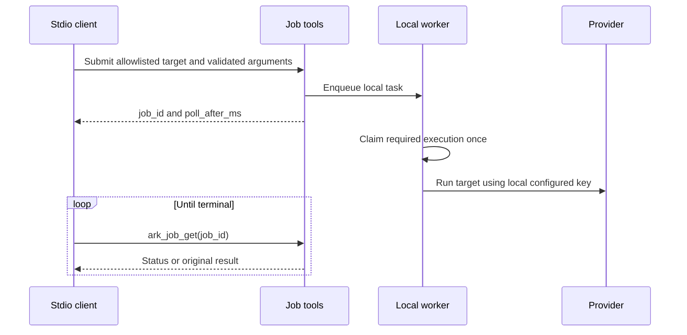

<!-- markdownlint-disable MD013 MD025 -->

# Background Jobs Contract

Historical contract only. Superseded by
[Direct Execution](SPEC_DIRECT_EXECUTION.md). Neither transport now exposes
these tools, native tasks, snapshots or MCP execution claims. The remainder
records the retired design, not current setup instructions.

## Scope

This contract is **stdio-only**. Local long-running tools use the FastMCP
Docket worker through ordinary `ark_job_*` tools, or native task augmentation
for capable clients. HTTP exposes neither route, creates no task snapshots
or queue entries, and runs provider tools directly in the foreground.
See [SPEC_HOSTED_BYOK.md](SPEC_HOSTED_BYOK.md).

## Tool Contracts

| Tool | Input | Result |
| --- | --- | --- |
| `ark_job_capabilities` | No input wrapper; `{}` | Configured targets with `tool_name`, `task_mode`, `required_scope`, `description`, `input_schema` |
| `ark_job_submit` | `input.tool_name`, `input.arguments` (complete target arguments, normally `{"input": {...}}`) | Server-generated `job_id`, `target_tool`, `status=working`, timestamps, TTL and `poll_after_ms` |
| `ark_job_get` | `input.job_id` | Status, timestamps, TTL, `result` and optional `error` |
| `ark_job_cancel` | `input.job_id` | Cooperative local cancellation; does not cancel accepted provider work |

Get/cancel check ownership before backend access. Unknown or unavailable jobs
do not reveal another owner's result. Memory-backed jobs belong to the same
stdio process; a second process cannot retrieve them.

Check terminal status and `result.is_error`. The original tool result is in
`result.structured_content`; a provider `task_id` is not the Ark `job_id`.
`input_required` is unsupported by ordinary jobs and needs cancellation or
a capable client, not treatment as success.

## Execution Policy

`tools/_catalog.py` supplies the immutable background registry.

| Mode | Targets |
| --- | --- |
| Required | `seed_audio_generate`, `seedream_generate_image`, `seedance_create_task`, `media_upload`, `seed_understand`, `seed_audio_understand` |
| Optional | `gen_task_get`, `seed_media_persist_url` |

On stdio a required tool's foreground invocation is rejected before provider
work. Pollers run in the foreground with `persist_output=false`; explicit
persistence requires background execution. The persist-URL tool can run in
either mode; persist-URL always downloads and stores.

The two changed persistence defaults (Seed Audio and Seedream)
are false globally, including stdio. A local caller must explicitly request
true to retain outputs.

## Lifecycle and Safety

Unknown/unregistered targets and invalid arguments fail before enqueue.
Submission uses a server-generated ID, never a client-selected one. If
ownership recording fails after enqueue, cancellation is attempted and the
request fails closed. Required execution claims in the `mcp-execution`
namespace prevent silent replay of an already-started local job.

Default `FASTMCP_DOCKET_URL=memory://` loses active/retained jobs at process
exit. Local optional Redis retention does not distribute SQLite state or
enable multiple replicas. Keep local state and any configured snapshot key
with retained jobs. HTTP must not use a task backend to preserve BYOK headers.

Job events omit arguments, results, prompts and credentials. Cancellation or a
lost response may leave accepted provider work running. Reconcile saved
provider task/request IDs instead of automatically resubmitting. Neither the
job bridge nor provider retries promise exactly-once billing.

## Local Outputs

Workers have no MCP roots. `output_path`, `output_dir` and `save_to` require
server-configured absolute `OUTPUT_ROOTS`; otherwise validation rejects the
request before provider work. Persistence itself does not need output roots.
See the current [integration workflows](../docs/integration-guide.md#direct-execution).

## Implementation and Limits

Handlers live in `tools/background_jobs.py`; the adapter in `background_jobs.py`
is the only consumer of pinned FastMCP task internals. The dependency remains
bounded to `fastmcp[tasks]>=4.1.8,<4.2`. There is no job-list or ordinary
input-update tool. Keep job IDs.

HTTP has a separate [asynchronous-create submission journal](SPEC_HOSTED_BYOK.md#http-submission-safety),
not a job backend: non-dry Seedance creates require `idempotency_key`
and only saved success replays after ownership checks. Stdio rejects supplied
keys. Unresolved HTTP attempts never automatically resume; synchronous product
replay and complete crash recovery remain deferred. PostgreSQL/Redis are
future scaling choices, not initial HTTP requirements. Old shared HTTP jobs
and state have no migration bridge into BYOK. Exact desktop-client task
support must be verified separately.
