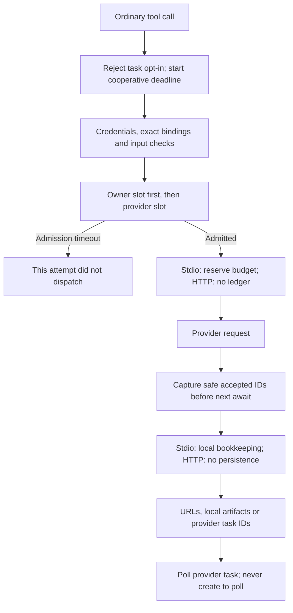

# Direct Execution

Hosted HTTP is stateless; no durable replay or database exists.

This contract supersedes [Background Jobs](SPEC_BACKGROUND_JOBS.md). Both stdio and HTTP
execute ordinary tool calls directly. There is no MCP job queue, worker,
job ID, execution claim, task snapshot or native task extension. Explicit
`io.modelcontextprotocol/tasks` opt-in is rejected on both transports,
including discovery, before provider dispatch.

## Surface

The catalog contains 13 conditionally registered local tools. Four are always
available: `ark_list_models`, `seed_media_get_artifact`,
`seed_media_export_artifact`, and `seed_media_persist_url`.
HTTP exposes eight baseline discovery/provider tools, including Seed TTS.
HTTP has no local storage/artifact tools or resources; local stdio retains them.
The additional catalog definition is opt-in HTTP-only `media_prepare_upload` (14 definitions total), adding
one tool to the baseline HTTP inventory. It signs locally under the same direct
deadline and owner-first `tos` admission, without dispatching a storage mutation
or reserving budget. Client binary upload occurs separately; see
[temporary uploads](SPEC_HOSTED_BYOK.md#temporary-upload-preparation).
Discovery supports image/video bindings and Seed TTS (`kind="audio"`),
and makes no provider calls. HTTP connection checks remain image/video only.

`seed_tts_generate` collects a bounded JSONL response in one direct call.
Stdio persists completed audio; HTTP returns it directly as one native MCP
audio block with separate metadata. No TOS or hosted storage is used.
It has no `persist` flag and uses the same deadline, admission and dispatch
tracking, without automatic synthesis retries. HTTP encodes at most 30 MiB
of audio under admission; its Base64 representation is at most 40 MiB before
metadata. A lost response has no recovery path; retain request IDs and never
automatically repeat synthesis. See [Seed TTS](../docs/seed-tts.md).

Provider video queues remain asynchronous. Retain provider task IDs and poll;
direct MCP execution does not mean a video finishes within the create call.

## Admission and Deadline

| Setting | Default | Constraint | Meaning |
| --- | --- | --- | --- |
| `MCP_ADMISSION_TIMEOUT_SECONDS` | `2.0` | Finite, positive, at most 30 | Total wait for owner and provider slots |
| `MCP_TOOL_TIMEOUT_SECONDS` | `600.0` | Finite, positive, at most 3600 | Cooperative deadline for the whole direct handler |
| `PROVIDER_MAX_CONCURRENCY` | `5` | Positive integer | Per-pod slots per provider bucket |
| `PRINCIPAL_MAX_CONCURRENCY` | `3` | Positive integer | Per-pod slots per derived HTTP owner; skipped for trusted local stdio |

The tool deadline starts at wrapper entry after MCP input parsing, before
credential/binding checks, admission and provider execution.
Provider request and download timeouts remain separate. Admission acquires
the owner slot first, then the provider slot, using one admission deadline.
A same-owner backlog cannot hold global provider slots while waiting for its
owner slot. Active/waiting owner entries are pinned in a bounded registry;
idle entries are removed. Partial acquisition is released on failure or
cancellation. Local stdio budget reservation happens only after admission; HTTP has no ledger.

`ADMISSION_TIMEOUT` is a `ProviderError` with operation `admission`,
`retryable=true`, `ambiguous_completion=false`: **this attempt did not
dispatch**. This does not prove that other variations in a batch did not
dispatch. No automatic admission retry loop is added. ModelArk polling and
discovery do not wait on saturated generation slots, but HTTP per-pod
body/rate/in-flight limits still apply, including to discovery.

The diagram describes `server.py`, `execution.py`,
`runtime.py::ProviderLimiters`, `billed_provider_slot`,
`capture_accepted_task`, and `domain/submissions.py`. Read-only/nonbillable paths
skip inapplicable budget and generation-admission stages.

## Cancellation and Uncertainty

`TOOL_DEADLINE_EXCEEDED` is a text-only error `ToolResult`, not a success
object with an incompatible schema. It distinguishes pre-dispatch/read-only
expiry from a mutation that may have started, retaining only bounded,
validated task/request IDs already observed. Mutation tracking follows
provider-operation semantics, not merely HTTP method or tool annotations.

Safe accepted IDs are captured before the next await after provider acceptance.
HTTP holds them only in the live call, not a durable journal.

TTS also captures its client-generated request ID immediately after dispatch
authorization and before the provider await. Up to five distinct request-only IDs
are kept separately from accepted task receipts, using the same bounded identifier
syntax and live-credential exclusion. Deadline text labels these as correlation IDs,
not task IDs or proof of provider acceptance; they cannot be polled. They survive
streaming and persistence deadlines and are cleared when the invocation ends.
Attempts that expire before dispatch do not capture a request ID.

External client cancellation propagates; only the server's own deadline
becomes `TOOL_DEADLINE_EXCEEDED`. Inner provider timeouts retain their existing
normalized errors. Expiry is checked before dispatch and after a call that
suppresses cancellation. Best-effort local budget finalization errors do
not erase known successful provider results.

The deadline is **cooperative, not a hard wall-clock bound**. Local stdio SQLite
operations and blocking S3/TOS SDK threads drain before locks, admission slots or clients
are released, even after repeated cancellation. Cleanup may exceed the nominal
deadline. A cancelled in-progress budget reservation is drained and any known
reservation released best-effort before cancellation propagates, without
dispatching afterward. Failed cleanup can leave conservative reserved allowance.
After reservation, cancellation commits only if that slot dispatched a provider
mutation; undispatched slots release, independent of earlier variations.

Local accepted-task ownership recording also drains cancellation. Its failure
returns known accepted IDs with an ambiguous, nonretryable error; it never
triggers another create.

## HTTP Lifecycle

HTTP has no task ledger, submission journal, durable replay or budget ledger.
`STATE_BACKEND=none` is selected automatically; explicit database backends fail
startup. Local stdio still selects SQLite for its persistence features.

Task get/list/cancel and Draft lookup are authorized by the supplied provider
key. `X-MCP-Client-Secret` separates per-pod admission scopes, not task access.
Clients sharing a provider key can access whatever that key authorizes.
Use separate provider credentials when independent authorization is required.

Omit `idempotency_key`; the retained legacy field is rejected when supplied.
An identical create is a new operation and may bill again. Save task/request IDs,
poll existing tasks, and reconcile lost or uncertain create responses through
the provider. Never automatically retry an uncertain mutation.

Rate limits and in-flight/provider/principal concurrency are in-memory per pod;
they multiply with replicas and reset at restart. `DAILY_BUDGET_USD` must be `0`
on HTTP; use provider-side spend controls. Readiness is lifespan-only and makes
no storage or provider probes. No database, migration, distributed lock, shared
volume or sticky session is needed for the hosted deployment.

## Clients and Recovery

There is no hosted state to restore or replay. Restarting a pod does not
cancel provider work; clients must retain IDs and poll with authorized provider
credentials. A lost create response may hide billed work and must be reconciled,
not resubmitted automatically.

This is a fresh stateless deployment. Historical database compatibility and
stateful-release migration tooling are not part of this repository.

Use client timeout 660 seconds and compatible proxy settings. Both transports
await foreground MCP calls; HTTP outputs remain URL-only.

## Local Outputs and Export Schema

Direct stdio persistence uses live MCP roots, falling back to `OUTPUT_ROOTS`.
Without either, explicit local path writes are rejected. Persistence into
the configured artifact store does not itself require output roots.
HTTP remains URL-only and rejects persistence and local paths.

The static exporter emits top-level `execution: "direct"` and each available
transport's `execution: "direct"`. It emits no `background` key, including
inside transport metadata. Registration gates and selected credential headers
remain transport-specific. Site examples call the original tool with its
`input` wrapper, never a job envelope.
