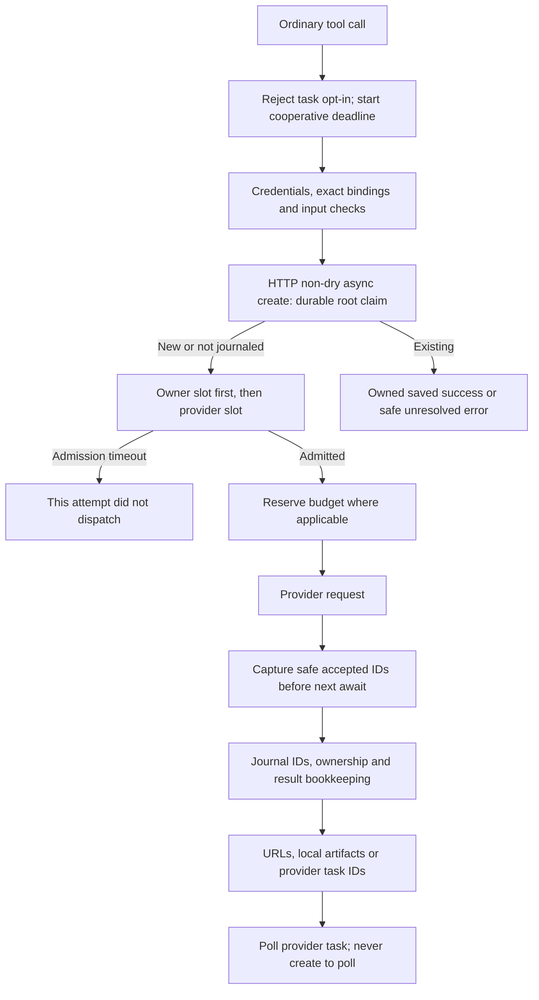

# Direct Execution

This contract supersedes [Background Jobs](SPEC_BACKGROUND_JOBS.md). Both stdio and HTTP
execute ordinary tool calls directly. There is no MCP job queue, worker,
job ID, execution claim, task snapshot or native task extension. Explicit
`io.modelcontextprotocol/tasks` opt-in is rejected on both transports,
including discovery, before provider dispatch.

## Surface

The catalog contains 15 conditionally registered local tools. Four are always
available: `ark_list_models`, `seed_media_get_artifact`,
`seed_media_export_artifact`, and `seed_media_persist_url`.
HTTP exposes seven discovery/provider tools, or ten with OmniHuman enabled.
HTTP has no storage/artifact tools or resources; local stdio retains them.
Discovery supports image/video bindings only and makes no provider calls.

Seed Audio and Seedream return generation results in the direct call.
Seedance and OmniHuman return provider task IDs: poll with `gen_task_get`
or `omnihuman_get_task`, not another create. Their provider-managed queues
remain asynchronous and are not MCP queues. Provider get/list/cancel tools,
task ownership, budget state and the HTTP submission journal remain.

## Admission and Deadline

| Setting | Default | Constraint | Meaning |
| --- | --- | --- | --- |
| `MCP_ADMISSION_TIMEOUT_SECONDS` | `2.0` | Finite, positive, at most 30 | Total wait for owner and provider slots |
| `MCP_TOOL_TIMEOUT_SECONDS` | `600.0` | Finite, positive, at most 3600 | Cooperative deadline for the whole direct handler |
| `PROVIDER_MAX_CONCURRENCY` | `5` | Positive integer | Slots per provider bucket |
| `PRINCIPAL_MAX_CONCURRENCY` | `3` | Positive integer | Slots per derived HTTP owner; skipped for trusted local stdio |

The tool deadline starts at wrapper entry after MCP input parsing, before
credential/binding checks, journal work, admission and provider execution.
Provider request and download timeouts remain separate. Admission acquires
the owner slot first, then the provider slot, using one admission deadline.
A same-owner backlog cannot hold global provider slots while waiting for its
owner slot. Active/waiting owner entries are pinned in a bounded registry;
idle entries are removed. Partial acquisition is released on failure or
cancellation. Budget reservation happens only after admission.

`ADMISSION_TIMEOUT` is a `ProviderError` with operation `admission`,
`retryable=true`, `ambiguous_completion=false`: **this attempt did not
dispatch**. This does not prove that other variations in a batch did not
dispatch. No automatic admission retry loop is added. ModelArk polling and
discovery do not wait on saturated generation slots, but HTTP global
body/rate/in-flight limits still apply, including to discovery.

The diagram describes `server.py`, `execution.py`,
`runtime.py::ProviderLimiters`, `billed_provider_slot`,
`capture_accepted_task`, and `submissions.py`. Read-only/nonbillable paths
skip inapplicable journal, budget and generation-admission stages.

## Cancellation and Uncertainty

`TOOL_DEADLINE_EXCEEDED` is a text-only error `ToolResult`, not a success
object with an incompatible schema. It distinguishes pre-dispatch/read-only
expiry from a mutation that may have started, retaining only bounded,
validated task/request IDs already observed. Mutation tracking follows
provider-operation semantics, not merely HTTP method or tool annotations;
OmniHuman's status POST is read-only.

Safe accepted IDs are captured synchronously inside the provider slot before
the next await, including budget finalization. Durable HTTP ID recording
precedes ownership recording; journal failure still attempts ownership.
Known IDs may accompany an error or a partial batch. Do not discard them or
claim that timeout cancelled accepted upstream work. Malformed or
credential-bearing IDs are never echoed.

External client cancellation propagates; only the server's own deadline
becomes `TOOL_DEADLINE_EXCEEDED`. Inner provider timeouts retain their existing
normalized errors. Expiry is checked before dispatch and after a call that
suppresses cancellation. Best-effort budget/journal finalization errors do
not erase known successful provider results.

The deadline is **cooperative, not a hard wall-clock bound**. SQLite operations
and blocking S3/TOS SDK threads drain before locks, admission slots or clients
are released, even after repeated cancellation. Cleanup may exceed the nominal
deadline. A cancelled in-progress budget reservation is drained and any known
reservation released best-effort before cancellation propagates, without
dispatching afterward. Failed cleanup can leave conservative reserved allowance.

## HTTP Lifecycle

The HTTP entrypoint's shutdown allowance is
`max(MCP_TOOL_TIMEOUT_SECONDS, BYTEPLUS_REQUEST_TIMEOUT_MS / 1000) + 30`
seconds. The VKE Caddy sidecar uses the same maximum plus 30; pod termination
grace is the maximum plus 60 (630/660 seconds by default). Neither allowance
is a hard cleanup guarantee or provider cancellation mechanism.

Before stores or submission recovery open, `RuntimeStateLease` acquires the
exclusive `runtime.sqlite3.lock`; it holds the lease until all state users
close. Contention fails HTTP startup closed. Startup failure/cancellation
drains cleanup. Never unlink a live lock, overlap application replicas or
use a network filesystem. Stdio does not acquire this HTTP lease.

The optional `MCP_METRICS_PORT` defaults to `0` (off); HTTP alone can start
it on 127.0.0.1 at ports 1024-65535. It is absent from the main app and public
proxy. Aggregate admission/deadline metrics do not introduce MCP workers or
per-owner telemetry. The read-only state inspector never performs recovery.
See [hosted operations](SPEC_HOSTED_BYOK.md#trusted-proxy-and-private-operations)
and [VKE Deployment](SPEC_VKE_DEPLOYMENT.md) for CIDR trust, existing Secrets,
single-StatefulSet retained storage and manual addon gates.

## Clients and Recovery

Use a client timeout of **660 seconds** for the default 600-second tool
deadline, and compatible proxy timeouts. Codex uses `tool_timeout_sec=660`;
Claude Code uses `timeout=660000` milliseconds; FastMCP Python uses
`Client(..., timeout=660)`. Increase client/proxy allowances when raising the
server setting. These allowances do not guarantee that all SDK/SQLite cleanup
finishes before a client disconnects.

Never blindly resubmit after a lost response, timeout or cancellation.
Poll known provider IDs using the original credentials and ownership scope.
If acceptance is uncertain or ownership was not recorded, reconcile with the
provider. Stdio has no create journal or replay guarantee.

HTTP non-dry Seedance/OmniHuman creates retain their required
`idempotency_key`: one fresh key per intended whole operation, including
variations. Repeat identical key/input only for delivery recovery, never
polling. Only complete saved success replays after ownership checks, before
upstream access. Failed/partial/cancelled attempts remain unresolved, never
automatically resumed. Do not change keys to bypass uncertainty.
Seedance dry runs are keyless and not journaled; stdio rejects supplied keys.
See [HTTP submission safety](SPEC_HOSTED_BYOK.md#http-submission-safety).

Keep the SQLite state, HMAC key/version and original client/provider credentials.
Claims never auto-prune; capacity limits new keys without disabling existing
reads. Removing MCP execution claims does not remove provider ownership or
journal rows. Synchronous replay, complete crash recovery, exactly-once
billing and multi-replica operation are not promised.

## Local Outputs and Export Schema

Direct stdio persistence uses live MCP roots, falling back to `OUTPUT_ROOTS`.
Without either, explicit local path writes are rejected. Persistence into
the configured artifact store does not itself require output roots.
HTTP remains URL-only and rejects persistence and local paths.

The static exporter emits top-level `execution: "direct"` and each available
transport's `execution: "direct"`. It emits no `background` key, including
inside transport metadata. Registration gates and selected credential headers
remain transport-specific. Site examples call the original tool with its
`input` wrapper, never a job envelope.
