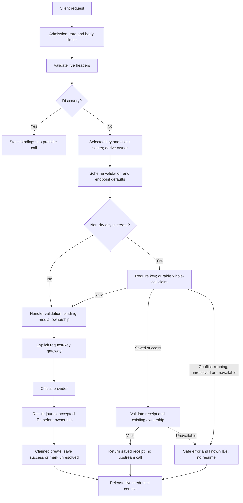

# Hosted BYOK Foundation

This is a forward-only, single-instance foundation, not a public-launch or
multi-replica certification. No OAuth, signup, server-issued key, customer
credential database, or compatibility migration is provided.

## Transport Surface

| Transport | Inventory | Execution and storage |
| --- | --- | --- |
| Local stdio | 21 catalog tools, conditionally registered; eight always available | Local provider settings, ordinary jobs/native tasks, optional storage and artifacts |
| HTTP | 9 tools, or 12 with `BYTEPLUS_OMNIHUMAN_ENABLED=true` | Direct foreground calls; provider-managed video tasks; no jobs, native tasks, storage/artifact tools or resources |

HTTP exposes `ark_list_models`, `seed_audio_generate`, `seedream_generate_image`,
`seedance_create_task`, `gen_task_get`, `gen_task_list`,
`gen_task_cancel_or_delete`, `seed_understand`, and `seed_audio_understand`.
The optional tools are `omnihuman_create_task`, `omnihuman_get_task`, and
`omnihuman_cancel_task`. Registration does not depend on operator provider keys.
Discovery is anonymous, static, and makes no provider calls; it does not
establish entitlement or return account pricing.
`ark_list_models` returns the receiving server's configured bindings even
without an environment provider key. `services[].enabled` reports registration,
not customer entitlement, provider-key validity or model activation.
The 12 [catalog scope strings](../docs/security.md#scope-taxonomy) are metadata,
not auth grants or customer-selected roles.

## Request Credentials

| Header | Requirement |
| --- | --- |
| `X-ModelArk-Api-Key` | ModelArk tools, including audio understanding and Files API delivery |
| `X-Seed-Speech-Api-Key` | Seed Audio generation |
| `X-OmniHuman-Api-Key` | Enabled OmniHuman tools |
| `X-MCP-Client-Secret` | Every provider operation, including dry runs; client-generated 32 random bytes encoded as 64 lowercase hex characters |
| `X-ModelArk-Seedance-Endpoint` | Optional exact registered video binding default |
| `X-ModelArk-Seedream-Endpoint` | Optional exact registered image binding default |

Only the selected provider key is required. `Authorization` is rejected,
not interpreted as a provider key or an MCP access token. Raw ASGI header pairs
are validated: duplicate, empty, whitespace-containing, control, non-ASCII
and oversized values are rejected without echoing them. Provider keys are
opaque printable ASCII, 1-4096 characters, never normalized.

An explicit tool `model` wins over its endpoint header default. Used defaults
must exactly match a registry binding for the product. No arbitrary opaque
`ep-*` lineage inference, automatic model activation or caller-selected base URL
is supported. HTTP uses these fixed official origins:

- ModelArk: `https://ark.ap-southeast.bytepluses.com/api/v3`
- Seed Speech: `https://voice.ap-southeast-1.bytepluses.com`
- Vision AI: `https://openapi.cv.bytepluses.com`

## Identity and Ownership

`MCP_AUTH_MODE=byok` is the default. Explicit `local` is stdio-only; the
`api_key` auth mode is removed. HTTP requires the operator's
`MCP_IDENTITY_HMAC_KEY`, a random 32-byte secret encoded as 64 lowercase hex,
and `MCP_IDENTITY_KEY_VERSION`, a positive integer defaulting to `1`.
These are operator identity configuration, not customer credentials.

Domain-separated HMAC derives a credential tenant from the version, selected
provider, fixed base URL and exact provider key. The owner derives from that
tenant and the client secret. Unrelated provider keys do not affect scope.
The same key with a different client secret has a different owner; changing
the provider key, client secret, HMAC key or version changes ownership scope.
Stable settings and credentials preserve identity across restarts, but there
is no recovery bridge or human/organization identity verification.

Fresh SQLite state is required. Task ownership has primary key
`(provider, tenant_id, task_id)` and an immutable `principal_id` owner.
Reads, claims and lists use this namespace. Conflicts cannot reassign owners.
Missing ownership and unavailable/capacity-exhausted state fail closed.
There is no old-schema migration. Retain the original provider IDs and scope
for polling; do not recreate accepted work to bypass an ownership failure.

Sharing a provider key still permits direct upstream access outside this MCP
boundary. Use separate provider keys/projects for stronger separation.
Budgets are per derived owner and approximate, not an account-wide spend ceiling.

## Credential Lifetime

Credentials exist only in a live request context, with a provider-specific
principal around invocation; contexts reset on completion/cancellation.
Explicit request-key gateways have no HTTP environment-key fallback and do
not mutate shared client headers. Credentials are not persisted in arguments,
task snapshots, database rows, artifact metadata, cache keys, logs or spans.
The operator still receives live credentials and must be trusted.

The receiving server's `Settings` is request-scoped and reset on exit.
Capability-registry lookup uses those scoped settings instead of the cached
process-default registry, so concurrent server instances cannot leak model
defaults or bindings into one another. Anonymous discovery uses the same scope.

Every HTTP entry path, including `http_app()`, enforces the boundary.
Constructing HTTP from a stdio-configured server is rejected. Native tasks and
ordinary jobs are not registered. Explicit per-call
`io.modelcontextprotocol/tasks` opt-in, including on discovery, is rejected
before provider dispatch, task-snapshot capture/save or queue creation.
Request headers are never restored from FastMCP task snapshots.
This explicit rejection is the application's stricter boundary, not a promise
that FastMCP's `task=forbidden` mode alone rejects client opt-in.

## Media and Delivery

`seed_audio_generate.persist`, `seedream_generate_image.persist` and
`omnihuman_get_task.persist_output` default to `false` on every transport.
HTTP rejects explicit `true`, local paths and stored artifact references
before dispatch. Explicit local persistence remains supported.
Seedream `b64_json` needs persistence and therefore is not an HTTP output mode.
HTTP returns provider URLs and metadata, not durable MCP media resources.
Missing/unusable URL-only Seed Audio output is a nonretryable per-item
`NO_DELIVERABLE_OUTPUT`, never an empty success or automatic regeneration.

Clients must retrieve outputs before expiry: about 2 hours for Seed Audio,
24 hours for Seedream/Seedance and 1 hour for OmniHuman. Native authorized
Seedance `asset://` references remain supported without asset administration.

Audio-understanding Files API delivery remains supported. Best-effort deletion
uses the same live request ModelArk key. Remote temporary-file expiry (roughly
one day if cleanup cannot complete) is separate from output URL expiry and
does not constitute local persistence. Unknown upload acceptance is not retried.

## Admission and Diagnostics

| Setting | Default | HTTP rule |
| --- | --- | --- |
| `RATE_LIMIT_RPM` | `60` | Positive per-IP rate; bounded limiter map |
| `RATE_LIMIT_BURST` | `0` | Uses RPM when zero |
| `MCP_HTTP_MAX_BODY_BYTES` | `2097152` (2 MiB) | Positive streamed request limit |
| `MCP_HTTP_MAX_IN_FLIGHT` | `64` | Positive admission bound before body processing, including discovery |
| `STATE_MAX_RECORDS` | `100000` | Positive retained-state bound, also the submission-journal capacity; no eviction of live owners or submission claims |
| `STATE_PRUNE_MAX_AGE_DAYS` | `30` | At least 14 when regular Seedance 2.5 is bound on HTTP; never prunes submission claims |

Stateless HTTP forces Host/Origin protection. Proxy headers are untrusted by
default. `/health` and `/ready` return minimal liveness/state readiness without
provider probes or configuration disclosure. Public HTTP has no `/metrics`
endpoint or configuration-detail resource.

Uncertain mutation transport failures and malformed 2xx responses are
nonretryable/ambiguous with sanitized diagnostics. Billable understanding
completions use this same policy: response loss, read/write/protocol errors and
malformed provider 2xx responses do not permit automatic replay.
Chat/mutation 5xx errors remain `retryable=true` in HTTP normalization but are
ambiguous and never retried automatically. Eligible 429 rejections,
demonstrably pre-dispatch connection/pool failures and reads retain bounded
retries; understanding's `retry_timeouts=False` excludes all `TIMEOUT` retries.
Errors retain safe codes/request IDs, not raw exception text or credential URLs.
Clients must reconcile instead of blindly retrying.

Budget reservation before dispatch still fails closed. In `billed_provider_slot`,
commit/release exceptions log `ERROR` event `budget_finalization_failed` with
safe `provider`, `action` and `reservation_id` fields, never raw exception text.
They do not replace the provider result/error, raise `AcceptedTaskError`, or
add to Seedance's `failed` count. Failed finalization leaves conservative
reserved allowance. Cancellation cleanup is shielded best effort, not a
guarantee that no reserved rows remain.

Seedance proceeds to the shared `record_accepted_task` helper even after a
budget-finalization log event; OmniHuman uses the same helper. On HTTP it
validates task/request IDs against `[A-Za-z0-9._:-]{1,256}` and rejects secret
echoes before either persistence write. Unsafe IDs produce `UNSAFE_TASK_RECEIPT`
without persisting or echoing them. Safe accepted IDs are journaled before
ownership recording. A failed journal write still attempts ownership.
Accepted journal/ownership failures become outward `AcceptedTaskError`
(`SUBMISSION_RECORD_FAILED` / `OWNERSHIP_RECORD_FAILED`), retaining safe
accepted task IDs and available request IDs.
These failures are ambiguous/nonretryable and never cause internal
resubmission. In Seedance variation results, `task_id` and `error` can coexist:
`submitted` counts known accepted IDs, while `failed` counts entries with
errors, so accepted journal/ownership errors can count in both. Single-call
failures remain error `ToolResult` text carrying known IDs, not structured
success output. HTTP polling requires recorded ownership; otherwise use
task/request IDs for provider-side reconciliation. Trusted stdio permits
unrecorded IDs, but still rejects a recorded owner mismatch.

Understanding JSON Schema validation is offline. `$ref`, `$dynamicRef` and
`$recursiveRef` must be fragment-only (`#...`); external schemas are never
retrieved. Internal tool metrics use catalog names or a fixed `unknown` label,
not arbitrary caller-supplied tool names; unknown background targets are skipped.

## HTTP Submission Safety

This first slice covers only `seedance_create_task` and
`omnihuman_create_task`, not synchronous generation or understanding.
The shared input schemas expose nullable `idempotency_key` with default null.
Non-null keys must contain 16-128 ASCII letters, digits, `_` or `-`;
a fresh UUID is recommended for each intended create operation.
HTTP requires a non-null key for non-dry creates, including Draft creation and
promotion. Seedance dry runs need no key and bypass the journal without
consuming one. Stdio rejects supplied non-null keys, including on dry runs.

One root claim covers the whole call, including every Seedance variation.
After live BYOK binding, schema validation and endpoint-default application,
the coordinator atomically commits that claim **before entering the handler**.
The scope is `(provider, tenant_id, principal_id, tool_name, key_digest)`.
Both the key and canonical validated input use domain-separated operator HMAC
fingerprints. Input defaults and effective endpoint/model are included;
the key itself is excluded from the input fingerprint.
An omitted ordinary Seedance model resolves to the registered default.
An omitted Draft-promotion model instead fingerprints an inherited-model
marker plus `draft_task_id`, without an upstream Draft lookup. Explicit and
inherited model forms may conservatively conflict; repeat identical arguments.

Repeating the same key and arguments is **delivery recovery, not polling**.
Only a fully successful saved receipt replays in the unchanged output schema.
Every recorded task must still pass ownership checks before replay, with no
handler entry, provider call, Draft lookup or automatic ownership repair.
Missing/expired ownership fails closed. Poll recovered task IDs through
`gen_task_get` or `omnihuman_get_task` to learn current provider status.
Reuse requires the original provider key/client secret, stable operator HMAC
key/version, and the same retained SQLite state.

| Error code | Meaning and client action |
| --- | --- |
| `IDEMPOTENCY_KEY_REQUIRED` | Non-dry HTTP create has no key; nothing dispatched |
| `SUBMISSION_CONFLICT` | Existing scoped key with changed input; restore the original arguments to recover that operation |
| `SUBMISSION_IN_PROGRESS` | Claim is still running; no second handler entry or automatic resume |
| `SUBMISSION_UNRESOLVED` | Failed, interrupted, partial or cancelled attempt, or unusable receipt/ownership; reconcile known task/request IDs |
| `SUBMISSION_UNAVAILABLE` | Journal unavailable or full; this call made no provider request |

Errors remain text-only `ToolResult` errors, not structured success. First
attempts retain existing diagnostics; repeats contain fixed safe guidance and
durably known accepted IDs, never saved raw errors. Do not change keys to
bypass uncertain acceptance. No failed variation is automatically resumed.

### Journal and Retention

`SQLiteSubmissionStore` in `submission_store.py` uses `http_submissions` and
`http_submission_tasks` in `runtime.sqlite3`, with WAL, `synchronous=FULL`,
a 5-second busy timeout and cancellation-safe serialized worker-thread I/O.
States are `running`, `succeeded` and `unresolved`; reopening this
single-instance store marks leftover running claims unresolved.
Failures, partial results and cancellation attempt the same transition.
A saved success is never demoted. A final receipt-write failure preserves the
first provider result but leaves repeated calls fail-closed.

Persist only scope digests, state/timestamps, up to five safe accepted
task/request-ID pairs, and an allowlisted success receipt of at most 32 KiB.
Seedance success requires exactly the requested ordered entries, no errors or
duplicate task IDs, consistent counters and exact journal ID matches.
OmniHuman success must also match its journal IDs. No raw idempotency keys,
prompts, media references, credentials, provider bodies or error messages are
persisted in the journal.

Claims are **never automatically pruned**, including by
`STATE_PRUNE_MAX_AGE_DAYS`. `STATE_MAX_RECORDS` limits journal rows; at capacity
new keys fail before dispatch, while existing keys remain readable and owned
task polling continues. Do not delete claims or reset state to admit more work:
forgetting a claim can permit duplicates. Operator capacity management remains
an operational follow-up. Ownership has separate retention; a surviving
receipt does not restore an expired owner.

## Next Phase

Synchronous product replay and complete crash recovery remain deferred.
A crash between provider acceptance and the first accepted-ID write can lose
that ID; the root claim prevents same-key re-dispatch but cannot discover
unknown tasks. Automatic reconciliation and exactly-once billing are not
promised. PostgreSQL/Redis are future scaling choices, not initial requirements;
SQLite remains the single-instance backend. Public launch still requires
operational capacity/recovery work, load/security validation and live provider
and exact-client interoperability checks. Offline protocol tests are not live
provider or desktop-client evidence.

## Sources

- Current implementation: `server.py`, `security/http_middleware.py`,
  `config/env.py`, `config/model_capabilities.py`, `tools/ark_list_models.py`,
  `tools/_seedance_shared.py`, `submissions.py`, `submission_store.py`,
  `runtime.py`, and ModelArk gateway/understanding adapters.
- [FastMCP background tasks](https://gofastmcp.com/servers/tasks), accessed
  2026-11-16: per-call extension opt-in and execution modes. The application
  boundary above is verified against this checkout, not inferred from framework defaults.
