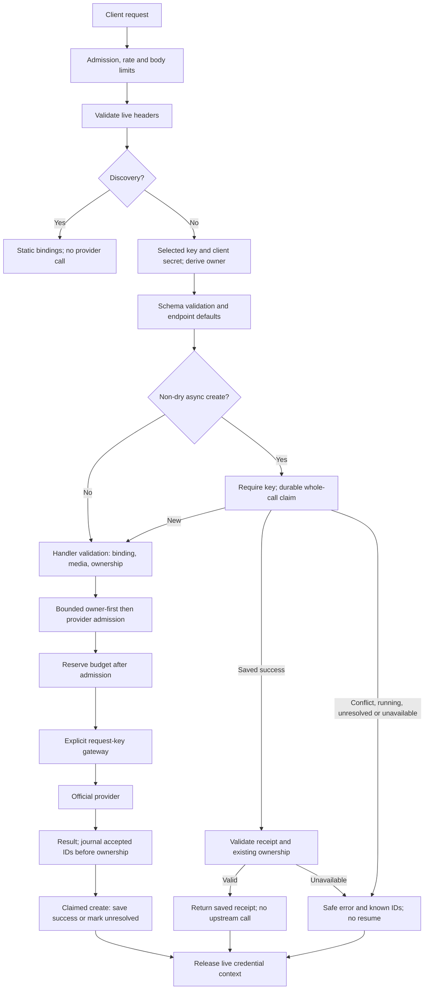

# Hosted BYOK Foundation

This is a forward-only, single-instance foundation, not a public-launch or
multi-replica certification. No OAuth, signup, server-issued key, customer
credential database, or compatibility migration is provided.

## Transport Surface

| Transport | Inventory | Execution and storage |
| --- | --- | --- |
| Local stdio | 15 catalog tools, conditionally registered; four always available | Direct calls, local provider settings, optional storage and artifacts |
| HTTP | 7 tools, or 10 with `BYTEPLUS_OMNIHUMAN_ENABLED=true` | Direct foreground calls; provider-managed video tasks; no jobs, native tasks, storage/artifact tools or resources |

HTTP exposes `ark_list_models`, `seed_audio_generate`, `seedream_generate_image`,
`seedance_create_task`, `gen_task_get`, `gen_task_list`,
`gen_task_cancel_or_delete`.
The optional tools are `omnihuman_create_task`, `omnihuman_get_task`, and
`omnihuman_cancel_task`. Registration does not depend on operator provider keys.
Discovery is anonymous, static, and makes no provider calls; it does not
establish entitlement or return account pricing.
Default `check_connection=false` returns `connection=null` without inspecting
request credentials in discovery. An opt-in HTTP configuration check is
described below; it is not a provider-authentication check.
`ark_list_models` returns the receiving server's configured bindings even
without an environment provider key. `services[].enabled` reports registration,
not customer entitlement, provider-key validity or model activation.
The 11 [catalog scope strings](../docs/security.md#scope-taxonomy) are metadata,
not auth grants or customer-selected roles.

## Request Credentials

| Header | Requirement |
| --- | --- |
| `X-ModelArk-Api-Key` | Seedream and Seedance tools |
| `X-Seed-Speech-Api-Key` | Seed Audio generation |
| `X-OmniHuman-Api-Key` | Enabled OmniHuman tools |
| `X-MCP-Client-Secret` | Every provider operation, including dry runs; client-generated 32 random bytes encoded as 64 lowercase hex characters |
| `X-ModelArk-Seedance-Endpoint` | Optional exact registered video binding default |
| `X-ModelArk-Seedream-Endpoint` | Optional exact registered image binding default |

Only the selected provider key is required. `Authorization` is rejected,
not interpreted as a provider key or an MCP access token. Raw ASGI header pairs
are validated: duplicate, empty, whitespace-containing, control, non-ASCII
and oversized values are rejected without echoing them. Provider keys are
opaque printable ASCII, 1-4096 characters, never normalized.

An explicit tool `model` wins over its endpoint header default. Used defaults
must exactly match a registry binding for the product. No arbitrary opaque
`ep-*` lineage inference, automatic model activation or caller-selected base URL
is supported. HTTP uses these fixed official origins:

- ModelArk: `https://ark.ap-southeast.bytepluses.com/api/v3`
- Seed Speech: `https://voice.ap-southeast-1.bytepluses.com`
- Vision AI: `https://openapi.cv.bytepluses.com`

## BYOE Endpoint Authority

Bring-your-own-endpoint (BYOE) support means selecting an **operator-verified
exact binding**, not self-service verification of an arbitrary customer ID.
The official [GetEndpoint authentication contract](https://ai.byteplus.com/ark/region:ap-southeast-1/docs/get-endpoint-api#authentication),
verified against the documentation body and OpenAPI schema on 2026-11-17,
requires Access Key V4 signing (AK/SK), not a ModelArk Bearer API key.
Its `ModelReference.FoundationModel.Name` and `ModelVersion` describe lineage;
an opaque endpoint ID or a caller-declared family does not establish it.

An authorized operator must verify the endpoint's model/version outside this
server, then configure the exact ID and supported family in
`SEEDANCE_MODEL_BINDINGS` or `SEEDREAM_MODEL_BINDINGS`. Retain an entry for the
configured product default. These bindings are visible in anonymous discovery,
so do not treat endpoint IDs in them as secrets. This server does not collect,
store or use customer AK/SK, fetch endpoint metadata, infer lineage, or activate
models. Automatic arbitrary-endpoint onboarding remains unimplemented and
requires a separately approved authority/credential design.

Unknown image/video `ep-*` selections fail with `ENDPOINT_NOT_CONFIGURED`
guidance before provider dispatch, without echoing the unknown ID. The operator
must verify and bind it; do not guess a family or bypass the check.

## HTTP Configuration Preflight

Call `ark_list_models` with `{"input":{"check_connection":true}}` only through
a live HTTP request. Omitted/null `kind` checks both video and image routes;
`kind="video"` or `"image"` checks just that route. Other kinds, stdio calls,
and calls without a live HTTP request context are rejected.
Seed Speech and OmniHuman are not checked.

No provider key or client secret is required to request diagnostics: missing
headers become issues. The HTTP boundary still rejects malformed headers.
Preflight uses header presence and this server's registry only, with no HMAC
identity derivation, provider or metadata requests, credential persistence,
state writes or changes to server settings.

`connection: HttpConnectionCheck | null` is null unless opted in:

| Field | Type | Meaning |
| --- | --- | --- |
| `configuration_valid` | boolean | Both required headers are present and every checked route is configured |
| `modelark_key_present` | boolean | Live `X-ModelArk-Api-Key` header is present |
| `client_secret_present` | boolean | Live independent `X-MCP-Client-Secret` header is present |
| `authentication_verified` | literal `false` | No upstream authentication, entitlement or balance verification |
| `provider_calls_made` | literal `false` | No provider or endpoint-metadata requests |
| `issues` | list of strings | `missing_modelark_key` and/or `missing_client_secret`; empty when both are present |
| `routes` | list of `EndpointSelectionCheck` | Checked defaults, video then image when both are requested |

Each `EndpointSelectionCheck` contains:

| Field | Type | Meaning |
| --- | --- | --- |
| `tool` | `seedance_create_task` or `seedream_generate_image` | Product route checked |
| `source` | `request_header` or `server_default` | Endpoint header when present, otherwise the operator default |
| `configured` | boolean | Exact selected ID is registered for that product |
| `model_id` | string or null | Registered model/endpoint ID; null for unknown selections, which are never echoed |
| `family` | string or null | Operator-configured family, not verified live lineage; null for unknown selections |
| `issue` | `endpoint_not_configured` or null | Operator verification/binding required, otherwise null |

`configuration_valid=true` does not prove key validity, endpoint existence,
current lineage, activation, permissions, balance or reachability. The check
describes route defaults, not a prospective create payload: an explicit
create-tool `model` still wins over an endpoint header. `models[].is_default`
continues to describe the server default, not the request-header override.
Neither a valid preflight nor a dry run is authorization to spend.

## Client Snippet Generator

`scripts/configure_http_client.py` is a standalone stdlib-only formatter:
`python scripts/configure_http_client.py --client codex|claude-code --url URL`.
It emits one TOML/JSON snippet to stdout. It reads no files or environment
secret values, writes no files, makes no network calls, and never invokes or
changes a client. Applying a snippet and private credential entry are separate
user-authorized setup steps.

- `--name`: defaults to `seed-mcp`, 1-64 ASCII letters/digits/underscore/hyphen.
- Repeated `--provider`: `modelark`, `seed-speech`, `vision-cv`; defaults to
  `modelark` when omitted. Only selected providers get headers.
- Environment-name defaults: `SEED_MCP_MODELARK_KEY`,
  `SEED_MCP_SEED_SPEECH_KEY`, `SEED_MCP_OMNIHUMAN_KEY`,
  `SEED_MCP_CLIENT_SECRET`. Override names with `--modelark-key-env`,
  `--seed-speech-key-env`, `--omnihuman-key-env`, `--client-secret-env`.
- Optional `--seedance-endpoint-env` and `--seedream-endpoint-env` add endpoint
  headers and require selected provider `modelark`; values must resolve to
  exact registered bindings when the client sends them.
- Variable names match `[A-Za-z_][A-Za-z0-9_]{0,127}`. Selected headers must use
  distinct names, including an independent client-secret variable. The
  generator does not inspect values or prove they are distinct.
- URLs require absolute HTTPS with a valid host/port and no userinfo, query,
  fragment, whitespace, controls or backslashes. `--allow-loopback-http` permits
  HTTP only on literal `localhost`, `127.0.0.1` or `::1` for isolated tests,
  not remote plaintext access or disabled TLS verification.
- `--tool-timeout-seconds`: integer 1-3600, default 660. Codex receives
  `mcp_servers.<name>`, `env_http_headers` and `tool_timeout_sec`; no
  `bearer_token_env_var`. Claude Code receives `mcpServers.<name>`,
  `type="http"`, `${VAR}` header references and `timeout` in milliseconds
  (660000 by default). These settings do not extend provider/proxy timeouts.

Invalid input exits with a safe generic error rather than echoing supplied
values. No credential-value or authentication flags are accepted. The
[shared-server guide](../docs/setup/shared-server.md) covers help, examples
and private client environment setup.

## Identity and Ownership

`MCP_AUTH_MODE=byok` is the default. Explicit `local` is stdio-only; the
`api_key` auth mode is removed. HTTP requires the operator's
`MCP_IDENTITY_HMAC_KEY`, a random 32-byte secret encoded as 64 lowercase hex,
and `MCP_IDENTITY_KEY_VERSION`, a positive integer defaulting to `1`.
These are operator identity configuration, not customer credentials.

Domain-separated HMAC derives a credential tenant from the version, selected
provider, fixed base URL and exact provider key. The owner derives from that
tenant and the client secret. Unrelated provider keys do not affect scope.
The same key with a different client secret has a different owner; changing
the provider key, client secret, HMAC key or version changes ownership scope.
Stable settings and credentials preserve identity across restarts, but there
is no recovery bridge or human/organization identity verification.

Fresh SQLite state is required. Task ownership has primary key
`(provider, tenant_id, task_id)` and an immutable `principal_id` owner.
Reads, claims and lists use this namespace. Conflicts cannot reassign owners.
Missing ownership and unavailable/capacity-exhausted state fail closed.
There is no old-schema migration. Retain the original provider IDs and scope
for polling; do not recreate accepted work to bypass an ownership failure.

Sharing a provider key still permits direct upstream access outside this MCP
boundary. Use separate provider keys/projects for stronger separation.
Budgets are per derived owner and approximate, not an account-wide spend ceiling.

## Credential Lifetime

Credentials exist only in a live request context, with a provider-specific
principal around invocation; contexts reset on completion/cancellation.
Explicit request-key gateways have no HTTP environment-key fallback and do
not mutate shared client headers. Credentials are not persisted in arguments,
task snapshots, database rows, artifact metadata, cache keys, logs or spans.
The operator still receives live credentials and must be trusted.

The receiving server's `Settings` is request-scoped and reset on exit.
Capability-registry lookup uses those scoped settings instead of the cached
process-default registry, so concurrent server instances cannot leak model
defaults or bindings into one another. Anonymous discovery uses the same scope.

Every HTTP entry path, including `http_app()`, enforces the boundary.
Constructing HTTP from a stdio-configured server is rejected. Native tasks and
ordinary jobs are not registered. Explicit per-call
`io.modelcontextprotocol/tasks` opt-in, including on discovery, is rejected
before provider dispatch, task-snapshot capture/save or queue creation.
Request headers are never restored from FastMCP task snapshots.
This explicit rejection is the application's stricter boundary, not a promise
that FastMCP's `task=forbidden` mode alone rejects client opt-in.

## Media and Delivery

`seed_audio_generate.persist`, `seedream_generate_image.persist` and
`omnihuman_get_task.persist_output` default to `false` on every transport.
HTTP rejects explicit `true`, local paths and stored artifact references
before dispatch. Explicit local persistence remains supported.
Seedream `b64_json` needs persistence and therefore is not an HTTP output mode.
HTTP returns provider URLs and metadata, not durable MCP media resources.
Missing/unusable URL-only Seed Audio output is a nonretryable per-item
`NO_DELIVERABLE_OUTPUT`, never an empty success or automatic regeneration.

Clients must retrieve outputs before expiry: about 2 hours for Seed Audio,
24 hours for Seedream/Seedance and 1 hour for OmniHuman. Native authorized
Seedance `asset://` references remain supported without asset administration.

## Admission and Diagnostics

| Setting | Default | HTTP rule |
| --- | --- | --- |
| `RATE_LIMIT_RPM` | `60` | Positive per-IP rate; bounded limiter map |
| `RATE_LIMIT_BURST` | `0` | Uses RPM when zero |
| `MCP_HTTP_MAX_BODY_BYTES` | `2097152` (2 MiB) | Positive streamed request limit |
| `MCP_HTTP_MAX_IN_FLIGHT` | `64` | Positive admission bound before body processing, including discovery |
| `STATE_MAX_RECORDS` | `100000` | Positive retained-state bound, also the submission-journal capacity; no eviction of live owners or submission claims |
| `STATE_PRUNE_MAX_AGE_DAYS` | `30` | At least 14 when regular Seedance 2.5 is bound on HTTP; never prunes submission claims |
| `MCP_ADMISSION_TIMEOUT_SECONDS` | `2.0` | Finite positive seconds, max 30; owner-first then provider-slot wait |
| `MCP_TOOL_TIMEOUT_SECONDS` | `600.0` | Finite positive seconds, max 3600; cooperative whole-tool deadline |

Both transports execute directly, without MCP jobs, native tasks, snapshots
or execution claims. The whole-tool timer starts at wrapper entry after MCP
parsing, before credentials, binding, journal and admission. Admission precedes
budget reservation. Active/waiting owner limiters are pinned; partial
acquisitions are released on failure. `ADMISSION_TIMEOUT` is retryable and
nonambiguous for this attempt only; other variations may already be accepted.
No automatic admission retry is added.

Use client timeout 660 seconds with the default tool deadline and compatible
proxy timeouts. SQLite/SDK draining may exceed the cooperative deadline.
`TOOL_DEADLINE_EXCEEDED` is text-only and retains mutation uncertainty and
known safe accepted IDs, captured before the next await after provider
acceptance. External cancellation propagates. Neither deadline nor disconnect
guarantees provider cancellation; never blindly resubmit.
See [Direct Execution](SPEC_DIRECT_EXECUTION.md).

Stateless HTTP forces Host/Origin protection. Proxy headers are untrusted by
default. Backend `/health` and `/ready` return minimal liveness/state readiness
without provider probes or configuration disclosure. Public HTTP has no
`/metrics` endpoint or configuration-detail resource; VKE also blocks `/ready`
at Caddy and uses it only for loopback exec probes.

Uncertain mutation transport failures and malformed 2xx responses are
nonretryable/ambiguous with sanitized diagnostics. Response loss,
read/write/protocol errors and malformed mutation 2xx responses do not permit
automatic replay. Mutation 5xx errors remain `retryable=true` in HTTP normalization but are
ambiguous and never retried automatically. Eligible 429 rejections,
demonstrably pre-dispatch connection/pool failures and reads retain bounded
retries.
Errors retain safe codes/request IDs, not raw exception text or credential URLs.
Clients must reconcile instead of blindly retrying.

Budget reservation before dispatch still fails closed. In `billed_provider_slot`,
commit/release exceptions log `ERROR` event `budget_finalization_failed` with
safe `provider`, `action` and `reservation_id` fields, never raw exception text.
They do not replace the provider result/error, raise `AcceptedTaskError`, or
add to Seedance's `failed` count. Failed finalization leaves conservative
reserved allowance. Cancellation cleanup is shielded best effort, not a
guarantee that no reserved rows remain.

Seedance proceeds to the shared `record_accepted_task` helper even after a
budget-finalization log event; OmniHuman uses the same helper. On HTTP it
validates task/request IDs against `[A-Za-z0-9._:-]{1,256}` and rejects secret
echoes before either persistence write. Unsafe IDs produce `UNSAFE_TASK_RECEIPT`
without persisting or echoing them. Safe accepted IDs are journaled before
ownership recording. A failed journal write still attempts ownership.
Accepted journal/ownership failures become outward `AcceptedTaskError`
(`SUBMISSION_RECORD_FAILED` / `OWNERSHIP_RECORD_FAILED`), retaining safe
accepted task IDs and available request IDs.
These failures are ambiguous/nonretryable and never cause internal
resubmission. In Seedance variation results, `task_id` and `error` can coexist:
`submitted` counts known accepted IDs, while `failed` counts entries with
errors, so accepted journal/ownership errors can count in both. Single-call
failures remain error `ToolResult` text carrying known IDs, not structured
success output. HTTP polling requires recorded ownership; otherwise use
task/request IDs for provider-side reconciliation. Trusted stdio permits
unrecorded IDs, but still rejects a recorded owner mismatch.

Internal tool metrics use catalog names or a fixed `unknown` label,
not arbitrary caller-supplied tool names. There are no job-admission metrics.

## Trusted Proxy and Private Operations

`RATE_LIMIT_TRUSTED_PROXY_CIDRS` defaults empty and replaces the removed
boolean `RATE_LIMIT_TRUST_PROXY_HEADERS` without an alias. It accepts explicit
canonical IPv4/IPv6 CIDRs; host bits, empty entries and catch-all networks
(including combined catch-all coverage) are rejected. Uvicorn proxy-header
rewriting is disabled so the middleware sees the immediate socket peer.

Untrusted peers' forwarding headers are ignored. Trusted peers' single
`X-Forwarded-For` header has bounded size/hops and canonical address parsing.
Walk right-to-left through trusted hops to the first untrusted address.
Malformed or duplicate chains fail with fixed text and no header echo.
Rate/body events use bounded route labels, not arbitrary paths or raw headers.

VKE runs Caddy in the same single pod as the loopback-bound application
(`127.0.0.1:3000`), trusting only `127.0.0.1/32`. Caddy overwrites forwarded
addresses and host/proto, removes `Forwarded`, and exposes only `/mcp` and
`/health` behind CLB TCP 443. Actual VKE source-IP preservation is unverified.
Do not add broad trusted networks to bypass this acceptance gate.

`MCP_METRICS_PORT` defaults to `0` (disabled); nonzero ports must be
1024-65535. The listener is HTTP-runtime-only and binds only 127.0.0.1,
separate from the main app, with thread shutdown/drain owned by the runtime.
It exposes the existing Prometheus registry without per-owner labels.
Admission rejections and tool deadlines use fixed aggregate labels.
Helm can enable port 9000, but creates no metrics Service; only authorized
loopback-bound pod port-forward/exec is supported for access.

## HTTP State Ownership

`RuntimeStateLease` holds a nonblocking hard filesystem lock on
`runtime.sqlite3.lock` before opening any stores or submission recovery.
Contention fails HTTP startup closed with fixed text. The lease remains owned
until state users close; acquisition/cleanup drain on partial startup failure
and cancellation. Never unlink or replace an active lock. File presence alone
is not lock ownership. Stdio does not acquire this HTTP lease and must not
share the active HTTP state directory.

This is local block-storage protection, not network-filesystem support or
distributed fencing. The VKE deployment uses one StatefulSet, retained ext4
ReadWriteOnce EBS and no application HPA. Dedicated VKE replaces ECS/Compose;
PostgreSQL and Redis remain unnecessary for this single-instance design.
See [VKE Deployment](SPEC_VKE_DEPLOYMENT.md).

The entrypoint grace is `max(tool timeout, provider timeout in seconds) + 30`;
Caddy uses the same allowance and chart pod termination uses the maximum
plus 60 (630/660 seconds by default). Draining is cooperative, not a guarantee
that accepted upstream work stops on shutdown.

`scripts/inspect_runtime_state.py` is stdlib-only, read-only aggregate
inspection using an explicit database path, capacity and bounded timeout.
It never opens application startup/recovery, emits IDs/payloads or repairs
state. Missing/corrupt/schema-mismatched state fails without creating a DB.
Preserve consistent SQLite/WAL backups and matching HMAC key/version; no
state reset, blind restore or requeue is an accepted recovery procedure.

## HTTP Submission Safety

This first slice covers only `seedance_create_task` and
`omnihuman_create_task`, not synchronous generation.
The shared input schemas expose nullable `idempotency_key` with default null.
Non-null keys must contain 16-128 ASCII letters, digits, `_` or `-`;
a fresh UUID is recommended for each intended create operation.
HTTP requires a non-null key for non-dry creates, including Draft creation and
promotion. Seedance dry runs need no key and bypass the journal without
consuming one. Stdio rejects supplied non-null keys, including on dry runs.

One root claim covers the whole call, including every Seedance variation.
After live BYOK binding, schema validation and endpoint-default application,
the coordinator atomically commits that claim **before entering the handler**.
The scope is `(provider, tenant_id, principal_id, tool_name, key_digest)`.
Both the key and canonical validated input use domain-separated operator HMAC
fingerprints. Input defaults and effective endpoint/model are included;
the key itself is excluded from the input fingerprint.
An omitted ordinary Seedance model resolves to the registered default.
An omitted Draft-promotion model instead fingerprints an inherited-model
marker plus `draft_task_id`, without an upstream Draft lookup. Explicit and
inherited model forms may conservatively conflict; repeat identical arguments.

Repeating the same key and arguments is **delivery recovery, not polling**.
Only a fully successful saved receipt replays in the unchanged output schema.
Every recorded task must still pass ownership checks before replay, with no
handler entry, provider call, Draft lookup or automatic ownership repair.
Missing/expired ownership fails closed. Poll recovered task IDs through
`gen_task_get` or `omnihuman_get_task` to learn current provider status.
Reuse requires the original provider key/client secret, stable operator HMAC
key/version, and the same retained SQLite state.

| Error code | Meaning and client action |
| --- | --- |
| `IDEMPOTENCY_KEY_REQUIRED` | Non-dry HTTP create has no key; nothing dispatched |
| `SUBMISSION_CONFLICT` | Existing scoped key with changed input; restore the original arguments to recover that operation |
| `SUBMISSION_IN_PROGRESS` | Claim is still running; no second handler entry or automatic resume |
| `SUBMISSION_UNRESOLVED` | Failed, interrupted, partial or cancelled attempt, or unusable receipt/ownership; reconcile known task/request IDs |
| `SUBMISSION_UNAVAILABLE` | Journal unavailable or full; this call made no provider request |

Errors remain text-only `ToolResult` errors, not structured success. First
attempts retain existing diagnostics; repeats contain fixed safe guidance and
durably known accepted IDs, never saved raw errors. Do not change keys to
bypass uncertain acceptance. No failed variation is automatically resumed.

### Journal and Retention

`SQLiteSubmissionStore` in `submission_store.py` uses `http_submissions` and
`http_submission_tasks` in `runtime.sqlite3`, with WAL, `synchronous=FULL`,
a 5-second busy timeout and cancellation-safe serialized worker-thread I/O.
States are `running`, `succeeded` and `unresolved`; reopening this
single-instance store marks leftover running claims unresolved.
Failures, partial results and cancellation attempt the same transition.
A saved success is never demoted. A final receipt-write failure preserves the
first provider result but leaves repeated calls fail-closed.

Persist only scope digests, state/timestamps, up to five safe accepted
task/request-ID pairs, and an allowlisted success receipt of at most 32 KiB.
Seedance success requires exactly the requested ordered entries, no errors or
duplicate task IDs, consistent counters and exact journal ID matches.
OmniHuman success must also match its journal IDs. No raw idempotency keys,
prompts, media references, credentials, provider bodies or error messages are
persisted in the journal.

Claims are **never automatically pruned**, including by
`STATE_PRUNE_MAX_AGE_DAYS`. `STATE_MAX_RECORDS` limits journal rows; at capacity
new keys fail before dispatch, while existing keys remain readable and owned
task polling continues. Do not delete claims or reset state to admit more work:
forgetting a claim can permit duplicates. Read-only aggregate inspection
supports capacity triage; capacity planning and remediation still require
operator decisions. Ownership has separate retention; a surviving
receipt does not restore an expired owner.

## Next Phase

Synchronous product replay and complete crash recovery remain deferred.
A crash between provider acceptance and the first accepted-ID write can lose
that ID; the root claim prevents same-key re-dispatch but cannot discover
unknown tasks. Automatic reconciliation and exactly-once billing are not
promised. PostgreSQL/Redis are future scaling choices, not initial requirements;
SQLite remains the single-instance backend. Public launch still requires
operational capacity/recovery work, load/security validation and live provider
and exact-client interoperability checks. Offline protocol tests are not live
provider or desktop-client evidence.

Actual model-driven Codex/Claude tool execution and paid provider validation remain pending.
Isolated `codex mcp get --json` / `claude mcp get` configuration inspection
can establish parsing only, not tool use or upstream authorization. An
unapproved Claude project entry remains unapproved. A loopback network smoke
with synthetic headers and mocked providers establishes only the tested
transport path, not live provider access, deployed TLS or customer endpoint
lineage. Neither check authorizes changing real client configuration,
credentials or trust settings.

The maintained `scripts/hosted_acceptance.py --caddy-bin PATH` checks isolated
real HTTP/Caddy TLS with mocked providers and bounded synthetic load.
Mock measurements are not capacity certification. Live VKE apply, source IP,
CSI, rollout/restore and real-client/provider acceptance remain unverified.
Terraform state is separate from old ECS state; source deletion is not cloud
decommissioning. Preserve old reviewed checkouts, private workspaces and backups.

## Sources

- Current implementation: `server.py`, `security/http_middleware.py`,
  `config/env.py`, `config/model_capabilities.py`, `tools/ark_list_models.py`,
  `tools/_seedance_shared.py`, `submissions.py`, `submission_store.py`,
  `runtime.py`, `execution.py`, and provider gateway adapters.
- [FastMCP background tasks](https://gofastmcp.com/servers/tasks), accessed
  2026-11-16: per-call extension opt-in and execution modes. The application
  boundary above is verified against this checkout, not inferred from framework defaults.
- [GetEndpoint](https://ai.byteplus.com/ark/region:ap-southeast-1/docs/get-endpoint-api#authentication),
  documentation body and linked OpenAPI schema verified 2026-11-17: Access Key
  V4 authentication and foundation-model lineage fields, not Bearer metadata access.
- [Codex configuration reference](https://developers.openai.com/codex/config-reference/)
  and [Claude Code MCP](https://code.claude.com/docs/en/mcp): client header and
  timeout configuration. Snippet generation is not model-driven client certification.
