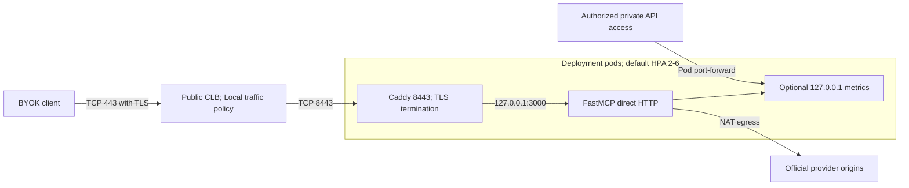

# Dedicated VKE Deployment

Hosted HTTP is database-free, with provider-key task authorization and per-pod
limits. No durable replay or shared budget accounting is provided. Local stdio
persistence is separate from this deployment.

## Ownership Boundaries

| Owner | Resources and responsibilities |
| --- | --- |
| Terraform `deploy/terraform/vke` | Dedicated VPC/subnets, NAT/EIP/SNAT/routes, private VKE cluster and fixed on-demand node pool |
| VKE administrator, outside Terraform and Helm | Both `csi-ebs` and `cloud-controller-manager` addons; compatible versions, installation when absent, readiness and lifecycle |
| Helm `deploy/helm/seed-mcp` | Application Deployment, HPA, PDB, proxy ConfigMap and CLB Service; no state PVC/StorageClass/headless Service |

Terraform does not retrieve kubeconfig or place HMAC keys, TLS Secrets,
certificates, passwords or customer credentials in state/outputs. Helm
references existing Secrets only, never accepts their values or emits Secret
resources. No generation-provider-key environment entries, `envFrom`, credential-fetching
bootstrap, hidden exec provisioners or addon resources belong to these roots.
Infrastructure IDs and safe partial Helm inputs are the only outputs.

Optional `temporaryUpload.enabled` defaults false; `existingSecret` defaults
empty. Enabling requires a distinct existing Secret, separate from identity/TLS.
Fixed required secretKeyRef keys are `TOS_ACCESS_KEY`, `TOS_SECRET_KEY`,
`TOS_BUCKET`, `TOS_REGION`, `TOS_ENDPOINT`, `MCP_UPLOAD_CLIENT_SECRET_SHA256`;
`TOS_SECURITY_TOKEN` is optional. The chart sets `OBJECT_STORAGE_BACKEND=tos`
and the enable flag; it never emits Secret resources or accepts credential
values/arbitrary env maps. External Secret changes require a pod rollout.
No TOS bucket, IAM, CORS or lifecycle is provisioned by these roots. Operators
must complete [temporary upload prerequisites](../docs/temporary-uploads.md#operator-setup)
and live acceptance before enabling; per-pod signing limits are not global
storage/egress budgets. This capability adds no database or volume.

The private control plane requires operator private connectivity; possession
of kubeconfig alone is insufficient. No public API fallback is supplied.

## Infrastructure Contract

`versions.tf` requires Terraform `>=1.17.1,<2.0.0` and pins `bytepluscc`
0.0.63. Use its generated lockfile without bypassing checksum verification.
Region defaults to `ap-southeast-1`; available zone, node type and currently
supported Kubernetes version are required operator-verified inputs. The chart
requires Kubernetes >=1.30 (`>=1.30.0-0`); choose a currently maintained regional
release above that floor, not an obsolete release merely satisfying the minimum.

Private VPC and Kubernetes Service ranges must not overlap each other or
operator networks. The root creates node, VPC-CNI pod and edge subnets; NAT
and associated EIP, SNAT entries and an associated default route provide
node/pod egress. Nodes and the API have public access disabled. Cluster
deletion protection is enabled. No node passwords or private SSH keys are
accepted; an existing key-pair name is optional for regional requirements.

The fixed on-demand pool defaults to two nodes in one zone with node
autoscaling disabled. Hostname spreading is not AZ-failure resilience.
Application HPA does not create nodes. Regional inventory, quotas,
route behavior and image pulls remain live gates.

Use a **separate fresh VKE Terraform state**. The default local backend file
is `seed-mcp-vke.tfstate`; operators must protect it and review any backend
selection independently. `fresh_state_confirmed=true` is an acknowledgement,
not state inspection. Never apply over or migrate old ECS state into this root.

## Prerequisite Gate

Verify private API access, CCM, two Ready nodes and surge/draining headroom,
existing identity/TLS Secrets, DNS/TLS, source restrictions and HPA metrics API
before `prerequisitesConfirmed=true`. This is acknowledgement, not proof.
CSI is not a new application prerequisite; preserve existing addons and old
volumes. Addons remain administrator-owned outside Terraform/Helm.

Node capacity must accommodate active, surge and draining pods. Application
HPA does not provision that capacity or establish provider quota headroom.

## Application Contract

The chart renders a stateless `Deployment`, HPA (default 2-6 pods, total-pod
CPU 70%, 300-second scale-down stabilization) and `PodDisruptionBudget` with
`minAvailable: 1`. Hostname topology spread uses `minDomains: 2`, `maxSkew: 1`
and `DoNotSchedule`. Rollouts use `maxSurge: 1` and `maxUnavailable: 0`.
There is no headless Service or application storage-zone pin.

Helm references existing identity and TLS Secrets only. `STATE_BACKEND=none` and
`DAILY_BUDGET_USD=0`; database inputs are rejected. No PVC, StorageClass, database
CA, PostgreSQL driver or shared state service is required. Bounded scratch uses
`emptyDir`. Model bindings remain exact and operator-verified.

`models.seedream` and `models.seedance` expose `defaultModel` and explicit
`bindings: [{model_id, family}]`. IDs are unique, families must match the product
and explicit lists include the selected default. Alternate defaults require
verified bindings. Used endpoint headers still require exact registry matches;
explicit tool `model` wins.

Chart defaults are `app.dailyBudgetUsd=0`, `providerMaxConcurrency=5`,
`principalMaxConcurrency=3` and `rateLimitBurst=0`. These are explicit env
mappings, not arbitrary env maps or account-wide spend controls.

## Network and Shutdown

The chart uses TCP 443 to Caddy 8443 and `externalTrafficPolicy: Local`.
It does not terminate TLS at the CLB or expose backend/metrics ports.
Service source ranges request a Kubernetes policy, not proof of CLB ACL
enforcement; validate allowed and denied source networks separately.
The Caddyfile under `deploy/helm/seed-mcp/files/` is shared with local acceptance.
Caddy is pinned to `2.11.9-alpine`. It disables admin API, automatic HTTPS and
access logging; it streams without buffering and proxies only `/mcp` and
`/health`. `/ready`, `/metrics` and all other paths return 404 publicly.
Backend health/readiness probes execute loopback HTTP; proxy probes check TCP.

The application binds `MCP_HOST=127.0.0.1`, `MCP_PORT=3000` and trusts only
`RATE_LIMIT_TRUSTED_PROXY_CIDRS=127.0.0.1/32`. Caddy replaces forwarded address,
host and proto headers and removes `Forwarded`. Uvicorn proxy rewriting and
access logs are disabled. CIDR parsing and right-to-left hop selection follow
[HTTP BYOK](SPEC_HOSTED_BYOK.md#trusted-proxy-and-private-operations).
Only actual VKE testing can establish end-to-end client source preservation.

`MCP_METRICS_PORT=0` is the application default; an enabled HTTP listener binds
only 127.0.0.1 on a port in 1024-65535. Helm `app.metricsEnabled=true` selects
9000. No metrics Service exists. Authorized loopback-bound pod port-forward
is the operator access path; metrics are aggregate, not customer diagnostics.

The HTTP entrypoint grace is
`max(MCP_TOOL_TIMEOUT_SECONDS, BYTEPLUS_REQUEST_TIMEOUT_MS / 1000) + 30`.
Caddy uses the same deadline-plus-30 allowance; Helm pod termination grace
is `max(tool, provider) + 60` seconds. Defaults are 630/660 seconds.
Cooperative draining can exceed deadlines; force termination or disconnect
does not cancel accepted provider work.

## State and Recovery

There is no hosted state to restore or replay. Restarting a pod does not
cancel provider work; clients must retain IDs and poll with authorized provider
credentials. A lost create response may hide billed work and must be reconciled,
not resubmitted automatically.

This is a deliberate contract change, not an automatic migration. Existing
stateful installations must preserve their old release, database/WAL backups,
identity and accepted IDs for reconciliation. Never delete retained data to
make the new version start. A Helm upgrade can delete removed resources; use
separately reviewed transition steps. No cloud resources are changed by source
removal.

## Acceptance Boundary

Local acceptance uses isolated real HTTP/Caddy TLS processes, temporary
synthetic credentials and mocked providers, without a database.
Its bounded load results are mock measurements, not capacity certification.
Real VKE apply, source IP, rollout/drain, TLS/DNS and target-client/
provider acceptance require separate approval and evidence. Live generation
requires an explicit spend cap. Durable replay, complete crash recovery and
exactly-once billing are not part of this initial-phase contract.

## Scaling and Durability Gates

Rate, in-flight, provider and principal limits are in-memory per pod. They
multiply with active, surge and draining replicas and reset on restart.
Readiness proves lifespan availability only, not provider reachability.
Use provider-side spend controls and validate live rollout, routing, latency,
quota and cost before launch. Mock load results are not capacity certification.

Clients sharing a provider key share whatever task access that provider permits.
Client secrets scope admission only. Omit `idempotency_key`; supplied legacy
keys are rejected. Repeated creates may bill again. These tradeoffs are defined
in [Hosted BYOK](SPEC_HOSTED_BYOK.md#http-submission-safety).

## Sources

Official URLs in frontmatter are retained from implementation research recorded
2026-11-17, not a claim of a new live deployment or independent regional test.
Source contracts were checked against `deploy/terraform/vke`, the Helm values/
schema/templates/Caddyfile, `runtime.py`, `__main__.py`,
`config/env.py`, `security/http_middleware.py`, `observability/admin.py` and
`scripts/inspect_runtime_state.py`. This spec and the linked hosted/direct
contracts hold durable decisions.
