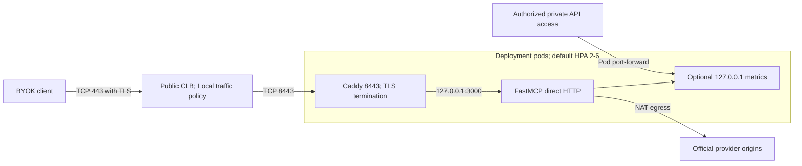

# Dedicated VKE Deployment

Hosted HTTP is database-free, with provider-key task authorization and per-pod
limits. No durable replay or shared budget accounting is provided. Local stdio
persistence is separate from this deployment.

## Ownership Boundaries

| Owner | Resources and responsibilities |
| --- | --- |
| Terraform `deploy/terraform/vke` | Dedicated VPC/subnets, NAT/EIP/SNAT/routes, private VKE cluster, fixed baseline node pool, optional bounded on-demand burst pool and optional dedicated APIG infrastructure |
| VKE administrator, outside Terraform and Helm | `cloud-controller-manager`, optional Cluster Autoscaler, node readiness and addon lifecycle; CSI is not an application prerequisite |
| Helm `deploy/helm/seed-mcp` | Application Deployment, HPA, PDB, proxy ConfigMap; public CLB or private APIG ClusterIP/ingress policy with separate staging/production gates; conditional IRSA ServiceAccount/token projection; no state PVC/StorageClass/headless Service |

Terraform does not retrieve kubeconfig or place HMAC keys, TLS Secrets,
certificates, passwords or customer credentials in state/outputs. Helm
references existing Secrets only, never accepts their values or emits Secret
resources. No generation-provider-key environment entries, `envFrom`, credential-fetching
bootstrap, hidden exec provisioners or addon resources belong to these roots.
Infrastructure IDs and safe partial Helm inputs are the only outputs.

Optional `temporaryUpload.enabled` defaults false; `existingSecret` defaults
empty. Enabling requires a distinct existing Secret, separate from identity/TLS.
Both credential modes require secretKeyRef keys `TOS_BUCKET`, `TOS_REGION`,
`TOS_ENDPOINT`, `MCP_UPLOAD_CLIENT_SECRET_SHA256`. Default
`temporaryUpload.credentialsMode=static` additionally requires `TOS_ACCESS_KEY`,
`TOS_SECRET_KEY`; `TOS_SECURITY_TOKEN` is optional. Explicit `irsa` mode
references none of these three credential keys. The chart sets `OBJECT_STORAGE_BACKEND=tos`
and the enable flag; it never emits Secret resources or accepts credential
values/arbitrary env maps. External Secret changes require a pod rollout.
No TOS bucket, IAM, CORS or lifecycle is provisioned by these roots. Operators
must complete [temporary upload prerequisites](../docs/temporary-uploads.md#operator-setup)
and live acceptance before enabling; per-pod signing limits are not global
storage/egress budgets. This capability adds no database or persistent volume.

### Explicit TOS IRSA

`TOS_CREDENTIAL_MODE=irsa` is HTTP temporary-upload-only, with exact role TRN,
absolute projected-token file and no configured AK/SK/session token. Static mode
remains the default; no ambient credential discovery, node metadata, proxy
inheritance or fallback is permitted. STS origin is restricted to
`https://sts.byteplusapi.com` (default) or `https://open.byteplusapi.com`.
Requested session duration is 3600-43200 seconds, default 3600.

Only an enrolled call after admission lazily creates the runtime-owned credential
provider. It exchanges the current token via unsigned form POST
`Action=AssumeRoleWithOIDC&Version=2018-01-01`, using `RoleTrn`, `OIDCToken`,
`RoleSessionName`, `DurationSeconds`. The synchronous exchange is worker-offloaded
and drained on cancellation; HTTP redirects are rejected, decoded responses
are bounded to 64 KiB and errors never echo provider bodies or credentials.
No token/network read occurs at startup, discovery or readiness.

Cache and refresh are single-flight in memory, five minutes before expiry.
Failed refresh backs off ten seconds, allowing cached credentials only outside
the final sixty seconds; otherwise fail closed. Reread the projected token
on each exchange. Freeze one credential triplet for POST policy, form token
and GET signing. Drop the cache on lifespan shutdown. No journal/database
is introduced and replicas refresh independently.

In IRSA mode the chart requires `temporaryUpload.irsa.prerequisitesConfirmed=true`,
an explicit non-`default` `serviceAccountName` and exact `roleTrn`. It creates
that ServiceAccount without IAM annotations or RBAC grants and retains
`automountServiceAccountToken=false`. Only the MCP container mounts the manual
projected token at `/var/run/secrets/seed-mcp/irsa/token`, with mode `0440`,
audience `sts.volcengine.com` and requested expiration 3600 seconds. Caddy
receives neither the mount nor TOS env. Static/disabled modes project no token.

The VKE administrator owns regional IRSA support, cluster OIDC enablement,
issuer/provider creation, exact namespace/ServiceAccount trust and least-privilege
TOS policy. Enablement can restart the API and is documented as irreversible.
Neither Terraform nor Helm enables IRSA, creates IAM resources or broadens
permissions. Trust must match actual `oidc:iss`, exact
`oidc:sub=system:serviceaccount:<namespace>:<serviceaccount>` and the VKE guide's
fixed `oidc:aud=sts.volcengine.com`. Exclude automatic webhook injection that
could mount tokens in Caddy or duplicate this manual configuration.

STS expiry shortens the unchanged nominal 900/86400-second signed permissions.
The one-hour default, or even the twelve-hour maximum, cannot guarantee a
24-hour GET lifetime. Refresh never renews already issued URLs. Returned expiry
timestamps remain nominal. Verify queue/fetch timing and effective lifetime.
Live BytePlus OIDC endpoint/payload acceptance, trust, nonroot token readability,
kubelet rotation, least privilege and signed TOS upload/read are separate
staging gates. The VKE guide and installed SDK ground the exchange shape;
an exact BytePlus OIDC OpenAPI schema has not been obtained.

The private control plane requires operator private connectivity; possession
of kubeconfig alone is insufficient. No public API fallback is supplied.

### GitHub Actions Delivery

`.github/workflows/deploy-vke.yml` supplies manual `check`/`deploy` operations
from `main` only. Explicit `target=staging|production` maps to the protected
`byteplus-staging|byteplus-production` environment. CI and
image publishing remain GitHub-hosted; Helm runs on an explicitly configured
workflow-restricted private runner group. A runner in the VKE VPC does not
require a laptop VPN or CEN. Public-repository runner isolation is an operator
prerequisite; labels alone do not isolate credentials or private network access.
Production requires separate repository enablement and runner-ready/group
variables plus a protected-environment approval acknowledgement. Provision and
verify that environment's reviewer/main-only/no-bypass policy before enablement;
no workflow creates or verifies GitHub environment protections automatically.
Staging readiness does not authorize production. Both targets retain a single
concurrency group and the helper/workflow require explicit service mode.

The workflow uses existing private token/certificate kubeconfig and values
files outside the checkout, not GitHub-to-BytePlus IAM federation. It creates
no infrastructure, IAM trust, Secrets, addons or DNS. Terraform's dedicated
operator state and VKE-admin ownership remain unchanged. VKE IRSA evidence
does not establish acceptance of GitHub OIDC tokens. No IAM/provider credentials
are stored in Actions or added to the application.

`scripts/deploy_vke.py` checks the exact private API/context, CA/no-proxy
configuration, Kubernetes/kubectl compatibility, Ready schedulable nodes,
metrics and existing identity/TLS fields before strict Helm lint and one
optional Helm dispatch. External CCM, capacity, source enforcement and
autoscaler prerequisites still require operator evidence. Raw command output
is captured, not relayed to logs; no Secret/manifests artifact upload is supplied.
Use a 15-minute Helm timeout and 30-minute job limit, without automatic retry,
rollback, namespace creation or secret regeneration. A partial/timed-out
installation requires inspection before another dispatch.

The [Actions runbook](../docs/github-actions-deployment.md) defines exact
runner, file-permission, environment-protection and variable requirements.
Source and offline tests are not live runner/account or public-launch evidence.

## Infrastructure Contract

`versions.tf` requires Terraform `>=1.17.1,<2.0.0` and pins `bytepluscc`
0.0.63. Use its generated lockfile without bypassing checksum verification.
Region defaults to `ap-southeast-1`; available zone, node type and currently
supported Kubernetes version are required operator-verified inputs. The chart
requires Kubernetes >=1.30 (`>=1.30.0-0`); choose a currently maintained regional
release above that floor, not an obsolete release merely satisfying the minimum.

Private VPC and Kubernetes Service ranges must not overlap each other or
operator networks. The root creates node, VPC-CNI pod and edge subnets; NAT
and associated EIP, SNAT entries and an associated default route provide
node/pod egress. Nodes and the API have public access disabled. Cluster
deletion protection is enabled. No node passwords or private SSH keys are
accepted; an existing key-pair name is optional for regional requirements.

The fixed on-demand baseline defaults to two nodes in one zone with its
autoscaling disabled. `burst_node_max_count=0` disables the separate optional
burst pool. A positive whole value creates that pool with desired/minimum zero,
the specified maximum and `ZoneBalance` subnet policy. Baseline plus burst is
limited to ten nodes. Both pools use identical private PostPaid/NoSpot node
configuration and 80 GiB ESSD_PL0 system disks. Hostname spreading and a
single-zone subnet do not establish AZ-failure resilience.

Terraform owns the fixed count and all burst bounds/configuration. Only the
burst pool's `auto_scaling.desired_replicas` has `ignore_changes`, allowing the
administrator-managed Cluster Autoscaler to own its live desired count.
HPA scales pods, not nodes. Enabling a burst pool does not install the addon or
prove scale-from-zero, automatic scale-in or sufficient capacity.

Separately verify a maintained compatible Cluster Autoscaler, pool discovery,
automatic scale-in and conservative cooldown settings. Its pod-drain timeout
must exceed the application's configured termination grace (660 seconds by
default); verify PDB/topology interactions and active-call draining. Test pending
pods triggering burst scale-out and safe return to zero. Two baseline nodes
continue to incur compute/disk charges at idle; cluster, NAT/EIP, load-balancer
and traffic charges are separate. Node bounds are not a monetary spend cap.
Regional inventory, quotas, route behavior and image pulls remain live gates.

Use a **separate fresh VKE Terraform state**. The default local backend file
is `seed-mcp-vke.tfstate`; operators must protect it and review any backend
selection independently. `fresh_state_confirmed=true` is an acknowledgement,
not state inspection. Do not reuse state belonging to an unrelated deployment.

`scripts/prepare_vke_terraform.py prepare` creates a new private source copy
and unset operator inputs in a same-owner mode-0700 parent, refusing existing
destinations. It copies only the explicit source/lock/test allowlist, not state,
plans, caches or credentials. Its `validate` command uses a temporary source
copy, private HOME and a minimal credential-free environment, disables backend
initialization and runs mock-provider plans only with the unchanged lockfile.
Provider installation can download from the registry. Neither command obtains
credentials, runs a live plan, applies resources, installs Helm or proves
regional inventory, backend separation, IAM authority or capacity. Live
planning and deployment remain separate operator-approved steps.

### Optional Gateway Preparation

`public_gateway_enabled=false` and `gateway_secondary_zone_id=""` are the
defaults. Enabling creates a dedicated standard APIG and two additional /20
subnets at VPC indices 3 and 4, leaving node/pod/edge ranges and their NAT
configuration unchanged. The primary gateway subnet uses `zone_id`; the
secondary requires an explicit distinct AZ in the same region. Disabled mode
rejects a nonempty secondary AZ. Gateway zone distribution does not make
single-zone VKE workers AZ-resilient.

The gateway uses two `1c2g` nodes, `small_1` CLB, public/private networking and
traffic-based public billing. Monitoring is explicitly disabled. Tracing is
left unset because native APIG rejected a partial `TraceSpec` with only
`Enable=false`; the identical request without it was accepted on 2026-11-21.
Tracing must read back disabled by postcondition, never inferred from omission.
Pinned provider 0.0.63 requires a nonempty logging destination even for disabled
`log_spec`, so the root omits that input and requires disabled access logging
by readback postcondition. Missing/enabled readback fails closed; this is not
proof of a disabled cloud default. A failed postcondition may follow creation:
inspect the actual gateway and protected state before retrying. Never attach
routes or send BYOK traffic until disabled logging has been verified.

Only a nullable `public_gateway_id` is output. No upstream, service, route,
default domain, certificate or ready endpoint is configured. Helm defaults to
public CLB/Caddy; opt-in `service.mode=apig-staging` supplies a private
synthetic-only backend, not a public BYOK gateway path.
Explicit `service.mode=apig-production` supplies private BYOK source support
only after `service.productionConfirmed=true`; that acknowledgement is not
proof of APIG verification or an authorized deployment.
Do not silently substitute it for an approved gateway design.

Live staging evidence on 2026-11-21 showed APIG 4.4.4 accepting an untrusted
self-signed certificate on a K8S upstream configured with `Protocol="HTTP"`,
`TlsMode="SIMPLE"` and SNI. A GET-only synthetic route returned the exact
backend marker through verified public HTTPS; it was subsequently disabled.
This configuration fails backend chain-trust acceptance. Direct-client
wrong-host/chain negative controls passed but do not prove gateway hostname
verification. Mode/SNI alone are not a verification control, and this result
must not be generalized to every gateway mode. The default launch requirement
is supported, configured and negatively tested backend trust. The deployment-
specific operator exception below waives that requirement without establishing
trust or changing the observed result.

Private HTTPS with the approved backend trust decision, public/upstream host separation,
forged-forwarded-header handling, stateless routing without session persistence
or affinity, no caching/mirroring/automatic POST retries, streaming/body/header
limits and compatible timeouts remain delivery gates. A complete matched cost
review must include the gateway, backend, runner and network charges. Explicit
operator authorization can permit infrastructure creation before TLS/routing
acceptance and cost review, with billing inspected afterward; it does not waive
the real-BYOK launch gates or regional quotas. Reconcile asynchronous task
status, protected state and live inventory after failures before any new create.
Never delete or reuse unrelated resources without explicit operator approval
to bypass a dedicated-resource quota. Separately approved exact retirement
requires fresh dependency checks and confirmed cloud absence; keep its evidence
outside the new dedicated Terraform state. Neither deletion acceptance nor a
possibly stale quota counter alone establishes headroom.
Infrastructure preparation and mock plans do not establish these contracts.
See [the deployment record](../docs/hosted-deployment-status.md) for the verified
instance and immutable historical execution evidence.

### Accepted Backend Verification Exception

On 2026-11-25, after the risks and the two TLS hops were distinguished, the
operator explicitly selected **"Keep HTTPS, waive verification"**.
This decision applies to the existing Seed MCP deployment in account
`3000006864`, region `ap-southeast-1`, gateway `gdc0lvqennrmdh5hbe8kg`,
service `st63a28rvt0o3d9htd28d` and upstream `udc15lgippshdkifdom6g`.
Preserve APIG and its existing generic client URL.

For that deployment, APIG enforcement of backend certificate chain, DNS SAN
and validity is **not a launch prerequisite**. Native verification capability
research and gateway certificate-negative tests are deferred hardening, not
deployment blockers. No verification control is claimed configured or proven.
This is a recorded risk acceptance, not a passing trust test or a general
default for other deployments.

Keep verified public client-to-APIG HTTPS and encrypted private APIG-to-Caddy
HTTPS. Do not switch the private hop to HTTP, disable Kubernetes/provider/client
TLS validation, weaken private Service/ingress restrictions or change credential
handling. An actor able to intercept or redirect the private connection could
impersonate the backend and obtain or alter credentials and traffic; encryption
without authenticated backend identity does not prevent that attack. Private
network restrictions reduce exposure but do not replace identity verification.

The waiver does not waive backend certificate/key, hostname and expiry
preflight, renewal ownership, protected delivery, disabled logging/tracing,
no-retry routing, credential recovery, live functional/drain acceptance or
separate public-launch approval. Keep staging credential-free. This decision
alone authorizes no deployment, route enablement, credential use/rotation,
paid provider call, commit or push. Reconfirm the scope if the gateway, service,
upstream or network boundary changes.

## Prerequisite Gate

Verify private API access, CCM, two Ready nodes and surge/draining headroom,
existing identity/TLS Secrets, DNS/TLS, source restrictions and HPA metrics API
before `prerequisitesConfirmed=true`. This is acknowledgement, not proof.
CSI is not an application prerequisite. Addon readiness and lifecycle remain
administrator-owned outside Terraform/Helm.

Node capacity must accommodate active, surge and draining pods. Application
HPA does not provision that capacity or establish provider quota headroom.
When burst is enabled, autoscaler readiness and verified scale-out/scale-in
behavior are additional live gates, not substitutes for baseline headroom.

## Application Contract

The chart renders a stateless `Deployment`, HPA (default 2-6 pods, total-pod
CPU 70%, 300-second scale-down stabilization) and `PodDisruptionBudget` with
`minAvailable: 1`. Hostname topology spread uses `minDomains: 2`, `maxSkew: 1`
and `DoNotSchedule`, with `matchLabelKeys: [pod-template-hash]` to count each
Deployment revision independently. Otherwise old replicas can satisfy the
spread while both replacement replicas land on one worker. The controller
supplies the hash; do not hardcode it in pod labels or selectors. Require the
`MatchLabelKeysInPodTopologySpread` feature (enabled by default since 1.27).
Rollouts use `maxSurge: 1` and `maxUnavailable: 0`.
There is no headless Service or application storage-zone pin.
Scheduling constraints do not rebalance surviving pods after deletion or
scale-down. Verify final worker diversity after rollouts and scale-in; any
operator rebalance must respect the PDB and full shutdown grace. See the
[Kubernetes topology spread contract](https://kubernetes.io/docs/concepts/scheduling-eviction/topology-spread-constraints/).

Helm references existing identity/TLS and optional upload configuration Secrets. `STATE_BACKEND=none` and
`DAILY_BUDGET_USD=0`; database inputs are rejected. No PVC, StorageClass, database
CA, PostgreSQL driver or shared state service is required. Bounded scratch uses
`emptyDir`. Model bindings remain exact and operator-verified.

The pod template explicitly lists only `app-tmp,proxy-tmp` in
`cluster-autoscaler.kubernetes.io/safe-to-evict-local-volumes`. Those bounded
volumes contain disposable scratch only. This permits autoscaler consideration
of application-bearing burst nodes without disabling local-storage protection
globally or declaring every volume safe. PDB, topology/capacity constraints and
the configured termination grace still apply. Live rescheduling, scale-in and
active-call draining remain acceptance gates.

`models.seedream` and `models.seedance` expose `defaultModel` and explicit
`bindings: [{model_id, family}]`. IDs are unique, families must match the product
and explicit lists include the selected default. Alternate defaults require
verified bindings. Used endpoint headers still require exact registry matches;
explicit tool `model` wins.

Chart defaults are `app.dailyBudgetUsd=0`, `providerMaxConcurrency=5`,
`principalMaxConcurrency=3` and `rateLimitBurst=0`. These are explicit env
mappings, not arbitrary env maps or account-wide spend controls.

## Network and Shutdown

The default `service.mode=public-clb` uses the following path. It is not
evidence of a deployed generic endpoint.

The chart uses TCP 443 to Caddy 8443 and `externalTrafficPolicy: Local`.
It does not terminate TLS at the CLB or expose backend/metrics ports.
Service source ranges request a Kubernetes policy, not proof of CLB ACL
enforcement; validate allowed and denied source networks separately.
The Caddyfile under `deploy/helm/seed-mcp/files/` is shared with local acceptance.
Caddy is pinned to `2.11.9-alpine`. It disables admin API, automatic HTTPS and
access logging; it streams without buffering and proxies only `/mcp` and
`/health`. `/ready`, `/metrics` and all other paths return 404 publicly.
Backend health/readiness probes execute loopback HTTP; proxy probes check TCP.

`service.mode=apig-staging` requires a distinct `backendHost`, empty CLB
`subnetId`, disabled uploads and explicit entirely RFC1918 `sourceRanges`.
It renders ClusterIP TCP 8443 and an ingress-only NetworkPolicy selecting the
application pods. Verify actual APIG source/SNAT and allowed/denied paths.
The separate Caddyfile accepts backend/public Host names, canonicalizes the
app Host and forwarded fields, strips `Forwarded` and the synthetic test marker,
and rejects generation keys, client secret and Authorization even when empty.
Unknown hosts/paths return 404. It does not validate APIG's backend trust.

Public application routes must remain disabled for this synthetic-only mode.
Temporary tests need verified exact operator-held random header matching at
APIG with missing/wrong-marker negatives, followed by immediate disable and
public 404 readback. The marker is not customer authentication. If that edge
boundary cannot be verified, private-only acceptance leaves APIG acceptance
pending. No real generation credentials may cross the unverified TLS hop.
Delivery helper/workflow select `backendHost` for certificate checks in this
mode, preserving one-shot Helm and protected main-only approval.

`service.mode=apig-production` preserves the same private Service, ingress
restrictions, host separation and disabled uploads. It selects a separate
Caddyfile forwarding supported BYOK/endpoint headers to the app and rejecting
incoming Authorization, including empty headers, with HTTP 400. Credential
validation and selected-provider forwarding remain application-owned.
Canonical Host/forwarded fields, stripped staging marker, body limits and
disabled logs remain mandatory; unknown hosts/paths return 404.
The private production listener advertises HTTP/1.1 only: direct HTTPX 0.28.1
HTTP/2 drain tests against Caddy 2.11.9 reproduced accepted-call failure on
shutdown GOAWAY. H2-capable clients must negotiate H1 here; no automatic retry
is enabled. Existing CLB/staging listeners keep their prior protocol settings.
APIG terminates public TLS independently, so public protocol behavior and its
private-hop H1 compatibility remain live acceptance gates.

`service.productionConfirmed` defaults false and must be true only for this
mode. The helper requires `--production-approved` only for production and pins
that chart acknowledgement from the CLI; a values file cannot bypass it.
The workflow production target requires `VKE_PRODUCTION_ENABLED`, separate
runner readiness and protected `VKE_PRODUCTION_APPROVED`, and only accepts
`apig-production`; staging rejects production mode/approval. These flags
acknowledge the documented backend trust decision, verified logging/routing, credential recovery,
certificate lifecycle and launch prerequisites. They do not establish those
facts. The flags alone do not roll out an application or open routes; actual
deployment and launch evidence is recorded separately.

APIG backend identity verification remains unestablished, but is waived for the
exact deployment in the [accepted exception](#accepted-backend-verification-exception).
Other deployments retain the default verified-backend requirement. Preserve
APIG and its generic URL; no substitute ingress, speculative verification fields
or automatic route changes are supplied.

The application binds `MCP_HOST=127.0.0.1`, `MCP_PORT=3000` and trusts only
`RATE_LIMIT_TRUSTED_PROXY_CIDRS=127.0.0.1/32`. Caddy replaces forwarded address,
host and proto headers and removes `Forwarded`. Uvicorn proxy rewriting and
access logs are disabled. CIDR parsing and right-to-left hop selection follow
[HTTP BYOK](SPEC_HOSTED_BYOK.md#trusted-proxy-and-private-operations).
Only actual VKE testing can establish end-to-end client source preservation.
With APIG, Caddy uses its direct gateway peer for rate limiting; clients behind
one gateway peer can share a bucket. Do not infer customer IP from untrusted
headers or add per-key concurrency to compensate.

`MCP_METRICS_PORT=0` is the application default; an enabled HTTP listener binds
only 127.0.0.1 on a port in 1024-65535. Helm `app.metricsEnabled=true` selects
9000. No metrics Service exists. Authorized loopback-bound pod port-forward
is the operator access path; metrics are aggregate, not customer diagnostics.

The HTTP entrypoint grace is
`max(MCP_TOOL_TIMEOUT_SECONDS, BYTEPLUS_REQUEST_TIMEOUT_MS / 1000) + 30`.
Caddy uses the same deadline-plus-30 allowance; Helm pod termination grace
is `max(tool, provider) + 60` seconds. Defaults are 630/660 seconds.
Cooperative draining can exceed deadlines; force termination or disconnect
does not cancel accepted provider work.

### Certificate Lifecycle

There is no issuer or automatic reload controller. Caddy's admin API and
automatic HTTPS remain off. Same-name external Secret data does not change the
pod template. Prefer a privately provisioned versioned TLS Secret and a
protected reference rollout; changing `tlsSecretName` changes both the volume
reference and runtime checksum. Verify the served chain, SAN, expiry and
fingerprint on every new replica, not just through the load-balanced Service.
The helper's key-load/hostname/one-day-expiry checks are not CA verification or
expiry monitoring. The [renewal procedure](../docs/backend-certificate-renewal.md)
defines ownership, alert windows, bounded overlap, failure reconciliation and
separately approved active-call rotation acceptance. No real Secret or issuer
is created by source implementation.

## State and Recovery

There is no hosted state to restore or replay. Restarting a pod does not
cancel provider work; clients must retain IDs and poll with authorized provider
credentials. A lost create response may hide billed work and must be reconciled,
not resubmitted automatically.

This is a fresh stateless deployment. Historical database compatibility and
stateful-release migration tooling are not part of this repository.

## Acceptance Boundary

Local acceptance uses isolated real HTTP/Caddy TLS processes, temporary
synthetic credentials and mocked providers, without a database.
Its bounded load results are mock measurements, not capacity certification.
`scripts/hosted_drain_acceptance.py --caddy-bin PATH --profile short` adds
dispatch-barrier TERM tests for app-first, proxy-first and simultaneous order,
with both H1 and H2-capable offers negotiating H1 on the private production
listener. Explicit `--profile production` runs six parallel 590-second mock
calls with 600/630/660-second tool/grace/observation clocks and 750-second
process watchdogs. Stalled/disconnected controls always use short clocks.
Success requires one dispatch, complete synthetic task/request receipts and
observed graceful exit before cleanup; forced kills fail acceptance.
Both profiles check actual client/backend connection reuse and replacement
after more than five seconds idle, without automatic create resubmission.
The harness uses isolated synthetic credentials and denies unmocked worker
socket operations. It adds no public tool, provider call or production mock flag.
No endpoint-withdrawal, certificate-rotation, new-intake or live autoscaler
guarantee follows from these process tests.
Real VKE apply, source IP, rollout/drain, TLS/DNS and target-client/
provider acceptance require separate approval and evidence. Live generation
requires an explicit spend cap. Durable replay, complete crash recovery and
exactly-once billing are not part of this initial-phase contract.

## Scaling and Durability Gates

Rate, in-flight, provider and principal limits are in-memory per pod. They
multiply with active, surge and draining replicas and reset on restart.
Readiness proves lifespan availability only, not provider reachability.
Use provider-side spend controls and validate live rollout, routing, latency,
quota and cost before launch. Mock load results are not capacity certification.

Clients sharing a provider key share whatever task access that provider permits.
Client secrets scope admission only. Omit `idempotency_key`; supplied legacy
keys are rejected. Repeated creates may bill again. These tradeoffs are defined
in [Hosted BYOK](SPEC_HOSTED_BYOK.md#http-submission-safety).

## Sources

Official URLs in frontmatter are retained from implementation research recorded
2026-11-17, not a claim of a new live deployment or independent regional test.
IRSA and STS sources were accessed 2026-11-19; the STS AssumeRole reference
establishes documented origins/durations/envelope, not OIDC API compatibility.
Node-pool and Cluster Autoscaler contracts were accessed 2026-11-19; source
validation does not establish live autoscaler readiness or regional capacity.
APIG source and provider validation were checked 2026-11-20; no gateway was
created and private-upstream TLS acceptance remains unverified.
Source contracts were checked against `deploy/terraform/vke`, the Helm values/
schema/templates/Caddyfile, `runtime.py`, `__main__.py`,
`config/env.py`, `security/http_middleware.py` and `observability/admin.py`.
This spec and the linked hosted/direct
contracts hold durable decisions.
