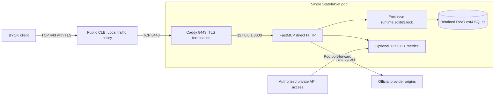

# Dedicated VKE Deployment

This describes the repository's deployment source, not a deployed service.
Live VKE apply, source-IP preservation, CSI behavior, rollout/drain, recovery,
real-client tool execution and provider acceptance remain **unverified**.
The dedicated VKE path replaces ECS/Compose. It does not add PostgreSQL,
Redis, multiple application replicas, application HPA or an HA guarantee.

## Ownership Boundaries

| Owner | Resources and responsibilities |
| --- | --- |
| Terraform `deploy/terraform/vke` | Dedicated VPC/subnets, NAT/EIP/SNAT/routes, private VKE cluster and fixed on-demand node pool |
| VKE administrator, outside Terraform and Helm | Both `csi-ebs` and `cloud-controller-manager` addons; compatible versions, installation when absent, readiness and lifecycle |
| Private operator workflow | Authenticated private kubeconfig/connectivity, existing identity/TLS/image-pull Secrets, DNS, certificate renewal, backups and recovery approval |
| Helm `deploy/helm/seed-mcp` | Application StatefulSet, proxy ConfigMap, CLB and headless Services, retained StorageClass and state claim template |
| Runtime | Exclusive HTTP state lease, SQLite stores/journal, request-only BYOK credentials and optional loopback metrics listener |

Terraform does not retrieve kubeconfig or place HMAC keys, TLS Secrets,
certificates, passwords or customer credentials in state/outputs. Helm
references existing Secrets only, never accepts their values or emits Secret
resources. No provider-key environment entries, `envFrom`, credential-fetching
bootstrap, hidden exec provisioners or addon resources belong to these roots.
Infrastructure IDs and safe partial Helm inputs are the only outputs.

The private control plane requires operator private connectivity; possession
of kubeconfig alone is insufficient. No public API fallback is supplied.

## Infrastructure Contract

`versions.tf` requires Terraform `>=1.17.1,<2.0.0` and pins `bytepluscc`
0.0.63. Use its generated lockfile without bypassing checksum verification.
Region defaults to `ap-southeast-1`; available zone, node type and currently
supported Kubernetes version are required operator-verified inputs.

Private VPC and Kubernetes Service ranges must not overlap each other or
operator networks. The root creates node, VPC-CNI pod and edge subnets; NAT
and associated EIP, SNAT entries and an associated default route provide
node/pod egress. Nodes and the API have public access disabled. Cluster
deletion protection is enabled. No node passwords or private SSH keys are
accepted; an existing key-pair name is optional for regional requirements.

The fixed on-demand pool defaults to two nodes in the storage zone with node
autoscaling disabled. This permits same-zone rescheduling capacity, not
application scaling or availability certification. Regional inventory, quotas,
route behavior and image pulls remain live gates.

Use a **separate fresh VKE Terraform state**. The default local backend file
is `seed-mcp-vke.tfstate`; operators must protect it and review any backend
selection independently. `fresh_state_confirmed=true` is an acknowledgement,
not state inspection. Never apply over or migrate old ECS state into this root.

## Prerequisite Gate

Deployment is explicitly staged, not a one-command apply:

1. After approved infrastructure creation, the VKE administrator inspects both
   existing addon installations. Retain healthy compatible versions. Install
   absent addons with compatible maintained versions through VKE addon
   management. Do not assume auto-installation, duplicate, import, silently
   upgrade or delete either addon through this Terraform/Helm stack.
2. Both addon cards must show Running with recorded compatible versions.
   Check `kubectl get csidriver ebs.csi.volcengine.com`, completed rollouts for
   `deployment/csi-ebs-controller` and `daemonset/csi-ebs-node` in `kube-system`,
   and nodes Ready with adequate allocatable resources. Check CCM Running in
   VKE addon management even if its workload is outside the tenant namespace.
3. Verify private API connectivity, the target namespace, existing identity
   Secret keys, valid TLS material/hostname and the planned DNS path privately.
4. Only after these checks set Helm `prerequisitesConfirmed=true`.
   The chart refuses default/unacknowledged input; this acknowledgement is
   **not programmatic proof** of provider readiness or Secret contents.

No addon/cloud readiness is inferred from a successful offline Helm render.
Record live evidence privately without credentials or customer media.

## Application Contract

Required chart inputs include digest-pinned `image`, `publicHost`, distinct
existing `identitySecret.name` and `tlsSecretName`, CLB `service.subnetId`,
restricted IPv4 `service.sourceRanges` and `storage.zone`.
The schema rejects unknown properties and unbounded/invalid settings.
`values.ci.yaml` is synthetic render data, never deployable approval.

Custom BYOE endpoints require operator-verified exact model/family bindings.
Request headers cannot bypass registry checks or establish endpoint lineage;
the [BYOE authority contract](SPEC_HOSTED_BYOK.md#byoe-endpoint-authority)
is unchanged. No arbitrary environment map or provider secrets are supported.

`models.seedream` and `models.seedance` each contain `defaultModel` and
`bindings: [{model_id, family}]`. Defaults are `dola-seedream-5-5-261028` and
`dreamina-seedance-2-5-260628`, with empty binding lists. Seedream families
are `seedream_5_5`, `pro`, `lite`, `4x`; Seedance families are `standard`,
`fast`, `mini`, `seedance_2_5`, `seedance_2_5_flash`. Lists allow at most 100
entries, unique IDs per product, and must include the selected default when
nonempty. Alternate defaults require explicit bindings even for built-in IDs.
Empty lists with shipped defaults retain the runtime's automatic Flash
inclusion; explicit lists must include it when wanted. These values map only
to `SEEDREAM_DEFAULT_MODEL`, `SEEDANCE_DEFAULT_MODEL`, `SEEDREAM_MODEL_BINDINGS`
and `SEEDANCE_MODEL_BINDINGS` (JSON), never credential variables.
Header overrides still require exact registry matches; explicit tool `model`
wins, without live endpoint-authority changes.

The chart sets `app.dailyBudgetUsd=25` (unlike the application's standalone
zero default), `app.providerMaxConcurrency=5`, `app.principalMaxConcurrency=3`
and `app.rateLimitBurst=0`. Explicit env entries map to `DAILY_BUDGET_USD`,
`PROVIDER_MAX_CONCURRENCY`, `PRINCIPAL_MAX_CONCURRENCY` and `RATE_LIMIT_BURST`.
Budget is bounded to 0-1000000 USD, concurrency to 1-256 and burst to 0-10000.
Zero budget records estimates without blocking; zero burst inherits RPM.
Per-owner estimate limits are not provider-account spending guarantees.

The StatefulSet has exactly one replica with no replica override or HPA.
The pod runs UID/GID 1001, read-only roots, dropped capabilities, RuntimeDefault
seccomp and no service-account token. CPU/memory requests/limits and temporary
emptyDir volumes are bounded. TLS material mounts only into Caddy.
HMAC key/version use explicit `secretKeyRef` entries.

One volumeClaimTemplate mounts state at `/app/.artifacts`; this is not HTTP
media persistence. The claim uses ReadWriteOnce, filesystem ext4 EBS, explicit
zone/project and `ebs.csi.volcengine.com`. StorageClass parameters are PostPaid,
ESSD_PL0, Retain and WaitForFirstConsumer. PVC retention is Retain on deletion
and scale-down; the StorageClass has Helm's keep policy. Default size is 40 GiB.
Encryption is opt-in and requires `storage.kmsPrerequisitesConfirmed=true`
after actual KMS verification. Retention does not replace backups.

## Network and Shutdown

The chart uses TCP 443 to Caddy 8443 and `externalTrafficPolicy: Local`.
It does not terminate TLS at the CLB or expose backend/metrics ports.
Service source ranges request a Kubernetes policy, not proof of CLB ACL
enforcement; validate allowed and denied source networks separately.
The Caddyfile under `deploy/helm/seed-mcp/files/` is shared with local acceptance.
Caddy is pinned to `2.11.9-alpine`. It disables admin API, automatic HTTPS and
access logging; it streams without buffering and proxies only `/mcp` and
`/health`. `/ready`, `/metrics` and all other paths return 404 publicly.
Backend health/readiness probes execute loopback HTTP; proxy probes check TCP.

The application binds `MCP_HOST=127.0.0.1`, `MCP_PORT=3000` and trusts only
`RATE_LIMIT_TRUSTED_PROXY_CIDRS=127.0.0.1/32`. Caddy replaces forwarded address,
host and proto headers and removes `Forwarded`. Uvicorn proxy rewriting and
access logs are disabled. CIDR parsing and right-to-left hop selection follow
[HTTP BYOK](SPEC_HOSTED_BYOK.md#trusted-proxy-and-private-operations).
Only actual VKE testing can establish end-to-end client source preservation.

`MCP_METRICS_PORT=0` is the application default; an enabled HTTP listener binds
only 127.0.0.1 on a port in 1024-65535. Helm `app.metricsEnabled=true` selects
9000. No metrics Service exists. Authorized loopback-bound pod port-forward
is the operator access path; metrics are aggregate, not customer diagnostics.

The HTTP entrypoint grace is
`max(MCP_TOOL_TIMEOUT_SECONDS, BYTEPLUS_REQUEST_TIMEOUT_MS / 1000) + 30`.
Caddy uses the same deadline-plus-30 allowance; Helm pod termination grace
is `max(tool, provider) + 60` seconds. Defaults are 630/660 seconds.
Cooperative draining can exceed deadlines; force termination or disconnect
does not cancel accepted provider work.

## State and Recovery

HTTP acquires the exclusive `runtime.sqlite3.lock` before opening stores or
submission recovery and holds it until all state users drain and close.
Contention fails startup closed; cancellation and partial startup clean up.
Never unlink a live lock, use a shared/network filesystem, or confuse this
local lease and RWO attachment with distributed fencing. Stdio is unchanged.

Fresh BYOK installations use new SQLite state without an old-schema migration.
Compatible ongoing installations retain their state and matching HMAC
key/version. Preserve provider/client scope and known task/request IDs.
Backups must be consistent with WAL and protected off-host, with separately
protected matching identity configuration. An older backup can lose submission
claims; no blind restore, state reset or requeue is safe recovery.
Reconcile the lost-write window before reopening creates.

The stdlib-only `scripts/inspect_runtime_state.py` reads aggregate table/state
counts, capacity ratios and oldest unresolved age with explicit database,
capacity and bounded timeout arguments. It does not open application startup,
repair, prune, recover, requeue or expose row IDs/payloads.
The container includes it at `/app/scripts/inspect_runtime_state.py` for
authorized private `kubectl exec` without shell or environment/Secret dumps.
Use [the operator runbook](../docs/runtime.md#read-only-state-inspection).
HTTP submission claims never auto-prune. Raising storage capacity alone does
not raise the configured row cap, and deleting claims can permit duplicates.

Source deletion is not cloud decommissioning. Preserve a reviewed old checkout,
private workspaces, old Terraform state, backups and matching HMAC configuration
for separately authorized ECS retirement. Retained cloud resources keep
incurring charges until deliberately reconciled and removed.

## Acceptance Boundary

Local acceptance uses isolated real HTTP/Caddy TLS processes, temporary
synthetic identity/state and mocked providers, not customer credentials.
Its bounded load results are mock measurements, not capacity certification.
Real VKE apply, source IP, CSI, rollout/recovery, TLS/DNS and target-client/
provider acceptance require separate approval and evidence. Live generation
requires an explicit spend cap. Synchronous replay, complete crash recovery
and exactly-once billing remain deferred.

## Sources

Official URLs in frontmatter are retained from implementation research recorded
2026-11-17, not a claim of a new live deployment or independent regional test.
Source contracts were checked against `deploy/terraform/vke`, the Helm values/
schema/templates/Caddyfile, `runtime.py`, `runtime_lock.py`, `__main__.py`,
`config/env.py`, `security/http_middleware.py`, `observability/admin.py` and
`scripts/inspect_runtime_state.py`. This spec and the linked hosted/direct
contracts hold durable decisions.
